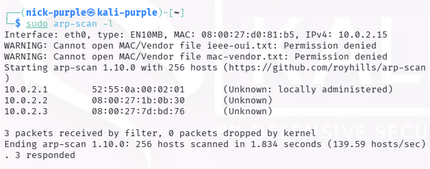
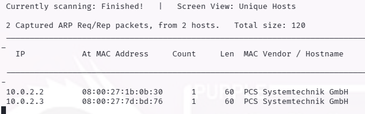
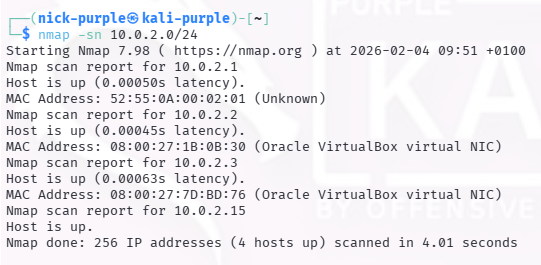

> **English** | [Italiano](README.md)

# Network scanning Active: live host discovery

> - **Phase:** Reconnaissance - Active Network Scanning
> - **Visibility:** Low - ARP/ICMP packets towards the local subnet, detectable by IDS but common in legitimate traffic
> - **Prerequisites:** Access to the target network (LAN or VPN), arp-scan and nmap installed, root privileges for ARP
> - **Output:** SCAN-001 - Map of active hosts in the subnet with IP, MAC address and vendor

---

Objective: Mapping of active nodes (Live Hosts) within the target network to identify the internal attack surface.
Target: Lab Network (`10.0.2.0/24`)

Tools: `arp-scan`, `netdiscover`, `nmap`

---

## 1 Theoretical introduction

Live Host Discovery is the preliminary phase of Network Scanning. It consists of identifying which IP addresses within a network range are assigned to active devices.

This activity is fundamental for:
- Optimizing time: Avoiding port scanning on non-existent IP addresses.
- Network Mapping: Creating a network topology (Server, Client, Gateway).

### Difference between ARP and ICMP

- ARP Scan (Layer 2): Used for local networks (LAN). It is extremely reliable since the ARP protocol is essential for communication and rarely blocked by local firewalls.
- ICMP/Ping Scan (Layer 3): Used for remote networks. Often subject to firewall blocks (e.g., Windows Defender blocks ICMP Echo requests by default).

---

## 2 Technical execution

**Finding ID:** `SCAN-001` | **Severity:** `Informational`

#### A. ARP scan (arp-scan)
`arp-scan` was used for rapid host detection in the local subnet. This method bypasses OS-level firewalls.

Command:

```Bash
sudo apt install arp-scan
sudo arp-scan -l
```



Analysis: 3 devices were detected, including the Windows 10 target machine (identifiable by MAC Address or known IP).

#### B. Active mapping (netdiscover)

netdiscover was used in active mode to query the entire network range.

Command:

```Bash
sudo apt install netdiscover
sudo netdiscover -r 10.0.2.0/24
```



Analysis: The tool provided a clear list of IPs and related MAC vendors (e.g., Oracle VirtualBox).

#### C. ping sweep (Nmap)

An ICMP scan (Ping Sweep) was performed to verify host visibility through routable protocols.

Command:

```Bash
nmap -sn 10.0.2.0/24
```



---

## 3 Conclusions

The Live Host Discovery activity successfully identified the Windows 10 target at IP address 10.0.2.3. The comparison between ARP and ICMP confirmed that, being on the same physical subnet, ARP scanning is the fastest and most reliable method for initial enumeration.

---

## MITRE ATT&CK mapping

| tactic | technique | mitre id | action description |
| :--- | :--- | :--- | :--- |
| discovery | remote system discovery | `T1018` | arp sweep with arp-scan and icmp ping sweep with nmap -sn to identify active hosts in subnet 10.0.2.0/24, detecting the windows 10 target at 10.0.2.3 (SCAN-001) |
| discovery | network service discovery | `T1046` | netdiscover in active mode to map active ips and vendor mac addresses in the local network (SCAN-001) |

---

> **Note:** Live Host Discovery activities were performed exclusively within an isolated VirtualBox lab (subnet 10.0.2.0/24) with an authorized Windows 10 target. No scans were conducted on external networks or systems without authorization.
