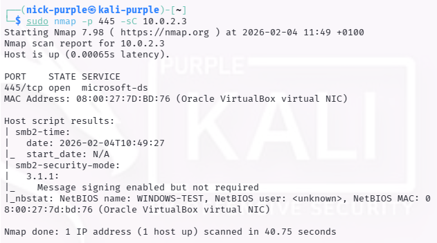

> **English** | [Italiano](README.md)

# Active scanning: Nmap scripting engine (NSE)

> - **Phase:** Reconnaissance - Active Network Scanning
> - **Visibility:** Medium - NSE scripts generate identifiable traffic (SMB requests, NetBIOS, banner grabbing) detectable by IDS
> - **Prerequisites:** Nmap installed, target ports identified from previous scan (SCAN-001/SCAN-002), root access
> - **Output:** SCAN-003 - SMB Signing not mandatory (SMB Relay vector) and NetBIOS name disclosure on 10.0.2.3

---

Objective: Use of advanced scripts for service enumeration and configuration vulnerability detection.

---

## 1 Theoretical introduction

The Nmap Scripting Engine (NSE) allows automating interaction with services to extract information that simple port scanning does not reveal.

In particular, default scripts (`-sC`) execute a battery of safe tests to identify NetBIOS names, system times and SMB protocol security configurations.

---

## 2 Technical execution

Default Scripts & Security Mode

A comprehensive scan was performed using default scripts (`-sC`) combined with SMB2 security mode verification.

```Bash
sudo nmap -p 445 -sC 10.0.2.3
```



---

## 3 Results analysis

**Finding ID:** `SCAN-003` | **Severity:** `High`

Two fundamental data points for the Enumeration phase emerged from the script output:

#### A. information disclosure (NetBIOS)

- Data Detected: `NetBIOS name: WINDOWS-TEST`
- Significance: Despite blocking `smb-os-discovery`, the NetBIOS service revealed the machine's hostname. This allows identifying the machine within a domain or workgroup.

#### B. configuration vulnerability (SMB signing)

- Data Detected: `Message signing enabled but not required`
- Significance: The target supports digital signing of SMB packets but does not enforce it.
- Security Impact (Red Team): This configuration exposes the network to SMB Relay attacks (Man-in-the-Middle). An attacker positioned on the same local network could intercept an authentication attempt towards this server and "relay" it to another host to gain unauthorized access.

---

## 4 Remediation (blue team)

To mitigate the SMB Relay risk:

- Set the Group Policy (GPO) "Microsoft network server: Digitally sign communications (always)" to Enabled.
- Disable NetBIOS if not strictly necessary to reduce hostname visibility.

---

## MITRE ATT&CK mapping

| tactic | technique | mitre id | action description |
| :--- | :--- | :--- | :--- |
| discovery | network service discovery | `T1046` | nse scan with default scripts (-sc) on port 445 of target 10.0.2.3 to identify smb configurations and exposed services (SCAN-003) |
| reconnaissance | gather victim host info: software | `T1592.002` | enumeration of smb2 protocol version and message signing configuration through smb2-security-mode script (SCAN-003) |

---

---

## Correlations with other findings

Finding SCAN-003 (SMB Signing not required) is the starting point of an attack chain documented in the lab:

| this finding | leads to | module |
| :--- | :--- | :--- |
| SCAN-003 - smb signing disabled | [VULN-001](<../../../../02-vulnerability-assessment/01-general-scanners (Infrastructure)/nessus/README.en.md>) - confirmation via nessus credentialed | 02-vuln-assessment |
| SCAN-003 - netbios exposure | [VULN-003](<../../../../02-vulnerability-assessment/02-protocol-specific-audit/smb-net-bios/README.en.md>) - netbios name disclosure | 02-vuln-assessment |
| SCAN-003 - credentials nick/1234 | [VULN-004](<../../../../02-vulnerability-assessment/02-protocol-specific-audit/smb-net-bios/README.en.md>) - c$ access with standard credentials | 02-vuln-assessment |
| VULN-001 + VULN-004 (chain) | [EXPLOIT-018](<../../../../04-system-exploitation/03-privilege-escalation (PrivEsc)/windows-priv-esc/winpeas/README.en.md>) - pass-the-hash lateral movement | 04-exploitation |

> **Note:** Enumeration activities with Nmap NSE were performed exclusively within an isolated VirtualBox lab with an authorized Windows 10 target (10.0.2.3). The documented SMB Signing misconfiguration was detected for analysis and attack surface documentation purposes.
