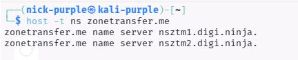
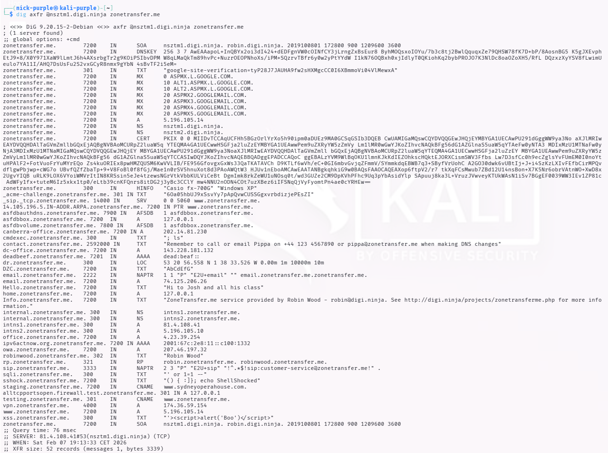
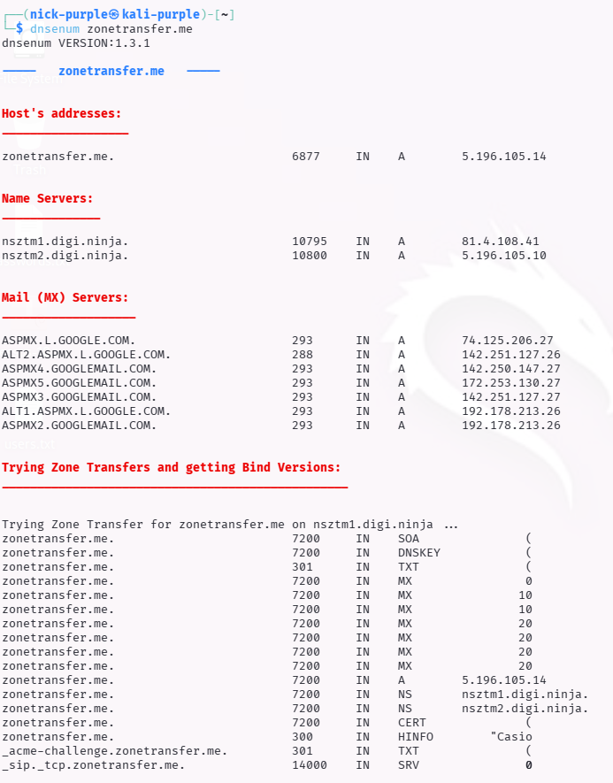
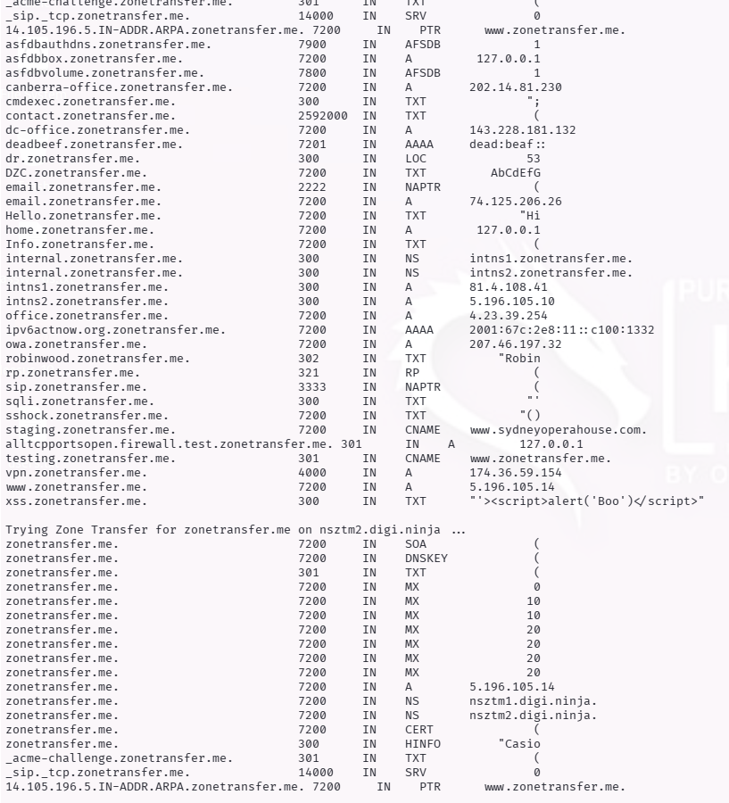
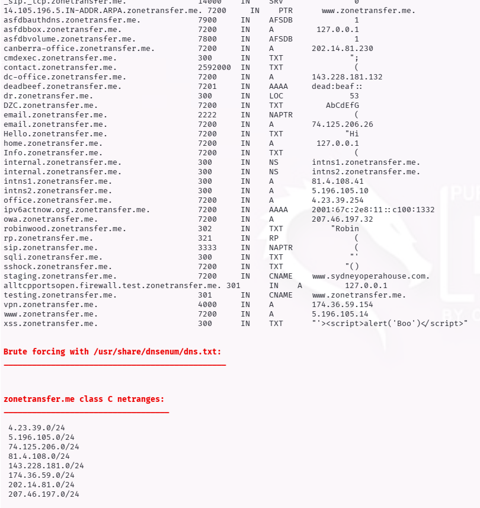

> **English** | [Italiano](README.md)

# Network scanning: DNS enumeration & zone transfers

> - **Phase:** Reconnaissance - DNS Enumeration
> - **Visibility:** Low - standard DNS queries towards the target's public Name Servers, compatible with legitimate traffic
> - **Prerequisites:** Known target domain, dig/host/dnsenum tools installed
> - **Output:** DNS-001 - Successful Zone Transfer on zonetransfer.me with complete DNS zone exfiltration (critical subdomains vpn, dev, office)

---

Objective: Map the target domain infrastructure by identifying subdomains, mail servers and attempting exfiltration of the entire DNS zone (Zone Transfer).

Educational Target: `zonetransfer.me` (DigiNinja service for authorized testing)

Tools: `dig`, `host`, `dnsenum`

---

## 1 Theoretical introduction

DNS (Domain Name System) typically operates on port 53 (UDP/TCP).

DNS Enumeration is a technique that aims to identify all records associated with a domain to expand the attack surface.

What is a Zone Transfer (AXFR)?

It is a DNS database replication mechanism between primary and secondary servers. If misconfigured (authorizing requests from any IP), it allows an attacker to download the complete list of the organization's subdomains and IPs.

---

## 2 Technical execution

**Finding ID:** `DNS-001` | **Severity:** `Critical`

#### A. name server (NS) identification

Before attacking, you need to know "who" manages the target's DNS.

Command:

```Bash
host -t ns zonetransfer.me
```



Analysis: Servers nsztm1.digi.ninja and nsztm2.digi.ninja were identified.

#### B. zone transfer execution (attack)

Using the dig tool, we query the identified Name Server requesting a complete copy of the zone (axfr).

Command:

```Bash
dig axfr @nsztm1.digi.ninja zonetransfer.me
```



- `@nsztm1.digi.ninja`: The DNS server we are requesting data from.
- `axfr`: The zone transfer request.

Extracted Data Analysis: Critical subdomains usually hidden emerged from the dump:

- `vpn.zonetransfer.me` (Remote access)
- `dev.zonetransfer.me` (Development environment)
- `office.zonetransfer.me` (Internal network)
- Comments in TXT records revealing internal details.

#### C. automation with DNSenum

To speed up the process, dnsenum is used which combines Google queries, Brute Force and Zone Transfer in a single command.

Command:

```Bash
sudo apt install dnsenum -y
dnsenum zonetransfer.me
```





---

## 3 Conclusions and remediation

The attack was successful confirming a Critical Misconfiguration. Complete DNS zone exposure nullifies "Security by Obscurity", providing the attacker with the complete network topology.

Remediation (Blue Team): Configure the DNS server (e.g., BIND9 or Windows DNS) to allow Zone Transfer only to the IP addresses of your own secondary DNS servers (Allow-Transfer list), blocking all other requests.

---

## MITRE ATT&CK mapping

| tactic | technique | mitre id | action description |
| :--- | :--- | :--- | :--- |
| reconnaissance | gather victim network info: dns | `T1590.002` | axfr zone transfer on zonetransfer.me through dig and dnsenum, obtaining the complete list of subdomains and ips including vpn, dev and office (DNS-001) |
| reconnaissance | search open technical databases: dns/passive dns | `T1596.001` | querying the target's public name servers to identify ns, mx records and transferable subzones (DNS-001) |

---

> **Note:** The Zone Transfer documented in this section was performed on `zonetransfer.me`, a public service maintained by DigiNinja specifically configured to allow zone transfers for educational and security training purposes. No production system was involved.
