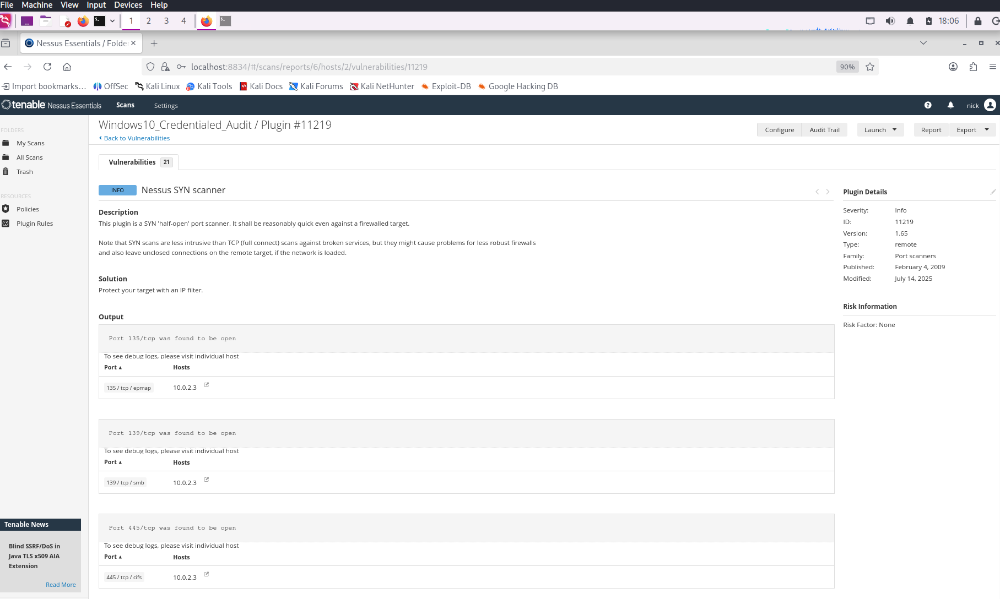
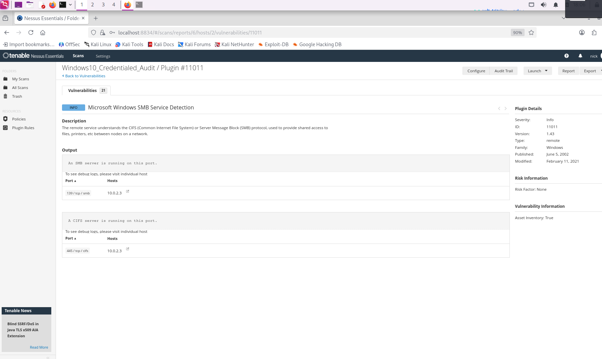
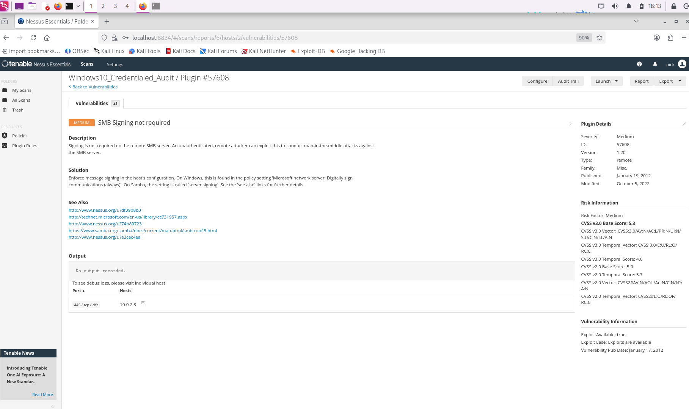

> [English](README.en.md) | **Italiano**

# Vulnerability assessment & remediation: Windows 10 hardening con tenable Nessus

> - **Fase:** Vulnerability Assessment - Credentialed Scan con Tenable Nessus
> - **Visibilita:** Alta - la scansione credentialed genera traffico SMB e WMI intenso verso il target, facilmente identificabile da un IDS
> - **Prerequisiti:** Nessus Essentials installato e configurato; account amministratore locale sul target Windows; servizi Remote Registry e File e Printer Sharing abilitati sul target
> - **Output:** Finding VULN-001 (SMB Signing non obbligatorio, severity Alto) e VULN-002 (Windows 10 22H2 End of Life, severity Medio); procedura di remediation via GPO verificata

---

## 1 Introduzione e obiettivo

Questo progetto documenta un processo completo di Vulnerability Assessment (VA) eseguito su una workstation Windows 10 all'interno di un ambiente di laboratorio virtualizzato. 

L'obiettivo principale è stato simulare uno scenario aziendale reale:
1. Eseguire una scansione di vulnerabilità.
2. Analizzare i risultati distinguendo tra falsi positivi/info e rischi reali.
3. Eseguire la Remediation (mitigazione) delle vulnerabilità critiche.
4. Verificare la messa in sicurezza tramite una scansione di conferma.

---

## 2 Teoria e concetti chiave

### Vulnerability assessment vs penetration test

Mentre il Penetration Test cerca di sfruttare una vulnerabilità per entrare nel sistema, il Vulnerability Assessment (oggetto di questo report) mira a catalogare e classificare tutte le falle di sicurezza presenti per poterle correggere preventivamente.

### Scansione Non-Credentialed vs credentialed

Durante il laboratorio ho sperimentato la differenza cruciale tra le due modalità:

- Non-Credentialed (Black Box): Nessus guarda il sistema dall'esterno. Vede solo le porte aperte e i servizi esposti. Spesso riporta pochi risultati o falsi negativi.
- Credentialed (White/Grey Box): Nessus effettua il login nel sistema target con credenziali amministrative. Questo permette di interrogare il registro di sistema, verificare le patch installate e le configurazioni locali. È la modalità utilizzata per questo report.

### SMB (server message block)

È il protocollo di rete utilizzato da Windows per la condivisione di file e stampanti. Se non configurato correttamente (es. senza firma digitale), è vulnerabile ad attacchiMan-in-the-Middle (MitM).

---

## 3 Fase di discovery e analisi

### 3.1 La scansione iniziale

Dopo aver configurato Nessus e il target (IP: `10.0.2.3`), la prima scansione ha riportato prevalentemente risultati informativi (INFO - Blu).

Risultati rilevanti (INFO):
- Plugin 11011 (SMB Service Detection): Conferma che il servizio SMB è attivo sulla porta 445/139.



- Plugin `92415` (Application Compatibility Cache): Nessus ha estratto laShimCache. Sebbene non sia una vulnerabilità, è un dato utile per l'analisi forense (mostra quali .exe sono stati eseguiti).



Analisi: questi risultati indicavano che il sistema era raggiungibile, ma non presentavano rischi immediati. Erano semplicemente la conferma che "tutto funziona".

### 3.2 Identificazione delle vulnerabilità reali

Approfondendo l'analisi con una scansione autenticata (Credentialed Audit), sono emerse problematiche di sicurezza reali:

### Vulnerabilità 1: SMB signing not required (risk: HIGH/MEDIUM)

**ID Finding:** `VULN-001` | **Severity:** `Alto`

- Descrizione: Il server SMB remoto non richiede la firma digitale dei pacchetti.
- Impatto: Un attaccante sulla stessa rete locale può intercettare la comunicazione tra il client e il server, modificarne il contenuto e inoltrarlo senza che le parti se ne accorgano (Attacco Man-in-the-Middle).
- Stato: Attivo (Colore Arancione).



### Vulnerabilità 2: Windows 10 22H2 SEoL (risk: MEDIUM)

**ID Finding:** `VULN-002` | **Severity:** `Medio`

- Descrizione: La versione di Windows 10 in uso (22H2) ha raggiunto la fine del supporto (End of Life) nell'Ottobre 2025.
- Contesto: Essendo la data attuale Gennaio 2026, il sistema non riceve patch di sicurezza da circa 3 mesi.
- Impatto: Il sistema è esposto a nuove minacce (0-day) per le quali Microsoft non rilascerà correzioni.

---

## 4 Fase di remediation (risoluzione)

Ho deciso di concentrarmi sulla mitigazione della vulnerabilità SMB Signing, in quanto risolvibile tramite configurazione (Hardening), mentre il problema SEoL richiederebbe un aggiornamento completo del sistema operativo.

### Procedura di hardening
Per forzare la firma SMB, ho agito sulle Group Policy (GPO) locali della macchina Windows 10.

Passaggi eseguiti:
1. Accesso all'editor dei criteri di gruppo: `Win + R`, poi `gpedit.msc`.
2. Percorso: Configurazione computer > Impostazioni di Windows > Impostazioni sicurezza > Criteri locali > Opzioni di sicurezza.
3. Policy modificata: `Server di rete Microsoft: aggiungi firma digitale alle comunicazioni (sempre)`.
4. Azione: Impostato su Abilitato (Enabled).

Comando di applicazione:

Per rendere effettiva la modifica senza riavviare, ho forzato l'aggiornamento delle policy tramite terminale (CMD Amministratore):

```powershell
gpupdate /force
```

---

## 5 Verifica finale

Ho rilanciato la scansione Nessus sullo stesso host.

- Risultato: La voce "SMB Signing not required" è scomparsa dalla lista delle vulnerabilità o è stata declassata a semplice "Info" (confermando che la firma è ora attiva).
- Conclusione: Il sistema è ora protetto contro attacchi di manipolazione del traffico SMB sulla rete locale.

---

## 6 Esperienza personale e troubleshooting

Durante questo laboratorio ho affrontato diverse sfide tecniche che hanno arricchito la mia comprensione del processo.

### Problema 1: interpretazione dei plugin "info"

- Situazione: Inizialmente, vedendo screenshot con plugin come "Microsoft Windows SMB Service Detection" (Plugin 11011), temevo fossero errori o vulnerabilità mancate.
- Soluzione: Ho imparato a leggere la Severity. I plugin "Info" (Blu) sono fondamentali per la ricognizione (mi dicono cosa c'è), ma non richiedono fix. Ho imparato a non allarmarmi per il blu, ma a cercare l'arancione e il rosso.

### Problema 2: configurazione della scansione credentialed

- Situazione: La scansione iniziale non rilevava dettagli profondi del sistema.
- Causa: Nessus non aveva i permessi per leggere il registro di sistema di Windows.
- Soluzione:
  - Ho creato un account amministratore locale dedicato su Windows.
  - Ho abilitato il servizio "Remote Registry" su Windows.
  - Ho configurato la condivisione file e stampanti per permettere l'ingresso del traffico SMB in entrata attraverso il firewall.
  - Ho inserito le credenziali nella sezione "Credentials" > "Windows" di Nessus.

### Problema 3: Windows EoL (end of life)

- Riflessione: Ho notato che Nessus segnala come "Medium" il fatto che Windows 10 sia fuori supporto (Siamo nel 2026, supporto terminato nel 2025).
- Lesson Learned: Nessuna configurazione può risolvere questo problema. In un ambiente aziendale reale, questo report sarebbe la prova necessaria per giustificare al management il budget per l'upgrade a Windows 11 o successivi.

---

## Conclusione

Questo progetto ha dimostrato l'importanza di non fermarsi alla scansione superficiale. L'abilitazione delle credenziali ha permesso di scoprire configurazioni insicure (SMB Signing) che, se sfruttate, avrebbero potuto compromettere l'integrità dei dati aziendali. La remediation tramite Group Policy è stata efficace e verificabile.

---

## Analisi a basso livello: architettura Nessus e meccanica della scansione

### Architettura del scanner

Nessus opera su un modello client-server con tre componenti principali:

```
Browser (UI)          Nessus Server (nessusd)           Target
    |                       |                              |
    |--- HTTPS 8834 ------->|                              |
    |   (policy, target,    |                              |
    |    credentials)       |                              |
    |                       |--- Fase 1: Port Scan ------->|
    |                       |   SYN scan su top 65535      |
    |                       |<-- SYN-ACK (porte aperte) ---|
    |                       |                              |
    |                       |--- Fase 2: Service ID ------>|
    |                       |   Banner grab + fingerprint  |
    |                       |<-- Versione servizio --------|
    |                       |                              |
    |                       |--- Fase 3: NASL Plugins ---->|
    |                       |   Plugin specifici per CVE   |
    |                       |<-- Risultato test ---------- |
    |                       |                              |
    |<-- Report JSON/HTML --|                              |
```

### Plugin NASL e logica di detection

I plugin Nessus sono scritti in NASL (Nessus Attack Scripting Language), un linguaggio domain-specific progettato per i test di sicurezza. Ogni plugin ha un ID univoco e testa una specifica vulnerabilita o configurazione:

| plugin id | nome | cosa testa | metodo |
| :--- | :--- | :--- | :--- |
| `57608` | smb signing not required | flag securitymode nel protocollo smb | invio `SessionSetup` e analisi della risposta `NegotiateProtocol` |
| `63155` | wmi: windows version | build number e patch level | query wmi `Win32_OperatingSystem` (richiede credenziali) |
| `92415` | shimcache | cronologia esecuzione binari | lettura registro `HKLM\SYSTEM\CurrentControlSet\Control\Session Manager\AppCompatCache` |
| `10394` | microsoft windows smb log | event log remoti | lettura via dcerpc eventlog pipe |

### Scansione credentialed: flusso di autenticazione

La differenza tra scansione non-credentialed e credentialed e sostanziale. Nella modalita credentialed, Nessus stabilisce una sessione SMB autenticata e utilizza due canali:

1. **Remote Registry** (servizio `RemoteRegistry`): accede a `HKLM\SOFTWARE\Microsoft\Windows\CurrentVersion\Uninstall\*` per enumerare il software installato e le KB patch mancanti
2. **WMI (Windows Management Instrumentation)**: query DCOM/WMI su porta TCP 135 + porta dinamica WMI per estrarre informazioni di sistema (OS build, hotfix, servizi, processi)

```
Nessus Scanner                          Target Windows
    |                                         |
    |--- SMB auth (NTLMSSP) ----------------->|  porta 445
    |<-- Session Granted ---------------------|
    |                                         |
    |--- DCE/RPC bind: winreg pipe ---------->|  Named Pipe: \PIPE\winreg
    |--- RegOpenKey HKLM\SOFTWARE... -------->|
    |<-- Chiavi registro (patch installate) --|  <-- KB list per match CVE
    |                                         |
    |--- WMI query: Win32_QuickFixEng ------->|  porta 135 + WMI dinamica
    |<-- Lista hotfix applicati --------------|
    |                                         |
    |  [Nessus confronta patch installate     |
    |   vs database CVE interno]              |
    |                                         |
    |  Risultato: "KB4013389 MANCANTE"        |
    |  -> Plugin 97833: MS17-010 VULNERABLE   |
```

Senza credenziali, Nessus puo solo analizzare i banner dei servizi esposti (es. la risposta `NegotiateProtocol` di SMB), identificando un sottoinsieme delle vulnerabilita. La scansione credentialed aumenta tipicamente il numero di finding del 300-500%.

### CVSS nel contesto Nessus

Nessus assegna automaticamente un punteggio CVSS a ogni finding basandosi sul database NVD. Per VULN-001 (SMB Signing disabled), il plugin `57608` riporta severity `Medium` nel contesto Nessus standard, ma il rischio reale dipende dall'ambiente: in una rete con Active Directory, l'assenza di SMB Signing abilita NTLM Relay, elevando il rischio a `Alto` nel contesto di questo assessment.

---

## Scenario reale: da SMB signing disabled a compromissione del dominio (VULN-001)

In un assessment aziendale, il finding VULN-001 (SMB Signing non obbligatorio) e raramente un problema isolato. Rappresenta il primo anello di una catena di attacco che porta alla compromissione dell'intero dominio Active Directory.

### Kill chain: NTLM relay via SMB signing disabled

```
Fase 1: Posizionamento (Attacker sulla LAN)
    |
    v
Fase 2: Poisoning - Responder su interfaccia di rete
    $ sudo responder -I eth0 -wPv
    [*] Poisoning LLMNR/NBT-NS/mDNS requests
    |
    v
Fase 3: Vittima risolve un hostname inesistente (typo: \\FILESERVR)
    -> LLMNR broadcast -> Responder risponde "Sono io FILESERVR"
    -> Vittima invia NTLM authentication verso Attacker
    |
    v
Fase 4: Relay - ntlmrelayx inoltra le credenziali NTLM al target REALE
    $ sudo ntlmrelayx.py -t smb://10.0.2.3 -smb2support
    [*] NTLM auth relayed to 10.0.2.3
    [*] Target does NOT require SMB Signing  <-- VULN-001 lo rende possibile
    [*] Authenticating against smb://10.0.2.3 as DOMAIN\admin
    |
    v
Fase 5: Esecuzione codice remoto sul target (se l'utente relayato e admin)
    [*] Executing command: whoami
    [*] nt authority\system
```

**Perche SMB Signing blocca l'attacco:** quando SMB Signing e obbligatorio, ogni pacchetto SMB include un Message Authentication Code (MAC) calcolato con la Session Key derivata dalle credenziali NTLM. L'attaccante che esegue il relay non possiede la Session Key (ha solo il challenge-response), quindi non puo firmare i pacchetti, e il server li rifiuta.

**Impatto in numeri (Verizon DBIR 2024):** il 68% delle reti Active Directory testate da CrowdStrike nel 2023-2024 presentavano SMB Signing non obbligatorio su almeno un server. In combinazione con LLMNR/NBT-NS attivi (default Windows), il tempo medio per ottenere credenziali di dominio admin e di 14 minuti dalla connessione alla rete.

### Remediation verificata (dal lab)

La remediation via GPO documentata nella Fase 4 di questo report (`Server di rete Microsoft: aggiungi firma digitale alle comunicazioni (sempre)`) e stata verificata con successo: la ri-scansione Nessus ha confermato la scomparsa del finding. In un ambiente di produzione, la stessa policy va applicata via GPO di dominio a tutti i member server e workstation.

---

## Blue team: vulnerability management lifecycle

### Detection della scansione

Una scansione Nessus credentialed genera pattern di traffico riconoscibili:
- Burst di connessioni SMB e WMI dallo stesso IP sorgente in finestra temporale ridotta (minuti)
- Accesso a chiavi di registro tipiche di vulnerability scanner: `HKLM\SOFTWARE\Microsoft\Windows\CurrentVersion\Uninstall`
- Event ID 4624 (Logon Type 3 - Network) con account di servizio Nessus (`nessus_audit` nel nostro lab)
- Query WMI `Win32_QuickFixEngineering` e `Win32_OperatingSystem` in rapida successione

In un ambiente controllato, l'account dedicato (`nessus_audit`) permette di filtrare questi eventi dal rumore di fondo.

### Ciclo di vulnerability management

Il valore di Nessus non e nella singola scansione, ma nel ciclo iterativo:

```
Scansione baseline (t0)
    |
    v
Triage: filtrare falsi positivi, contestualizzare CVSS
    |
    v
Prioritizzazione: patch critiche first (VULN-001 > VULN-002)
    |
    v
Remediation: GPO per SMB Signing, upgrade OS per EoL
    |
    v
Verifica: ri-scansione (t1) per confermare fix
    |
    v
Delta report: confronto t0 vs t1 (nuovi finding? regressioni?)
    |
    v
Scheduling: scansione periodica (settimanale/mensile)
```

In ambienti enterprise, Tenable.io (SaaS) o Tenable.sc (on-premise) centralizzano i report di centinaia di scanner, generano dashboard per il CISO e tracciano le metriche di mean-time-to-remediate (MTTR) per ogni team.

---

## Esperienza di laboratorio

La sfida piu significativa del lab e stata la configurazione del target per la scansione credentialed. Windows 10 di default blocca l'accesso remoto al registro e le connessioni WMI in ingresso. La sequenza di abilitazione (Remote Registry + File and Printer Sharing + account admin dedicato) riflette esattamente quello che un sysadmin deve configurare in produzione per permettere a Nessus di operare.

La differenza tra scansione non-credentialed (che ha rilevato solo plugin informativi come SMB Service Detection) e credentialed (che ha scoperto SMB Signing disabled e Windows EoL) e stata la lezione piu importante: uno scanner senza credenziali e essenzialmente cieco sulle misconfigurazioni interne. Questo spiega perche in un assessment professionale la scansione credentialed e lo standard minimo, non un optional.

Il troubleshooting del Plugin 92415 (ShimCache) ha rivelato un aspetto non ovvio: Nessus non si limita a cercare vulnerabilita, ma estrae anche artefatti forensi (programmi eseguiti, DLL caricate) che possono rivelare la presenza di software non autorizzato o indicatori di compromissione pregressa. Un VA professionale include sempre l'analisi dei plugin "Info" per questo motivo.

La remediation di VULN-001 tramite GPO locale e il successivo re-scan hanno completato il ciclo: identificazione, analisi, fix, verifica. In produzione, la stessa GPO verrebbe distribuita a livello di dominio tramite Group Policy Management Console (GPMC), applicandola a tutte le workstation e server simultaneamente.

---

## Mappatura MITRE ATT&CK

| tattica | tecnica | id mitre | descrizione dell'azione |
| :--- | :--- | :--- | :--- |
| reconnaissance | active scanning: vulnerability scanning | `T1595.002` | utilizzo di nessus in modalita credentialed per identificare vulnerabilita note sull'host windows 10 target (VULN-001, VULN-002). |
| discovery | network service discovery | `T1046` | enumerazione dei servizi attivi (smb porta 445) e delle loro configurazioni tramite credentialed scan. |
| reconnaissance | gather victim host information: software | `T1592.002` | raccolta di informazioni sul software installato e sul patch level tramite interrogazione del registro di sistema windows (shimcache, versione os). |

---

---

## Correlazioni con altri finding

| provenienza | questo finding | porta a | modulo |
| :--- | :--- | :--- | :--- |
| [SCAN-003](<../../../01-recon (Red Team Basic)/02-network-scanning-active/port-scanning (Nmap)/nmap-scripts/README.md>) | VULN-001 - smb signing disabled | [EXPLOIT-018](<../../../04-system-exploitation/03-privilege-escalation (PrivEsc)/windows-priv-esc/winpeas/README.md>) - pass-the-hash lateral movement | 04-exploitation |
| scansione nessus | VULN-002 - windows eol | [EXPLOIT-001](<../../../04-system-exploitation/01-frameworks/metasploit/README.md>) - eternalblue su sistema non patchato | 04-exploitation |
| [VULN-004](<../../02-protocol-specific-audit/smb-net-bios/README.md>) | VULN-001 + VULN-004 | [EXPLOIT-013](<../../../04-system-exploitation/03-privilege-escalation (PrivEsc)/windows-priv-esc/juicypotato-printnightmare/README.md>) - seimpersonateprivilege | 04-exploitation |

> **Nota:** Tutte le attivita documentate sono state condotte in un ambiente di laboratorio virtualizzato (VirtualBox NAT Network). Il target e una macchina virtuale Windows 10 di proprieta dell'autore. Nessuna scansione e stata eseguita su sistemi di terze parti senza autorizzazione esplicita.
