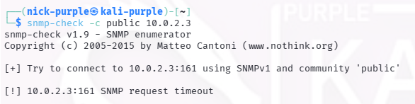

> [English](README.en.md) | **Italiano**

# Audit protocollo SNMP (porta 161 UDP)

> - **Fase:** Vulnerability Assessment - Protocol Audit (SNMP)
> - **Visibilita:** Media - onesixtyone invia pacchetti UDP 161 con community string di brute force, identificabili da sistemi IDS
> - **Prerequisiti:** Porta 161 UDP identificata come potenzialmente aperta dalla fase di recon; dizionario di community string comuni (incluso in onesixtyone)
> - **Output:** Finding VULN-006 (severity Informativo) - servizio SNMP assente, superficie di attacco inesistente; conferma della postura di sicurezza sul vettore monitoring di rete

Strumenti: Onesixtyone, Snmp-check

---

## 1 Introduzione teorica

Il protocollo SNMP (Simple Network Management Protocol) viene utilizzato per il monitoraggio dei dispositivi di rete. Le versioni v1 e v2c sono considerate insicure perché trasmettono la "Community String" (password) in chiaro. Se attivo e mal configurato (community `public`), permette a un attaccante di mappare l'intero sistema (sistema operativo esatto e patch level,utenti presenti sul sistema, software installati, tutta la struttura della rete interna).

---

## 2 Verifica presenza servizio (discovery)

**ID Finding:** `VULN-006` | **Severity:** `Informativo`

È stato eseguito un tentativo di discovery utilizzando `onesixtyone` con un dizionario di community string comuni, per verificare se il servizio fosse attivo e raggiungibile.

```Bash
onesixtyone -c /usr/share/doc/onesixtyone/dict.txt 10.0.2.3
```

Risultato: Il tool non ha ricevuto alcuna risposta dal target. Nessuna community string valida è stata identificata.

---

## 3 Tentativo di enumerazione (deep scan)

Per ulteriore conferma, è stato lanciato `snmp-check` ipotizzando la community di default "public".

```Bash
snmp-check -c public 10.0.2.3
```



Esito: Timeout della richiesta. Il target non ha la porta UDP 161 aperta.

---

## 4 Conclusioni

L'audit ha dato esito Positivo (Sicuro).

Il servizio SNMP non è installato o è disabilitato sulla macchina target. La superficie di attacco relativa al monitoraggio di rete è inesistente. Questa configurazione è raccomandata per workstation che non necessitano di monitoraggio centralizzato.

---

## Analisi a basso livello: protocollo SNMP e vettori di attacco

### Architettura SNMP (RFC 3411-3418)

SNMP opera su UDP porta 161 (agent) e 162 (trap receiver). Il protocollo utilizza un modello agent-manager: l'agent (installato sui dispositivi da monitorare) espone informazioni organizzate in un albero gerarchico di Object Identifier (OID), e il manager (console di monitoraggio) effettua query per raccogliere dati.

```
SNMP Manager (NMS)                     SNMP Agent (target)
  |                                          |
  |--- GetRequest (OID 1.3.6.1.2.1.1.1) --->|  community: "public"
  |                                          |
  |<-- GetResponse: "Linux server 5.15..." --|  <-- sysDescr (OS + kernel)
  |                                          |
  |--- GetBulkRequest (subtree walk) ------->|  community: "public"
  |                                          |
  |<-- Responses: tabella interfacce,        |  <-- TUTTO il sistema esposto
  |    routing table, utenti, processi...    |
```

### Versioni SNMP e sicurezza

| versione | autenticazione | crittografia | rischio |
| :--- | :--- | :--- | :--- |
| **v1** (1988) | community string in chiaro | nessuna | Critico - sniffabile e brute-forceable |
| **v2c** (1996) | community string in chiaro | nessuna | Critico - stessa debolezza di v1, piu efficiente |
| **v3** (2004) | username + password (usm) | aes/des opzionale | medio-basso se configurato con authpriv |

SNMPv1/v2c trasmettono la community string in chiaro nel pacchetto UDP. Un attaccante sulla stessa rete puo intercettarla con un semplice `tcpdump -i eth0 -A udp port 161`. La community `public` (read-only) e `private` (read-write) sono i default su quasi tutti i dispositivi.

### OID tree: cosa espone SNMP

L'albero OID e standardizzato (MIB-II, RFC 1213). Le informazioni piu critiche per un attaccante:

| oid | nome | informazione esposta |
| :--- | :--- | :--- |
| `1.3.6.1.2.1.1.1` | sysdescr | os, versione kernel, architettura |
| `1.3.6.1.2.1.1.5` | sysname | hostname del dispositivo |
| `1.3.6.1.2.1.4.20.1` | ipaddrtable | tutti gli indirizzi ip configurati |
| `1.3.6.1.2.1.4.21.1` | iproutetable | tabella di routing completa |
| `1.3.6.1.2.1.25.4.2.1.2` | hrswrunname | processi in esecuzione |
| `1.3.6.1.2.1.25.6.3.1.2` | hrswinstalledname | software installato |
| `1.3.6.1.4.1.77.1.2.25` | (microsoft mib) | lista utenti windows |

Con community `private` (read-write), un attaccante puo modificare la configurazione del dispositivo: cambiare la routing table (redirect del traffico), alterare le ACL del firewall, o sovrascrivere il firmware su router/switch.

### Comandi operativi (se il servizio fosse stato attivo)

```Bash
# Walk completo dell'albero MIB (richiede community valida)
snmpwalk -v2c -c public 10.0.2.3

# Enumerazione mirata: lista utenti Windows
snmpwalk -v2c -c public 10.0.2.3 1.3.6.1.4.1.77.1.2.25

# Brute force community string con onesixtyone
onesixtyone -c /usr/share/seclists/Discovery/SNMP/snmp.txt 10.0.2.3

# Enumerazione completa con snmp-check
snmp-check -c public -v2c 10.0.2.3
```

---

## Blue team: hardening SNMP

**Detection:**
- Monitorare pacchetti UDP 161 in ingresso da IP non autorizzati - qualsiasi query SNMP da un host non NMS e sospetta
- Alert su brute force community string: burst di pacchetti UDP 161 con community diverse dallo stesso IP
- IDS signature: pacchetti SNMP con community "public" o "private" (default non modificati)

**Hardening:**
- Se non necessario, disabilitare completamente il servizio SNMP (come nel nostro target - configurazione ideale)
- Se necessario: migrare a SNMPv3 con autenticazione (authPriv: SHA + AES128 minimo)
- Cambiare le community string di default (`public`/`private`) con stringhe complesse (>20 caratteri)
- Configurare ACL sugli agent per accettare query solo dagli IP dei manager NMS autorizzati
- Su router/switch: `snmp-server host <NMS_IP> version 3 priv <username>` + `no snmp-server community public`

---

## Esperienza di laboratorio

L'assenza del servizio SNMP sul target Windows 10 e un risultato atteso per una workstation: SNMP e tipicamente abilitato su dispositivi di infrastruttura (router, switch, firewall, server di monitoraggio), non su endpoint utente. Il valore didattico dell'esercizio risiede nella comprensione del protocollo e del suo potenziale di information disclosure.

Il test con `onesixtyone` ha completato rapidamente perche opera su UDP: non essendoci handshake TCP, il tool invia i pacchetti e attende un timeout per le risposte. L'assenza di risposta puo significare due cose: servizio assente, oppure servizio presente ma con community string non nel dizionario. Per distinguere i due casi, si utilizza `nmap -sU -p 161 target`: se la porta e "open|filtered" il servizio potrebbe essere presente; se e "closed", il kernel ha risposto con ICMP Port Unreachable confermando l'assenza del servizio.

In un assessment reale, SNMP e spesso il "quick win" su dispositivi di rete: router e switch di fascia media-bassa vengono frequentemente lasciati con community `public` di default. Una singola query `snmpwalk` con community corretta puo rivelare l'intera topologia di rete, la routing table e la lista degli utenti - informazioni che normalmente richiederebbero ore di enumerazione attiva. Per questo motivo, l'audit SNMP e sempre incluso nella checklist di un VA anche quando non ci si aspetta di trovare il servizio attivo.

---

## Mappatura MITRE ATT&CK

| tattica | tecnica | id mitre | descrizione dell'azione |
| :--- | :--- | :--- | :--- |
| discovery | network service discovery | `T1046` | tentativo di discovery snmp con `onesixtyone` su porta udp 161 tramite dizionario di community string comuni; risultato: nessuna risposta (VULN-006). |
| reconnaissance | gather victim host information: client configurations | `T1592.004` | tentativo di enumerazione della configurazione di sistema tramite snmp community "public" con `snmp-check`; risultato: timeout, servizio assente (VULN-006). |

---

> **Nota:** Tutte le attivita documentate sono state condotte in un ambiente di laboratorio virtualizzato (VirtualBox NAT Network). Il target e una macchina virtuale Windows 10 di proprieta dell'autore. Nessuna scansione e stata eseguita su sistemi di terze parti senza autorizzazione esplicita.
