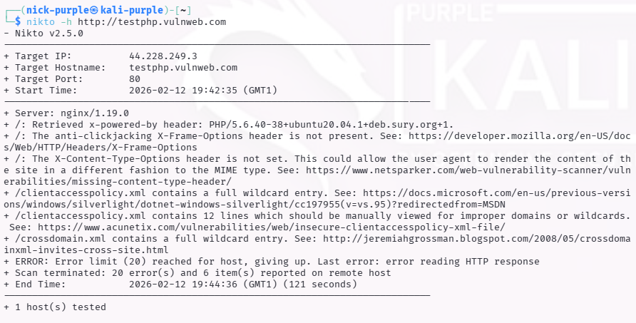
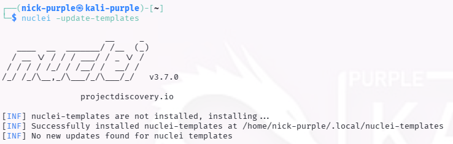
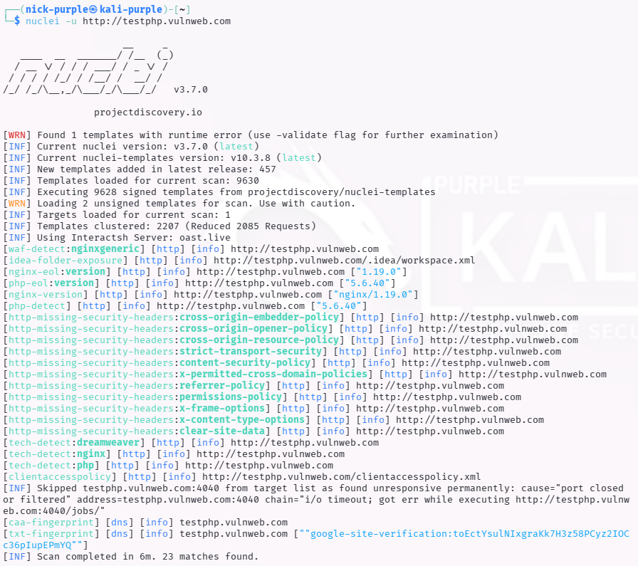

> [English](README.en.md) | **Italiano**

# Web recon: vulnerability scanning (Nikto & Nuclei)

> - **Fase:** Web Attack - Automated Vulnerability Scanning
> - **Visibilita:** Alta (Nikto - molto rumoroso, facilmente rilevabile) / Media (Nuclei - template-based, meno rilevabile)
> - **Prerequisiti:** Target web identificato, `nikto` preinstallato su Kali, `nuclei` con template aggiornati
> - **Output:** Lista di vulnerabilita, misconfiguration e CVE rilevate sul target; conferma di WEB-002 e WEB-003

---

Obiettivo: Automatizzare la ricerca di configurazioni errate (Misconfigurations), file di default e vulnerabilità server note su un target web.

Target: `http://testphp.vulnweb.com`

Strumenti: `Nikto` (Legacy Scanner), `Nuclei` (Modern Template Scanner)

---

## 1 Introduzione teorica

I Vulnerability Scanners sono strumenti che interrogano il target confrontando le risposte con un database di firme (signatures) note.
A differenza del Tech Profiling (che identifica la tecnologia), lo Scanner cerca attivamente CVE (Common Vulnerabilities and Exposures) e debolezze strutturali.

### Confronto strumenti
- Nikto (Perl): Uno scanner "general purpose" storico. Eccellente per rilevare file pericolosi dimenticati e configurazioni server errate. È noto per essere "rumoroso" (genera molto traffico).
- Nuclei (Go): Lo standard moderno. Utilizza template YAML creati dalla community per rilevare vulnerabilità specifiche con altissima precisione e velocità. È ampiamente usato nelle pipeline DevSecOps.

---

## 2 Esecuzione tecnica: Nikto scan

È stata eseguita una scansione con Nikto contro il server target.

Comando:

```Bash
nikto -h http://testphp.vulnweb.com
```




Analisi Dettagliata dei Findings: La scansione, sebbene interrotta prematuramente dal server per eccesso di errori, ha evidenziato diverse criticità strutturali:

- Information Disclosure (Critico): Il server espone l'header `X-Powered-By: PHP/5.6.40`. L'uso di una versione PHP obsoleta (End-Of-Life) espone l'applicazione a vulnerabilità note non patchabili.
- Security Misconfiguration (Headers): Mancano header di sicurezza fondamentali:

  - `X-Frame-Options`: Espone al rischio di Clickjacking.
  - `X-Content-Type-Options`: Espone al rischio di MIME Sniffing.

- Insecure Cross-Domain Policy: I file `crossdomain.xml` e `clientaccesspolicy.xml` sono configurati con wildcard (`*`), permettendo potenzialmente a domini esterni non fidati di interagire con l'applicazione (Legacy Risk).

Nota sull'Errore: L'errore Error limit (20) reached indica che il server target ha smesso di rispondere alle richieste. Questo evidenzia la natura "aggressiva" di Nikto, che in un contesto reale verrebbe facilmente rilevato e bloccato dai sistemi di difesa perimetrale (WAF/IPS).

---

## 3 Advanced scanning: Nuclei (template based)

Per una rilevazione mirata e moderna, è stato utilizzato Nuclei. A differenza di Nikto, Nuclei utilizza Template YAML aggiornati quotidianamente per identificare CVE specifiche.

Comando:

```Bash
# Aggiornamento template ed esecuzione
nuclei -update-templates
```



```Bash
nuclei -u http://testphp.vulnweb.com
```



Analisi dei Findings (Nuclei Scan):

L'output di Nuclei fornisce dettagli granulari sull'infrastruttura:

1. DevOps Misconfiguration (`idea-folder-exposure`):

    È stato rilevato il file `.idea/workspace.xml`. Questo indica che gli sviluppatori hanno caricato per errore i file di configurazione dell'IDE (IntelliJ/PHPStorm) sul server di produzione. Questo file può rivelare la struttura interna del progetto e i nomi dei file sorgente.

2. Software Obsoleto (`php-eol`, `nginx-eol`):

    Nuclei ha taggato esplicitamente le versioni rilevate come EOL (End of Life).

    - PHP 5.6.40
    - Nginx 1.19.0

    Questo conferma che il software non riceve più aggiornamenti di sicurezza, rendendolo un bersaglio critico.

3. WAF Detection (`waf-detect`):

    Il tool ha identificato il comportamento del server come `nginxgeneric`, utile per pianificare tecniche di evasione del Firewall in fasi successive.

---

## 4 Scenari speciali: localhost & static sites

L'approccio al Vulnerability Scanning cambia radicalmente a seconda dell'ambiente target.

#### A. localhost / Docker (hardening)

Quando si scansiona un ambiente locale (`localhost:5173`) o un container Docker, l'obiettivo non è l'attacco ma l'Hardening. Lanciare Nikto contro il proprio container permette di scoprire se il server sta "parlando troppo" (Verbose Headers).

- Esempio: Rilevare che Express.js espone `X-Powered-By: Express` permette allo sviluppatore di disabilitare quell'header prima di andare in produzione, riducendo le informazioni disponibili agli attaccanti.

#### B. static hosting (GitHub pages)

Contro siti statici come `https://nicholas-arcari.github.io`, scanner server-side come Nikto sono inefficaci poiché il server è gestito dal provider (GitHub) e non è modificabile. L'attenzione si sposta sulle Librerie Client-Side. In questo scenario, la vulnerabilità non è nel server, ma nel browser dell'utente: si cercano versioni obsolete di librerie JavaScript (es. jQuery < 3.0, Bootstrap vecchi) che contengono vulnerabilità DOM-based XSS.

---

## Nota etica: gestione dei report

I risultati sopra riportati si riferiscono a `testphp.vulnweb.com`, un ambiente di addestramento pubblico intenzionalmente vulnerabile.

Importante: In uno scenario reale (Pentest su cliente), i report di scansione contenenti versioni software e vulnerabilità specifiche sono classificati come Strictly Confidential e non devono mai essere pubblicati su repository pubblici.

---

## Analisi a basso livello: Nikto vs Nuclei - architettura e template

### Architettura Nikto

Nikto opera con un database di "tuning" (categorie di test) e invia richieste HTTP sequenziali:

```
nikto -h http://target
    |
    v
1. Connect e banner grab (Server header, powered-by)
2. Per ogni entry nel database (~7.000 check):
   |-- GET /path -> analisi status code e body
   |-- Confronto con signature nota
   |-- Se match: report finding
3. Output finale (testo/HTML/XML)
```

Il database Nikto (`/var/lib/nikto/databases/`) contiene file CSV con pattern:

```
# db_tests: ID, OSVDB, tuning, URI, method, match_pattern, fail_pattern, summary
"000001","0","9","/","GET","Apache/","","Web server identified"
"003289","637","2","/.git/HEAD","GET","ref:","","Git repository exposed"
```

### Architettura Nuclei e template YAML

Nuclei utilizza template YAML che descrivono sia la richiesta che la condizione di match:

```yaml
# Template esempio: php-eol-detection.yaml
id: php-eol
info:
  name: PHP End of Life Detection
  severity: medium
  tags: tech,php,eol

http:
  - method: GET
    path:
      - "{{BaseURL}}"
    matchers-condition: and
    matchers:
      - type: regex
        part: header
        regex:
          - "X-Powered-By: PHP/5\\.[0-6]"    # PHP 5.0-5.6 = EOL
      - type: status
        status:
          - 200

    extractors:
      - type: kval
        kval:
          - x_powered_by
```

**Vantaggi dell'approccio template:**
- Ogni template e indipendente e verificabile
- La community contribuisce ~6.000 template (ProjectDiscovery)
- Falsi positivi ridotti: il matcher specifica esattamente cosa cercare
- Aggiornamento incrementale: `nuclei -update-templates` scarica solo i nuovi

### Confronto operativo dettagliato

| aspetto | nikto | nuclei |
| :--- | :--- | :--- |
| linguaggio | perl | go |
| check database | ~7.000 (statico) | ~6.000+ template (community, aggiornati quotidianamente) |
| falsi positivi | frequenti (pattern matching grezzo) | rari (matcher precisi con condizioni and) |
| velocita | lento (sequenziale, singolo thread) | veloce (goroutine, multi-target parallelo) |
| rumorosita | molto alta (~7.000 richieste) | media (solo template rilevanti) |
| output | testo/html | json/sarif (integrabile in ci/cd) |
| uso moderno | legacy, quick check | standard de facto per dast automatizzato |

---

## Blue team: detection degli scanner web

### Indicatori di scanning automatizzato

- **Volume richieste:** Nikto genera ~7.000 richieste in pochi minuti, con >90% di 404. Pattern inequivocabile
- **User-Agent:** Nikto usa `Nikto/2.x.x` di default (facilmente spoofabile con `-useragent`)
- **Path pattern:** richieste a path tipici di scanner (`/.git/HEAD`, `/admin/`, `/backup.sql`, `/wp-config.php.bak`) in rapida sequenza
- **Error rate:** elevato numero di errori 4xx/5xx dallo stesso IP in finestra temporale ridotta

### Hardening Anti-Scanner

```nginx
# Rate limiting per IP (Nginx)
limit_req_zone $binary_remote_addr zone=scanner:10m rate=10r/s;
location / {
    limit_req zone=scanner burst=20 nodelay;
}

# Blocco User-Agent noti
if ($http_user_agent ~* "nikto|nuclei|sqlmap|dirbuster|gobuster") {
    return 403;
}
```

---

## Esperienza di laboratorio

Il crash di Nikto (Error limit 20 reached) ha dimostrato in modo tangibile la differenza tra "tool di laboratorio" e "tool per produzione": Nikto genera cosi tanto traffico anomalo che anche un server di test senza WAF ha smesso di rispondere. In un ambiente con WAF reale (Cloudflare, Akamai), Nikto sarebbe stato bloccato dopo le prime 50 richieste.

Nuclei ha prodotto risultati piu precisi in meno tempo: i template `php-eol`, `nginx-eol` e `idea-folder-exposure` hanno identificato esattamente tre misconfigurazioni senza generare migliaia di richieste inutili. La struttura YAML dei template li rende leggibili e verificabili, a differenza del database CSV di Nikto che e opaco.

Il finding `.idea/workspace.xml` scoperto da Nuclei e particolarmente significativo: questo file viene creato automaticamente dagli IDE JetBrains (IntelliJ, PHPStorm) e contiene la struttura del progetto, i file aperti recentemente, e potenzialmente credenziali di database configurate nell'IDE. La sua presenza su un server di produzione indica che il deploy e stato fatto copiando l'intera directory del progetto, incluse le cartelle nascoste dell'IDE.

---

## Mappatura MITRE ATT&CK

| tattica | tecnica | id mitre | descrizione dell'azione |
| :--- | :--- | :--- | :--- |
| reconnaissance | active scanning: vulnerability scanning | `T1595.002` | scansione con nikto e nuclei per identificare php eol, header di sicurezza mancanti (`X-Frame-Options`, `X-Content-Type-Options`) e crossdomain.xml esposto |
| reconnaissance | gather victim host info: software | `T1592.002` | nuclei template `php-eol` e `nginx-eol` che confermano php 5.6.40 e nginx 1.19 come end of life (WEB-002) |
| discovery | file and directory discovery | `T1083` | nuclei template `idea-folder-exposure` che conferma l'esposizione della cartella `.idea/workspace.xml` (WEB-003) |
| discovery | network service scanning | `T1046` | rilevamento comportamento waf tramite template `waf-detect` di nuclei (identificato come `nginxgeneric`) |

---

> **Nota:** La scansione con Nikto ha generato oltre 20 errori sul server target, che ha smesso
> di rispondere per saturazione delle richieste. Questo dimostra la natura "aggressiva" di Nikto
> in ambienti di produzione: il tool sarebbe stato bloccato da qualsiasi WAF reale. I risultati
> si riferiscono a `testphp.vulnweb.com`, ambiente di test autorizzato Acunetix.
