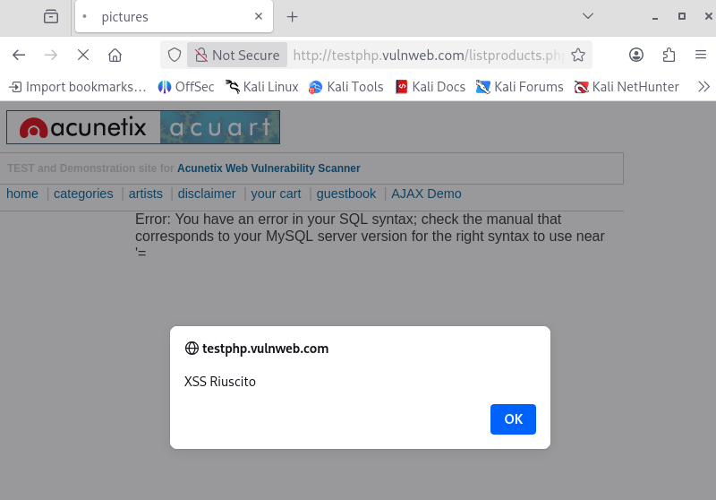
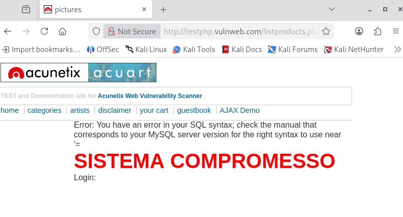

> **English** | [Italiano](README.md)

# Vulnerability assessment: reflected Cross-Site scripting (XSS)

> - **Phase:** Web Attack - XSS Reflected
> - **Visibility:** Low - single request with payload in URL parameter, indistinguishable from normal navigation
> - **Prerequisites:** URL parameter that is reflected in the HTML response without encoding, identified through web recon
> - **Output:** JavaScript execution in victim's browser (alert PoC), virtual defacement, phishing vector, finding WEB-005

---

**Finding ID:** `WEB-005` | **Severity:** `Medium` | **CVSS v3.1:** 6.1

---

## 1 Executive summary

During the analysis of the web application `testphp.vulnweb.com`, a Reflected Cross-Site Scripting (XSS) vulnerability was identified.

The application does not properly sanitize user input provided through URL parameters, reflecting it directly in the page's HTML code.

This vulnerability allows an attacker to create malicious links that, if visited by the victim, execute arbitrary JavaScript code in the user's browser context.

Risks include:

- Session Hijacking: Session cookie theft.
- Phishing: Page content modification to deceive the user.
- Malicious Redirects: User redirection to external sites.

---

## 2 Technical analysis

#### Scenario a: URL parameter injection

The `listproducts.php` endpoint accepts the `cat` parameter to filter products. It was verified that inserting HTML/JavaScript code in the parameter value causes it to be executed by the browser without filters.

Attack Vector:

The attack occurs through URL manipulation. An attacker can send this link via email or social engineering.

Payload (Proof of Concept):

```html
http://testphp.vulnweb.com/listproducts.php?cat=<script>alert('XSS Riuscito')</script>
```

Evidence Analysis:

As shown in the screenshot below, the payload injected in the URL is processed by the server and included in the response. The browser interprets the `<script>` tag and executes the `alert()` function, opening a popup with the custom message.



#### Scenario b: virtual defacement (phishing vector)

Beyond JavaScript code execution, it was verified that the application allows injection of arbitrary HTML tags (HTML Injection).

This vector is particularly critical for Social Engineering attacks: an attacker can exploit the user's trust in the legitimate domain (`testphp.vulnweb.com`) to present fake error messages or fraudulent login forms.

Payload (Defacement & Fake Login):

```html
http://testphp.vulnweb.com/listproducts.php?cat=<h1 style="color:red;font-size:40px">SISTEMA COMPROMESSO</h1><form>Login:<input type="text"><input type="submit"></form>
```

Evidence Analysis:

The screenshot below shows the visual alteration of the page. The application renders the title "SISTEMA COMPROMESSO" and an input field, simulating a credential request. The visible SQL error further confirms that input was not validated as integer.



---

## 3 Remediation plan

The Reflected XSS vulnerability must be fixed by treating all user input as untrusted.

- Context-Aware Output Encoding (Fundamental):
    
    Before reflecting any user data in the HTML page, convert special characters to their respective HTML Entities.

  - `<` becomes `&lt;`

  - `>` becomes `&gt;`

  - `"` becomes `&quot;`

  - `'` becomes `&#x27;`

Secure PHP Example:

```PHP
// DO NOT do this:
echo "Category: " . $_GET['cat'];

// DO this:
echo "Category: " . htmlspecialchars($_GET['cat'], ENT_QUOTES, 'UTF-8');
```

Input Validation:

If the `cat` parameter must be a number (category ID), force the type to `Integer` and reject any non-numeric input.

Content Security Policy (CSP):

Implement CSP headers to limit sources from which the browser can load and execute scripts (e.g., disable `unsafe-inline`).

---

## MITRE ATT&CK mapping

| tactic | technique | mitre id | action description |
| :--- | :--- | :--- | :--- |
| initial access | exploit public-facing application | `T1190` | exploitation of the `cat` parameter vulnerable to reflected xss on `listproducts.php`, with injection of `<script>alert('XSS Riuscito')</script>` (WEB-005) |
| credential access | steal web session cookie | `T1539` | the reflected xss payload is the primary vector for stealing the session cookie from the victim who clicks the malicious link (WEB-005) |
| initial access | phishing: spearphishing link | `T1566.002` | distribution of the malicious url `listproducts.php?cat=<PAYLOAD>` through email or social engineering to target specific users (WEB-005) |

---

> **Note:** Finding WEB-005 was documented on `testphp.vulnweb.com`. Reflected XSS is classified `Medium` because it requires user interaction (click on the malicious link) unlike Stored XSS. In the presence of sensitive content (e.g., admin session token accessible via JavaScript), the effective severity can be elevated to `High`.
