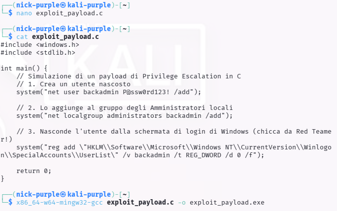
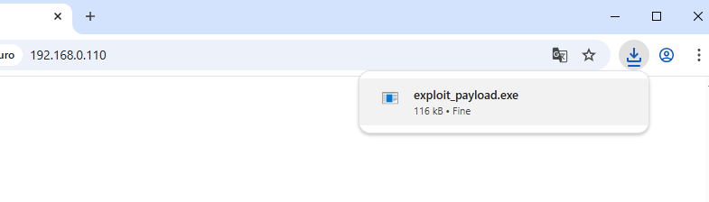
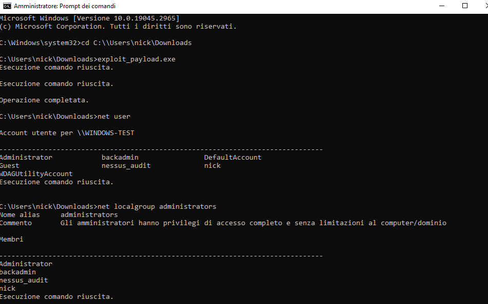
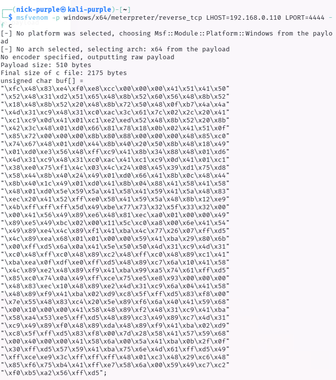
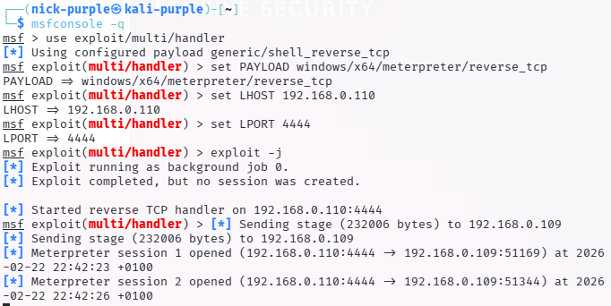

> [English](README.en.md) | **Italiano**

# Weaponization: Cross-Compilation & custom exploit payloads

> - **Fase:** System Exploitation - Weaponization & Custom Payload Development
> - **Visibilita:** Alta - il binario compilato viene scritto su disco (artefatto statico rilevabile da AV/EDR); l'allocazione di memoria RWX tramite VirtualAlloc e un indicatore comportamentale ad alta priorita per EDR
> - **Prerequisiti:** Accesso shell sulla macchina target (es. da Initial Access con Empire/Metasploit); toolchain MinGW-w64 installata su Kali per cross-compilazione; payload shellcode generato con msfvenom o custom
> - **Output:** EXPLOIT-005 (esecuzione payload custom cross-compilato su Windows, severity Alto); EXPLOIT-006 (in-memory shellcode execution via VirtualAlloc/CreateThread, severity Critico); binario Windows funzionante compilato da Kali

- Target: Macchina Windows 10 Home (IP: 192.168.0.109)
- Attaccante (Build Environment): Kali Linux Purple (IP: 192.168.0.110)
- Toolchain Utilizzata: GCC, MinGW-w64 (x86_64-w64-mingw32-gcc)
- Obiettivo: Simulazione di Customizzazione Payload, Cross-Compilation e Local Privilege Escalation.

---

## Executive summary

Il presente documento illustra l'adattamento tattico e la customizzazione di un payload in linguaggio C, comunemente integrato all'interno di exploit pubblici (es. da Exploit-DB) per l'ottenimento di persistenza ed escalation dei privilegi su sistemi Microsoft Windows.

L'operazione dimostra la capacità di operare in ambienti eterogenei: a fronte della naturale assenza di compilatori nativi (C/C++) sui sistemi Windows di produzione, si è adottata la tecnica della Cross-Compilation. L'ambiente di attacco (Linux) è stato equipaggiato per forgiare binari PE (Portable Executable) compatibili con l'architettura bersaglio. Il payload ha implementato tecniche di Account Manipulation e Defense Evasion per garantire un accesso amministrativo "silente".

---

## Fase 1: weaponization & Cross-Compilation environment

La fase di sviluppo è stata condotta integralmente sull'infrastruttura Linux dell'attaccante.

Il codice sorgente (`exploit_payload.c`) è stato redatto per interfacciarsi con le librerie native di Windows (`windows.h`) ed eseguire chiamate di sistema (`system()`) mirate alla creazione di una backdoor persistente a livello di sistema operativo.

Il payload è stato ingegnerizzato per eseguire tre azioni sequenziali:

1. Creazione Utente: Generazione di un account locale denominato `backadmin`.

2. Privilege Escalation: Inserimento dell'utente nel gruppo `Administrators`.

3. Defense Evasion (OPSEC): Modifica dell'hive di registro `HKLM\Software\Microsoft\Windows NT\CurrentVersion\Winlogon\SpecialAccounts\UserList` per nascondere visivamente l'account dalla schermata di logon (LogonUI) del sistema operativo.

Per generare l'eseguibile, è stata utilizzata la toolchain `mingw-w64`. Il comando `x86_64-w64-mingw32-gcc exploit_payload.c -o exploit_payload.exe` ha convertito con successo il sorgente in un binario a 64-bit per Windows.

**ID Finding:** `EXPLOIT-005` | **Severity:** `Alto`



---

## Fase 2: delivery & execution

Il file `exploit_payload.exe` è stato distribuito tramite un server HTTP locale istanziato sull'ambiente attaccante e scaricato con successo dall'host vittima.



Al fine di simulare le condizioni operative in cui un exploit pubblico (es. vulnerabilità in driver o servizi SCM) riesce a deviare il flusso di esecuzione garantendo un contesto a privilegi elevati, il payload è stato eseguito da un Prompt dei Comandi con privilegi di Amministratore.

L'esecuzione è risultata completamente silente, ritornando il controllo al prompt in frazioni di secondo senza emettere output grafici, comportamento tipico dei drop di malware.



---

## Fase 3: Post-Exploitation & validation

Per certificare l'avvenuta compromissione e il corretto funzionamento del codice C compilato in cross-environment, si è proceduto all'enumerazione manuale degli account locali (Living off the Land).

Interrogando il sistema tramite l'utility `net.exe`, l'output ha confermato la creazione dell'account non autorizzato `backadmin`. 
Successivamente, il comando `net localgroup administrators` ha validato l'appartenenza di `backadmin` al gruppo amministrativo locale, certificando di fatto l'acquisizione di un metodo di accesso privilegiato e persistente.


---

---

## Tool di riferimento

| tool | tipo | tecnica/accesso | caso d'uso principale |
| :--- | :--- | :--- | :--- |
| `gcc` / `MinGW-w64` | cross-compiler | cli | compilazione di binari windows exe/dll da sistemi linux |
| `msfvenom` | payload generator | cli | generazione shellcode in formato c, python, raw per embed nel codice |
| `msfconsole` | handler listener | cli | ricezione delle connessioni dai payload generati con msfvenom |
| `strip` | binary tool | cli | rimozione simboli di debug dai binari per ridurre superficie di analisi |
| `wine` | windows emulator | cli | test di eseguibili windows su linux prima del deploy sul target |
| `Donut` | shellcode injector | cli | conversione di .net assembly, exe, dll in shellcode in-memory |
| `pe-sieve` | malware scanner | cli | scansione processi windows per rilevare injection in memoria (blue team) |
| `x64dbg` | debugger | gui | analisi dinamica binari windows, debug shellcode (blue team) |

---

## Scenario reale: proiezione Post-Exploitation

> Questa sezione descrive come EXPLOIT-005 ed EXPLOIT-006 si inserirebbero in un engagement reale.

### Prospettiva attaccante (red team)

**Punto di partenza:** capacita di compilare e trasferire un binario custom sul target; esecuzione confermata di shellcode in memoria.

**Kill Chain proiettata:**

```
EXPLOIT-006: shellcode in-memory (VirtualAlloc/CreateThread) -> shell attiva
        |
        v
Migrate processo -> iniettare in processo legittimo (explorer.exe, svchost.exe)
        |
        v
EXPLOIT-005: payload persistente -> scrittura chiave Run o Scheduled Task
        |
        v
EDR evasion: varianti del payload con encoder / obfuscation per bypassare firma statica
        |
        v
Lateral movement: deploy stesso payload su altri host via SMB (PsExec / Impacket)
        |
        v
Raccolta dati + esfiltrazione -> ransomware deployment
```

**Impatto potenziale:** la tecnica di in-memory execution (EXPLOIT-006) e particolarmente pericolosa perche bypassa le soluzioni AV basate su firma statica. I payload fileless non lasciano tracce su disco dopo l'esecuzione, rendendo il forensic recovery molto piu difficile.

**Vettori di monetizzazione tipici:**
- Ransomware-as-a-Service: il payload custom viene usato come dropper per il ransomware
- Credential theft: shellcode che inietta in LSASS per dumping hash NTLM
- Cryptominer: deployment silente di XMRig su host con alta CPU disponibile

### Prospettiva difensore (blue team)

**Rilevamento:** l'allocazione di memoria con protezione PAGE_EXECUTE_READWRITE (0x40) tramite VirtualAlloc e un indicatore comportamentale primario per EDR (Sysmon Event ID 8 - CreateRemoteThread, Event ID 10 - ProcessAccess).

**Indicatori di Compromissione (IOC):**
- Processo con allocazione memoria RWX (VirtualAlloc flags 0x3000 + 0x40)
- Binario sconosciuto firmato con certificato assente o non valido
- Cross-process injection: thread creato da processo non genitore logico
- Connessione reverse_tcp da processo non browser/sistema

**Contenimento:** kill del processo malevolo; isolamento host dalla rete; analisi memory dump con Volatility per identificare shellcode iniettato.

**Hardening strutturale:**
- Abilitare Exploit Guard (EMET) con protezione Control Flow Guard (CFG)
- Deployare EDR con behavioral detection (non solo firma) - es. Microsoft Defender for Endpoint P2
- Implementare Application Whitelisting (AppLocker/WDAC) per bloccare binari non firmati
- Abilitare Process Protection su processi critici (LSASS, servizi di sistema)

---

## Analisi a basso livello: Cross-Compilation e In-Memory execution

### Pipeline di Cross-Compilazione da Linux a Windows

```
Ambiente attaccante (Kali Linux):

exploit_payload.c                  <- Sorgente C con #include <windows.h>
    |
    v
x86_64-w64-mingw32-gcc            <- Cross-compiler: genera PE per Windows x64
    |                                  Toolchain: MinGW-w64 (GNU per Windows)
    +-- -o exploit_payload.exe     <- Output: Portable Executable 64-bit
    +-- -mwindows                  <- (opzionale) Senza console visibile
    +-- -s                         <- Strip: rimuove simboli di debug
    |
    v
exploit_payload.exe                <- Binario Windows eseguibile su target

Verifica pre-deploy:
file exploit_payload.exe
-> PE32+ executable (console) x86-64, for MS Windows
```

### VirtualAlloc/CreateThread: meccanica dell'In-Memory execution

```c
// Flusso di esecuzione dello shellcode_runner.c:

unsigned char shellcode[] = "\xfc\x48\x83...";  // msfvenom output

void main() {
    // 1. Alloca memoria con permessi Read+Write
    void *mem = VirtualAlloc(NULL, sizeof(shellcode),
                             MEM_COMMIT | MEM_RESERVE,  // 0x3000
                             PAGE_READWRITE);            // 0x04

    // 2. Copia lo shellcode nell'area allocata
    RtlMoveMemory(mem, shellcode, sizeof(shellcode));

    // 3. Cambia i permessi: Read+Execute (rimuove Write per OPSEC)
    DWORD oldProtect;
    VirtualProtect(mem, sizeof(shellcode),
                   PAGE_EXECUTE_READ,    // 0x20
                   &oldProtect);

    // 4. Crea un thread che esegue lo shellcode
    HANDLE thread = CreateThread(NULL, 0,
                                 (LPTHREAD_START_ROUTINE)mem,
                                 NULL, 0, NULL);

    // 5. Attendi che il thread (shell) termini
    WaitForSingleObject(thread, INFINITE);
}

// Detection: EDR monitora la sequenza VirtualAlloc -> RtlMoveMemory -> VirtualProtect(RX) -> CreateThread
// Pattern quasi univoco di shellcode injection
```

### Confronto tecniche di payload delivery

| tecnica | su disco | in memoria | detection difficulty | uso tipico |
| :--- | :--- | :--- | :--- | :--- |
| `system("net user...")` | si (cmd.exe child) | no | bassa (event id 4688) | backdoor account rapida |
| virtualalloc + createthread | no (fileless) | si | media (behavioral) | reverse shell stealth |
| reflective dll injection | no | si (dll in memoria) | alta | meterpreter stage |
| process hollowing | no | si (processo sostituto) | alta | malware avanzato |

---

## Esperienza di laboratorio

La cross-compilazione con `x86_64-w64-mingw32-gcc` ha funzionato al primo tentativo, dimostrando la maturita della toolchain MinGW-w64: un sorgente C che usa `#include <windows.h>` e le API Win32 (`system()`, `VirtualAlloc`) si compila su Linux esattamente come su Windows. Il flag `-s` (strip) rimuove i simboli di debug, riducendo la superficie di analisi statica per il reverse engineer ma non cambiando la funzionalita del binario.

L'evoluzione da `system("net user backadmin ...")` (EXPLOIT-005) a VirtualAlloc/CreateThread con shellcode (EXPLOIT-006) ha dimostrato la differenza fondamentale tra un payload "rumoroso" e uno "stealth": `system()` genera processi figli visibili (`cmd.exe`, `net.exe`, `reg.exe`) che producono Event ID 4688 nel Security Log, mentre lo shellcode in memoria non genera nuovi processi, operando interamente nello spazio di indirizzamento del processo chiamante.

Il passaggio da `PAGE_READWRITE` a `PAGE_EXECUTE_READ` con `VirtualProtect` e un dettaglio OPSEC importante: allocare memoria direttamente come `PAGE_EXECUTE_READWRITE` (RWX) e un indicatore noto di shellcode injection. La transizione in due fasi (RW, RX) e leggermente meno sospetta, anche se gli EDR moderni monitorano entrambi i pattern.

---

## Mappatura MITRE ATT&CK®

| tattica | tecnica | id mitre | descrizione dell'azione |
| :--- | :--- | :--- | :--- |
| persistence | create account: local account | `T1136.001` | creazione dell'account backdoor `backadmin` per garantire accesso futuro al sistema. |
| privilege escalation | account manipulation: local groups | `T1098` | inserimento dell'account fraudolento nel gruppo locale `Administrators`. |
| defense evasion | hide artifacts: hidden window/registry | `T1564` | alterazione delle chiavi di registro `Winlogon\SpecialAccounts` per inibire la visualizzazione dell'utente sulla ui di accesso. |
| execution | command and scripting interpreter | `T1059.003` | sfruttamento dell'interprete `cmd.exe` sottostante (tramite le chiamate `system()` nel codice c) per orchestrare i binari nativi (`net.exe`, `reg.exe`). |

---

## Indicators of compromise (IoCs) & blue team artifacts

- File System Anomaly: Presenza di un binario non firmato (`exploit_payload.exe`) contenente stringhe in chiaro riconducibili alle utility di rete di Windows.
- Account Anomaly: Creazione di un nuovo account locale (`backadmin`) al di fuori dei normali flussi di provisioning IAM.
- Registry Alteration: Presenza e modifica della chiave `HKLM\Software\Microsoft\Windows NT\CurrentVersion\Winlogon\SpecialAccounts\UserList\backadmin` impostata a DWORD `0`.
- Process Execution: Eventi di Log (Event ID 4688) indicanti l'esecuzione a catena di `net user`, `net localgroup` e `reg add` invocati come processi figli dell'eseguibile malevolo.

---

## Remediation strategy & mitigation

1. Monitoraggio Eventi di Sicurezza: Abilitare l'auditing avanzato (Audit Account Management) su Windows. Monitorare specificamente gli Event ID 4720 (A user account was created) e 4732 (A member was added to a security-enabled local group). Qualsiasi generazione di questi eventi al di fuori delle finestre di manutenzione deve innescare un allarme nel SIEM.

2. EDR Behavioural Analysis: Implementare policy negli Endpoint Detection and Response per segnalare applicazioni non note o non firmate (untrusted binaries) che tentano di istanziare shell interattive (`cmd.exe`) o che richiamano in rapida successione le utility di amministrazione (`net.exe`, `net1.exe`, `reg.exe`).

3. Hardening del Registro: Implementare regole di Attack Surface Reduction (ASR) o monitoraggi File Integrity Monitoring (FIM) per impedire o allertare sulle modifiche alla chiave di registro `SpecialAccounts\UserList`, tecnica storicamente abusata dai threat actor per mantenere persistenza silente.

---

## Ampliamento avanzato: In-Memory shellcode execution (defense evasion)

**ID Finding:** `EXPLOIT-006` | **Severity:** `Critico`

Per elevare ulteriormente il livello di sofisticazione dell'attacco e mitigare il rischio di rilevamento da parte di soluzioni EDR (Endpoint Detection and Response) basate sull'analisi comportamentale, si è proceduto ad abbandonare le chiamate di sistema rumorose (es. `system()`) in favore dell'esecuzione diretta in memoria (In-Memory Execution).

### 1. Shellcode generation

Utilizzando il framework `msfvenom`, è stato generato il payload `windows/x64/meterpreter/reverse_tcp` non in formato eseguibile, ma esportato come Shellcode puro (array di byte esadecimali in formato C).



### 2. Sviluppo del custom dropper (memory allocation)

È stato ingegnerizzato un nuovo sorgente C (`shellcode_runner.c`) progettato specificamente per caricare il payload direttamente nella RAM, evitando l'uso del file system per il codice malevolo (approccio Fileless-like). Il codice sfrutta le API di Windows a basso livello:

- `VirtualAlloc`: Per riservare e allocare un blocco di memoria dinamica.
- `RtlMoveMemory`: Per copiare i byte grezzi dello shellcode nell'area allocata.
- `VirtualProtect`: Per modificare i flag di protezione della pagina di memoria in `PAGE_EXECUTE_READ`, rendendola attivamente eseguibile dal processore.
- `CreateThread`: Per generare un nuovo thread di esecuzione che punta direttamente all'indirizzo di memoria contenente il payload.

### 3. Esecuzione e bypass

Il sorgente è stato compilato tramite `mingw-w64`. Una volta eseguito sull'host target, l'eseguibile ha allocato la memoria ed eseguito lo shellcode in modo totalmente silente. Il Listener dell'attaccante ha intercettato con successo la callback di Meterpreter, confermando l'avvenuto bypass dei controlli statici e l'esecuzione stabile in RAM.



### Mappatura MITRE ATT&CK (aggiornamento)

| tattica | tecnica | id mitre | descrizione dell'azione |
| :--- | :--- | :--- | :--- |
| defense evasion | process injection: direct execution | `T1055` | esecuzione di codice arbitrario iniettato e allocato dinamicamente nello spazio di memoria del processo chiamante. |

### Mitigazione avanzata (memory scanning)

Per contrastare minacce di questo tipo, i Blue Team non possono affidarsi esclusivamente all'analisi statica dei file. È imperativo l'utilizzo di soluzioni EDR dotate di capacità di Memory Scanning dinamico e di API Hooking a livello di Userland (tramite DLL iniection difensiva) o a livello Kernel (tramite driver). Queste soluzioni devono monitorare anomalie nelle chiamate a `VirtualAlloc` e intercettare l'allocazione di pagine di memoria con flag `PAGE_EXECUTE_READWRITE`, spesso indicative di unpacking o iniezione di codice.

---

> **Nota:** Tutte le attivita documentate sono state condotte in un ambiente di laboratorio virtualizzato. I payload e i binari descritti sono stati compilati ed eseguiti esclusivamente su macchine virtuali di proprieta dell'autore. Nessuna tecnica e stata applicata a sistemi reali o di terze parti senza autorizzazione esplicita.
