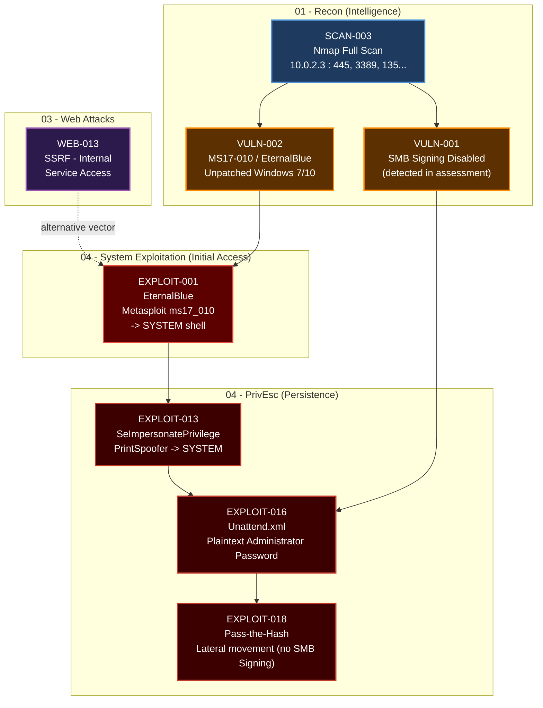
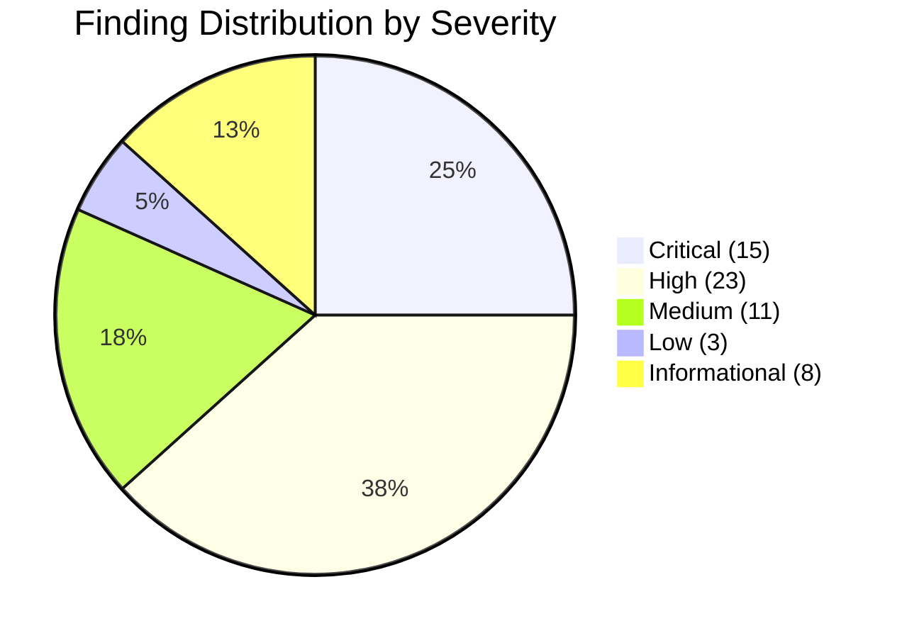
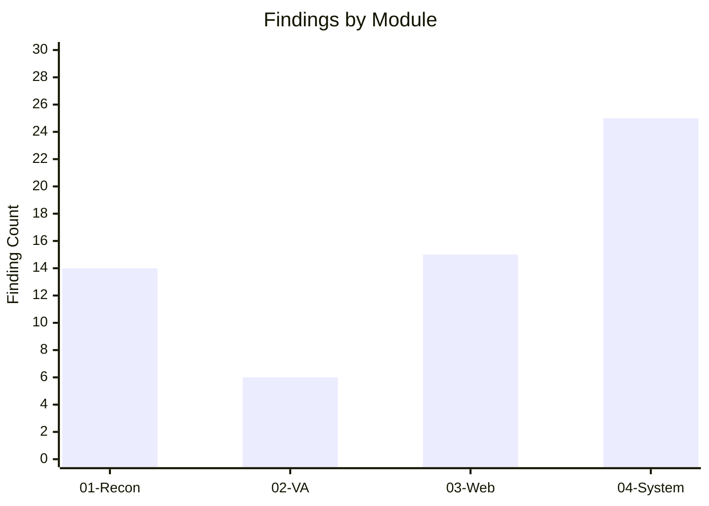

> **English** | [Italiano](README.md)

# Cybersecurity labs


---

Welcome to the central repository for offensive (Red Team), defensive (Blue Team) and cloud security operations.

This structure is organized following the logical flow of a real **Penetration Test** and the phases of the **Cyber Kill Chain**, with additional modules dedicated to defense and modern infrastructures.

The READMEs within each module are not simple command guides: they document the **real lab experience** (issues encountered, operational decisions, concrete results), the **theory** behind each technique and a **projection towards real-world scenarios** of attack and defense.

---

## Legal disclaimer

> **WARNING:** All materials, scripts and methodologies contained in this repository are for **educational** and **research** purposes only. The author assumes no responsibility for the improper use of this information.
>
> *Never test systems without explicit written authorization.*

---

## Navigation map

| phase / domain | folder | status | findings |
| :--- | :--- | :---: | :--- |
| **i. intelligence** | [01-recon](#01-recon-red-team-basic) | complete | OSINT-001..006, SCAN-001..003, DNS-001..003, INTEL-001..006 |
| **ii. assessment** | [02-vulnerability-assessment](#02-vulnerability-assessment) | complete | VULN-001..009 |
| **iii. web ops** | [03-web-attacks](#03-web-attacks-red-team--secure-coding) | complete | WEB-001..015 |
| **00. setup** | [00-setup-after-installing-kali](#00-setup-after-installing-kali) | complete | - (hardening guide) |
| **iv. system ops** | [04-system-exploitation](#04-system-exploitation) | complete | EXPLOIT-001..025 |
| **v. human ops** | [05-social-engineering](#05-social-engineering-toolingpython) | complete | SE-001..015 |
| **vi. wireless** | [06-wireless-security](#06-wireless-security) | complete | WIFI-001..012 |
| **vii. post-exploit** | [07-post-exploitation](#07-post-exploitation) | complete | POST-001..014 |
| **viii. defense** | [08-defense-hardenings](#08-defense-hardenings-blue-team-prevention) | complete | DEF-001..008 |
| **ix. analysis** | [09-digital-forensics](#09-digital-forensics-blue-team-analysis) | complete | FOR-001..002 |
| **x. modern infra** | [10-cloud-security](#10-cloud-security-cloudmodern) | complete | CLOUD-001..010 |
| **xi. active directory** | [11-active-directory](#11-active-directory-windows-domain) | in progress (methodology) | ad- (from lab) |

---

## Theoretical and academic apparatus

Beyond the operational READMEs, each module includes a **`THEORETICAL-FOUNDATIONS.en.md`** document: an
academic-level complement (thesis-chapter structure) that formalizes the adversary model, the security
properties, the theoretical foundations, the quantitative analysis, the limitations and the open
problems, with direct engagement with the peer-reviewed **primary literature**. The master annotated
bibliography is in **[`REFERENCES.en.md`](REFERENCES.en.md)** (real sources: IEEE S&P, USENIX Security,
CCS, POPL, NIST, RFC).

> **Graduate-level theory:** **[`THEORY-ADVANCED.en.md`](THEORY-ADVANCED.en.md)** is the rigorous theory
> chapter (definitions, theorems, proofs) that brings the apparatus to the register of a cryptography and
> formal-methods textbook: game-based provable security and reductions (Part I); a **proven concrete-
> security theorem** on the offline attack, whose bound coincides with the measurement executed in
> `EVALUATION/exp02` (Part II); Lowe's authentication hierarchy that formally names freshness and connects
> KRACK to the verification in `FORMAL-MODELS/` (Part III); BLP/Biba lattices and non-interference
> [Goguen-Meseguer] (Part IV). It is the rigorous counterpart of the conceptual per-module foundations.

| module | central theoretical foundation | document |
| :--- | :--- | :--- |
| 01 recon | attack surface [manadhata & wing] + entropy [shannon] | [foundations](01-recon%20%28Red%20Team%20Basic%29/THEORETICAL-FOUNDATIONS.en.md) |
| 02 vuln assessment | undecidability of detection (rice) + cvss metrology | [foundations](02-vulnerability-assessment/THEORETICAL-FOUNDATIONS.en.md) |
| 03 web | injection as data/code confusion [su & wassermann] | [foundations](03-web-attacks%20%28Red%20Team%20%2B%20Secure%20Coding%29/THEORETICAL-FOUNDATIONS.en.md) |
| 04 system | weird machines [bratus] + turing-complete rop [shacham] | [foundations](04-system-exploitation/THEORETICAL-FOUNDATIONS.en.md) |
| 05 social eng. | dual process [kahneman] + authentication gap | [foundations](05-social-engineering/THEORETICAL-FOUNDATIONS.en.md) |
| 06 wireless | fall of crypto-1 [nohl, garcia] + freshness | [foundations](06-wireless-security/THEORETICAL-FOUNDATIONS.en.md) |
| 07 post-exploit | attack graphs [sheyner] + confinement [lampson] | [foundations](07-post-exploitation/THEORETICAL-FOUNDATIONS.en.md) |
| 08 defense | bayesian base-rate fallacy [axelsson] | [foundations](08-defense-hardenings%20%28Blue%20Team%20Prevention%29/THEORETICAL-FOUNDATIONS.en.md) |
| 09 forensics | order of volatility + abductive inference | [foundations](09-digital-forensics%20%28Blue%20Team%20Analysis%29/THEORETICAL-FOUNDATIONS.en.md) |
| 10 cloud | co-residency [ristenpart] + identity as perimeter | [foundations](10-cloud-security%20%28Cloud%26Modern%29/THEORETICAL-FOUNDATIONS.en.md) |

### Empirical evaluation (reproducible measurements)

Beyond the theory, the **[`EVALUATION/`](EVALUATION/README.en.md)** folder contains **runnable,
deterministic** experiments (Python stdlib, fixed seeds) that *measure* the theoretical phenomena
instead of only deriving them - the step that takes the quantitative analysis from "cited from the
literature" to "measured and independently verifiable". No number is invented: every value comes from
the real execution of the included code.

- **Exp A** (module 08): a brute-force detector on 1,000,000 labeled events empirically confirms the
  **base-rate fallacy** [Axelsson 2000] - at a base rate of `1e-5`, 99.8% of the alarms are false,
  with the Bayesian formula verified by resampling.
- **Exp B** (modules 04, 06): on a Zipf password distribution, Shannon (13.4 bits) overestimates
  practical resistance; **749 guesses crack 50%** of the accounts - a measurement of the
  nominal-entropy / guessing-entropy gap.

### Formal verification (formal methods on a protocol)

The **[`FORMAL-MODELS/`](FORMAL-MODELS/README.en.md)** folder adds the third method of academic rigor:
the formal verification of a protocol. An **explicit-state model checker** (executed, exhaustive) of the
WPA2 4-way handshake under a Dolev-Yao adversary **mechanically finds the KRACK attack**
[Vanhoef & Piessens 2017] in the vulnerable model (4-step counterexample) and **verifies** the absence
of the defect in the patched model. It formally demonstrates that KRACK is a state-machine defect (key
reinstallation / loss of nonce freshness), not a break of the cryptographic primitives - the thesis of
module 06, section 3.5. A second verification, **by inductive invariant (unbounded)**, *proves* the
absence of the defect in the patched model for executions of arbitrary length. Also included is a
reference **Tamarin** model (not executed here, labeled as such).

Finally, the **[`concepts/`](concepts/README.en.md)** folder collects **background-knowledge** pages (malware
taxonomy, DoS/DDoS) with a conceptual and defensive angle: the theoretical context that the operational modules
(00-11) take for granted.

### Self-Assessment and limitations

Consistent with scientific honesty, **[`SELF-ASSESSMENT.en.md`](SELF-ASSESSMENT.en.md)** is an internal
adversarial critical review: it lists the threats to validity of each layer (synthetic data,
abstractions, single author, LLM assistance) and declares what remains out of scope - first and foremost
external peer review, which no repository can self-generate. It is not peer review: it addresses its
function (finding the flaws), not its credential.

---

## Kill chain - documented attack scenario

The following diagram represents the complete attack path documented in this repository,
from initial reconnaissance to total compromise of the Windows 10 target (`192.168.0.109`).
Each node is linked to the corresponding finding ID in the module READMEs.



---

## Risk heat map

Visual distribution of the 60 findings by severity and category.





| category | Critical | High | Medium | Low | Informational | total |
| :--- | :---: | :---: | :---: | :---: | :---: | :---: |
| 01-recon | 1 | 3 | 4 | 2 | 4 | 14 |
| 02-vulnerability assessment | 0 | 2 | 3 | 1 | 0 | 6 |
| 03-web attacks | 7 | 6 | 2 | 0 | 0 | 15 |
| 04-system exploitation | 7 | 12 | 2 | 0 | 4 | 25 |
| **total** | **15** | **23** | **11** | **3** | **8** | **60** |

---

## Repository architecture

```
cybersecurity-labs/
+-- REPORT_STANDARDS.md          <- Reporting standards (read before contributing)
+-- README.md                    <- This file
+-- EXECUTIVE_SUMMARY.md         <- Executive Summary for management (60 findings, Top 5 critical)
+-- LAB_SETUP.md                 <- VirtualBox topology, NAT/Bridge IPs, Docker Compose, VM configuration
+-- CERT_MAPPING.md              <- Lab-to-certification mapping (OSCP, eJPT, CEH, Security+, PenTest+)
+-- TOOLS_REFERENCE.md           <- Complete tool index (70 tools, 76 linked files)
+-- docker-compose.yml           <- Containerized web targets (DVWA, DVGA, Juice Shop)
+-- mkdocs.yml                   <- MkDocs Material configuration for GitHub Pages
+-- scripts/                     <- Automation: lab-setup.sh, check-finding-ids.sh
+-- tests/                       <- Pytest test suite for Python scripts
+-- 00-setup-after-installing-kali/  <- Hardening guide: 20 post-installation steps
+-- 01-recon (Red Team Basic)/
+-- 02-vulnerability-assessment/
+-- 03-web-attacks (Red Team + Secure Coding)/
+-- 04-system-exploitation/
+-- 05-social-engineering (Tooling&Python)/
+-- 06-wireless-security/
+-- 07-post-exploitation/
+-- 08-defense-hardenings/
+-- 09-digital-forensics/
+-- 10-cloud-security/
+-- 11-active-directory (Windows Domain)/
```

---

## Repository structure

### 01-Recon (red team basic)

**Objective:** Map the attack surface without leaving detectable traces.

Reconnaissance is the most critical and most overlooked phase: the more information gathered before attacking, the lower the risk of being detected during subsequent phases. This section is divided into two complementary operational approaches: **passive OSINT** (invisible, zero contact with the target) and **active scanning** (noisy, detectable).

- **Completed:** Personal OSINT on `nicholas-arcari.github.io`, Google Dorking on `nasa.gov`, network scanning on VirtualBox lab (Windows 10 `10.0.2.3`), DNS enumeration, Shodan/Censys recon
- **Findings:** 12 documented findings (OSINT-001..004, SCAN-001..003, DNS-001..003, INTEL-001..004) + 4 methodological labs (OSINT-005..006 OSINT automation and code leakage, INTEL-005..006 perimeter mapping and cloud asset discovery)
- **Content:** TheHarvester, Sherlock, Nmap, Masscan, dnsrecon, Subfinder, Shodan CLI

---

### 02-Vulnerability-assessment

**Objective:** Answer "what is broken?" with measurable and classified data.

While recon answers "what exists?", Vulnerability Assessment answers "what is vulnerable and how much?". This section bridges reconnaissance and exploitation: without a structured VA, subsequent attacks would be blind attempts. It documents both automated methodology (Nessus, OpenVAS) and manual methodology (protocol-specific auditing).

- **Completed:** Nessus credentialed scan on Windows 10, SMB/NetBIOS audit, SMTP, SNMP, SSL/TLS, CVE analysis with searchsploit and CVSS calculator, professional reporting templates
- **Findings:** 6 documented findings (VULN-001..006): SMB Signing, Windows EoL, NetBIOS disclosure, C$ access with default credentials, SMTP audit, SNMP; + 3 protocol-audit labs (VULN-007..009: LDAP, NFS/RPC, RDP)
- **Content:** Nessus, OpenVAS/GVM, nmap NSE, enum4linux, nbtscan, testssl.sh, searchsploit

---

### 03-Web-attacks (red team + secure coding)

**Objective:** Compromise web applications and APIs - then fix the code.

This is the largest section of the repository, with a dual nature: **Red Team** (finding and exploiting vulnerabilities) and **Secure Coding** (understanding why they exist and how to eliminate them in code). It covers the entire OWASP Top 10:2021 and the OWASP API Top 10:2023. The Secure Coding section documents the complete cycle: vulnerability identified, vulnerable code analyzed, fix implemented, post-remediation verification.

- **Completed:** SQL Injection (manual + sqlmap), XSS Reflected/Stored/Blind, SSTI Jinja2 RCE, Web Brute Force, Session Hijacking, JWT forging, GraphQL Introspection + RCE, IDOR/BOLA, Drupal CVE-2018-7600, SAST analysis, Prepared Statements fix, htmlspecialchars() fix
- **Findings:** 15 documented findings (WEB-001..015): from missing CSRF to RCE via GraphQL
- **Content:** Burp Suite, OWASP ZAP, Gobuster, Feroxbuster, Nikto, Nuclei, sqlmap, Hydra, WPScan, JoomScan, PyJWT, DVWA, DVGA, Metasploit

---

### 00-Setup-after-installing-kali

**Objective:** Turn a bare metal Kali installation into a secure and operational environment.

20 documented steps for hardening and initial configuration: default credential change, UFW firewall, SSH hardening, kernel sysctl, Suricata IDS, LUKS encryption, backup and monitoring. Operational prerequisite before any offensive or defensive activity.

- **Status:** Complete (21 READMEs: parent + 20 steps)
- **Content:** UFW, sshd_config, sysctl, Suricata, GVM/OpenVAS, Logwatch, LUKS/VeraCrypt, rsync

---

### 04-System-exploitation

**Objective:** Obtain a shell (RCE) and become root/admin.

Dedicated to pure infrastructure attacks: exploitation of exposed services, known vulnerability exploits, local privilege escalation. The focus is not just "running Metasploit" but understanding the compromise chain: from an unprivileged shell to total system control.

- **Completed:** C2 frameworks (Empire + Metasploit), custom payload cross-compilation, exploit research (searchsploit), Linux PrivEsc (GTFOBins, LinPEAS, cronjob hijacking), Windows PrivEsc (PrintSpoofer, WinPEAS, Unattend.xml, XAMPP weak ACL), kernel audit (Sherlock, PwnKit)
- **Findings:** 25 documented findings (EXPLOIT-001..025): from fileless Initial Access to NTLM and Linux hash cracking
- **Content:** PowerShell Empire 5, Metasploit, msfvenom, PrintSpoofer, WinPEAS, LinPEAS, GTFOBins, Sherlock.ps1, MinGW-w64

---

### 05-Social-engineering (Tooling&Python)

**Objective:** Hacking the human factor.

The most effective attack vector is not technical: it is psychological. This section documents phishing attack simulation, deceptive payload creation and social engineering techniques, with particular attention to their detectability and countermeasures.

- **Status:** To be documented
- **Content:** GoPhish templates, custom Python scripts, Office/HTA payload generators

---

### 06-Wireless-security

**Objective:** Interception and attacks on radio frequencies.

Everything that "travels through the air" is potentially interceptable. This section covers WiFi, Bluetooth/BLE, SDR and RFID/NFC - protocols often overlooked in corporate hardening programs.

- **Status:** To be documented
- **Content:** Aircrack-ng, Bettercap, SDR (radio frequency), RFID/NFC tools

---

### 07-Post-exploitation

**Objective:** Maintain access and move through the network (Lateral Movement).

Obtaining the initial shell is only the first step. This section documents what happens next: how to maintain access (persistence), how to harvest credentials (credential dumping), how to expand network presence (pivoting) and how to exfiltrate data silently.

- **Status:** To be documented
- **Content:** Mimikatz, Chisel/Ligolo (tunneling), persistent backdoors, exfiltration techniques

---

### 08-Defense-hardenings (blue team prevention)

**Objective:** Proactively protect and monitor in real time.

The defensive counterpart of the previous modules. For every attack technique documented in modules 01-07, the defensive response can be found here: correct configuration, hardening, monitoring and detection. Wazuh (SIEM/XDR) is the central tool in this section.

- **Status:** To be documented
- **Key tools:** Wazuh (SIEM/XDR), CIS Benchmarks, Honeypots

---

### 09-Digital-forensics (blue team analysis)

**Objective:** Investigate the incident and reconstruct the kill chain.

When defenses fail, forensics comes into play: analyzing the traces left by the attacker to understand what happened, how they got in, what they did and what they took. Wireshark (network traffic analysis) is the starting point.

- **Status:** To be documented
- **Key tools:** Wireshark, Autopsy, Volatility

---

### 10-Cloud-security (Cloud&Modern)

**Objective:** Security for modern infrastructures: containers, orchestrators and cloud providers.

Modern infrastructures (Docker, Kubernetes, AWS/Azure/GCP) introduce an attack surface completely different from traditional networking. This section documents both cloud-specific attack techniques and countermeasures and audit tools.

- **Status:** To be documented
- **Content:** AWS/Azure/GCP enumeration, Docker security (Trivy), Kubernetes audit, IaC scanning (Terraform)

---

### 11-Active-directory (Windows domain)

**Objective:** Attack and defend the Windows domain, from authenticated access to Domain Admin.

Covers the most common vector of internal penetration tests: the abuse of legitimate Active Directory features (Kerberos, replication, delegation, AD CS, ACLs). Methodology module: techniques, commands, detection and MITRE, with illustrative outputs and Finding IDs (`AD-`) to be assigned in a real lab.

- **Status:** In progress (methodology, Italian only; EN coming)
- **Content:** enumeration (BloodHound/LDAP/kerbrute), Kerberos (Kerberoasting, AS-REP, Golden/Silver Ticket), AD CS (ESC1/ESC8), delegation and ACLs (RBCD, delegation, ACL abuse), credential dumping (DCSync, Shadow Credentials, NTDS.dit)

---

## Global finding registry

| id | title | severity | module |
| :--- | :--- | :--- | :--- |
| [OSINT-001](<01-recon (Red Team Basic)/01-osint-passive (Open Source Intelligence)/breach-data/README.en.md>) | breach data exposure | High | osint-passive/breach-data |
| [OSINT-002](<01-recon (Red Team Basic)/01-osint-passive (Open Source Intelligence)/email-harvesting/README.en.md>) | email harvesting on personal domain | Informational | osint-passive/email-harvesting |
| [OSINT-003](<01-recon (Red Team Basic)/01-osint-passive (Open Source Intelligence)/google-dorks/README.en.md>) | google dorking - exposed documents and login pages | variable | osint-passive/google-dorks |
| [OSINT-004](<01-recon (Red Team Basic)/01-osint-passive (Open Source Intelligence)/user-enumeration/README.en.md>) | user enumeration on social networks | Low | osint-passive/user-enumeration |
| [OSINT-005](<01-recon (Red Team Basic)/01-osint-passive (Open Source Intelligence)/osint-frameworks/README.en.md>) | automated osint correlation via multi-source frameworks (spiderfoot, recon-ng, maltego) | variable | osint-passive/osint-frameworks |
| [OSINT-006](<01-recon (Red Team Basic)/01-osint-passive (Open Source Intelligence)/code-secret-leakage/README.en.md>) | secrets exposed in public repositories (git history) | high/critical | osint-passive/code-secret-leakage |
| [SCAN-001](<01-recon (Red Team Basic)/02-network-scanning-active/live-host-discovery/README.en.md>) | live host discovery - subnet mapping | Informational | network-scanning/live-host-discovery |
| [SCAN-002](<01-recon (Red Team Basic)/02-network-scanning-active/port-scanning (Nmap)/masscan/README.en.md>) | massive port scan - exposed surface | Informational | port-scanning/masscan |
| [SCAN-003](<01-recon (Red Team Basic)/02-network-scanning-active/port-scanning (Nmap)/nmap-scripts/README.en.md>) | smb signing not required (via nmap nse) | High | port-scanning/nmap-scripts |
| [DNS-001](<01-recon (Red Team Basic)/03-dns-enumeration/dns-recon/README.en.md>) | zone transfer or subdomain disclosure | critical/medium | dns-enumeration/dns-recon |
| [DNS-002](<01-recon (Red Team Basic)/03-dns-enumeration/hosts-file/README.en.md>) | hosts file manipulation vector | Medium | dns-enumeration/hosts-file |
| [DNS-003](<01-recon (Red Team Basic)/03-dns-enumeration/subdomain-finding/README.en.md>) | hidden subdomains identified | Medium | dns-enumeration/subdomain-finding |
| [INTEL-001](<01-recon (Red Team Basic)/04-infrastructure-intel/shodan-censys/README.en.md>) | exposed services detected via shodan | High | infrastructure-intel/shodan-censys |
| [INTEL-002](<01-recon (Red Team Basic)/04-infrastructure-intel/shodan-censys/README.en.md>) | exposed software versions via shodan | Medium | infrastructure-intel/shodan-censys |
| [INTEL-003](<01-recon (Red Team Basic)/04-infrastructure-intel/shodan-censys/README.en.md>) | infrastructure banner grabbing | Low | infrastructure-intel/shodan-censys |
| [INTEL-004](<01-recon (Red Team Basic)/04-infrastructure-intel/tech-stack/README.en.md>) | tech stack fingerprinting | Informational | infrastructure-intel/tech-stack |
| [INTEL-005](<01-recon (Red Team Basic)/04-infrastructure-intel/asn-whois-ct/README.en.md>) | perimeter mapped via asn/whois and certificate transparency | variable | infrastructure-intel/asn-whois-ct |
| [INTEL-006](<01-recon (Red Team Basic)/04-infrastructure-intel/cloud-asset-discovery/README.en.md>) | exposed cloud storage (s3/blob bucket) with anonymous read | medium/critical | infrastructure-intel/cloud-asset-discovery |
| [VULN-001](<02-vulnerability-assessment/01-general-scanners (Infrastructure)/nessus/README.en.md>) | smb signing not required (nessus credentialed) | High | general-scanners/nessus |
| [VULN-002](<02-vulnerability-assessment/01-general-scanners (Infrastructure)/nessus/README.en.md>) | windows 10 22h2 end of life | Medium | general-scanners/nessus |
| [VULN-003](<02-vulnerability-assessment/02-protocol-specific-audit/smb-net-bios/README.en.md>) | netbios name/service disclosure | Low | protocol-audit/smb-net-bios |
| [VULN-004](<02-vulnerability-assessment/02-protocol-specific-audit/smb-net-bios/README.en.md>) | c$ access with default credentials | High | protocol-audit/smb-net-bios |
| [VULN-005](<02-vulnerability-assessment/02-protocol-specific-audit/smtp/README.en.md>) | smtp audit - to be determined | Medium | protocol-audit/smtp |
| [VULN-006](<02-vulnerability-assessment/02-protocol-specific-audit/snmp/README.en.md>) | snmp audit - to be determined | Medium | protocol-audit/snmp |
| [WEB-001](<03-web-attacks (Red Team + Secure Coding)/01-proxy-tools (Intercept)/owasp-zap/README.en.md>) | missing csrf token on search form | Medium | proxy-tools/owasp-zap |
| [WEB-002](<03-web-attacks (Red Team + Secure Coding)/02-web-recon (Enumeration)/tech-profiler/README.en.md>) | php 5.6.40 eol + x-powered-by exposure | High | web-recon/tech-profiler |
| [WEB-003](<03-web-attacks (Red Team + Secure Coding)/02-web-recon (Enumeration)/dir-busting/README.en.md>) | exposed cvs directory + .idea | High | web-recon/dir-busting |
| [WEB-004](<03-web-attacks (Red Team + Secure Coding)/03-owasp (Attacks)/sql-injection (SQLi)/manual-payloads/README.en.md>) | manual sql injection - auth bypass + dump | Critical | owasp/sql-injection/manual-payloads |
| [WEB-005](<03-web-attacks (Red Team + Secure Coding)/03-owasp (Attacks)/xss (Cross-Site Scripting)/reflected/README.en.md>) | reflected xss - get parameter | Medium | owasp/xss/reflected |
| [WEB-006](<03-web-attacks (Red Team + Secure Coding)/03-owasp (Attacks)/xss (Cross-Site Scripting)/stored/README.en.md>) | stored xss - comments field | High | owasp/xss/stored |
| [WEB-007](<03-web-attacks (Red Team + Secure Coding)/03-owasp (Attacks)/xss (Cross-Site Scripting)/xss-hunter-payloads/README.en.md>) | blind/oob xss - form without output | High | owasp/xss/xss-hunter-payloads |
| [WEB-008](<03-web-attacks (Red Team + Secure Coding)/03-owasp (Attacks)/ssti (Server Side Template Injection)/README.en.md>) | ssti jinja2 rce - mro exploit chain | Critical | owasp/ssti |
| [WEB-009](<03-web-attacks (Red Team + Secure Coding)/03-owasp (Attacks)/auth-attacks/bruteforce-web/README.en.md>) | web brute force - missing rate limiting | High | owasp/auth-attacks/bruteforce-web |
| [WEB-010](<03-web-attacks (Red Team + Secure Coding)/03-owasp (Attacks)/auth-attacks/session-hijacking/README.en.md>) | session hijacking - unprotected cookie | High | owasp/auth-attacks/session-hijacking |
| [WEB-011](<03-web-attacks (Red Team + Secure Coding)/03-owasp (Attacks)/sql-injection (SQLi)/sql-map-data/README.en.md>) | automated sqli sqlmap - pci-dss violation | Critical | owasp/sql-injection/sql-map-data |
| [WEB-012](<03-web-attacks (Red Team + Secure Coding)/05-api-security/jwt-tokens/README.en.md>) | jwt weak secret - forged admin token | Critical | api-security/jwt-tokens |
| [WEB-013](<03-web-attacks (Red Team + Secure Coding)/05-api-security/graphql/README.en.md>) | graphql introspection + command injection rce | Critical | api-security/graphql |
| [WEB-014](<03-web-attacks (Red Team + Secure Coding)/05-api-security/postman/README.en.md>) | idor/bola - other users' financial data | Critical | api-security/postman |
| [WEB-015](<03-web-attacks (Red Team + Secure Coding)/04-cms-specific/drupal/README.en.md>) | drupal CVE-2018-7600 drupalgeddon2 rce | Critical | cms-specific/drupal |
| [EXPLOIT-001](<04-system-exploitation/01-frameworks/empire/README.en.md>) | fileless initial access via empire agent (.bat in-memory stager) | High | frameworks/empire |
| [EXPLOIT-002](<04-system-exploitation/01-frameworks/empire/README.en.md>) | persistence via registry run key hkcu | High | frameworks/empire |
| [EXPLOIT-003](<04-system-exploitation/01-frameworks/metasploit/README.en.md>) | initial access via msfvenom reverse_tcp + process injection explorer.exe | High | frameworks/metasploit |
| [EXPLOIT-004](<04-system-exploitation/01-frameworks/metasploit/README.en.md>) | network pivoting via internal socks proxy | High | frameworks/metasploit |
| [EXPLOIT-005](<04-system-exploitation/02-exploit-database/compiled-exploits/README.en.md>) | cross-compiled c payload with persistent backdoor (backadmin) | High | exploit-database/compiled-exploits |
| [EXPLOIT-006](<04-system-exploitation/02-exploit-database/compiled-exploits/README.en.md>) | in-memory shellcode execution via virtualalloc/createthread | Critical | exploit-database/compiled-exploits |
| [EXPLOIT-007](<04-system-exploitation/02-exploit-database/searchsploit/README.en.md>) | exploit research and nmap/searchsploit correlation (methodology) | Informational | exploit-database/searchsploit |
| [EXPLOIT-008](<04-system-exploitation/03-privilege-escalation (PrivEsc)/linux-priv-esc/gtfo-bins-notes/README.en.md>) | sudo nopasswd on `find` - immediate root escalation | High | linux-priv-esc/gtfo-bins |
| [EXPLOIT-009](<04-system-exploitation/03-privilege-escalation (PrivEsc)/linux-priv-esc/gtfo-bins-notes/README.en.md>) | suid bit on `awk` - arbitrary execution as root | High | linux-priv-esc/gtfo-bins |
| [EXPLOIT-010](<04-system-exploitation/03-privilege-escalation (PrivEsc)/linux-priv-esc/linpeas/README.en.md>) | credential disclosure in log/config files (linpeas) | High | linux-priv-esc/linpeas |
| [EXPLOIT-011](<04-system-exploitation/03-privilege-escalation (PrivEsc)/linux-priv-esc/linpeas/README.en.md>) | cronjob hijacking: writable root script - reverse shell | High | linux-priv-esc/linpeas |
| [EXPLOIT-012](<04-system-exploitation/03-privilege-escalation (PrivEsc)/linux-priv-esc/linpeas/README.en.md>) | CVE-2021-4034 pwnkit audit - system up to date | Informational | linux-priv-esc/linpeas |
| [EXPLOIT-013](<04-system-exploitation/03-privilege-escalation (PrivEsc)/windows-priv-esc/juicypotato-printnightmare/README.en.md>) | seimpersonateprivilege abuse via printspoofer - nt authority\system | Critical | windows-priv-esc/juicypotato |
| [EXPLOIT-014](<04-system-exploitation/03-privilege-escalation (PrivEsc)/windows-priv-esc/juicypotato-printnightmare/README.en.md>) | CVE-2021-34527 printnightmare audit - system patched | Informational | windows-priv-esc/juicypotato |
| [EXPLOIT-015](<04-system-exploitation/03-privilege-escalation (PrivEsc)/windows-priv-esc/sherlock/README.en.md>) | kernel patch audit (sherlock) - ms10-015..ms16-032 not present | Informational | windows-priv-esc/sherlock |
| [EXPLOIT-016](<04-system-exploitation/03-privilege-escalation (PrivEsc)/windows-priv-esc/winpeas/README.en.md>) | credential disclosure in unattend.xml - administrator password | Critical | windows-priv-esc/winpeas |
| [EXPLOIT-017](<04-system-exploitation/03-privilege-escalation (PrivEsc)/windows-priv-esc/winpeas/README.en.md>) | xampp weak acl: authenticated users writedata on service binaries | Critical | windows-priv-esc/winpeas |
| [EXPLOIT-018](<04-system-exploitation/03-privilege-escalation (PrivEsc)/windows-priv-esc/winpeas/README.en.md>) | localaccounttokenfilterpolicy=1 - lateral movement via pth | Medium | windows-priv-esc/winpeas |
| [EXPLOIT-019](<04-system-exploitation/03-privilege-escalation (PrivEsc)/windows-priv-esc/winpeas/README.en.md>) | powershell history psreadline with plaintext credentials | High | windows-priv-esc/winpeas |
| [EXPLOIT-020](<04-system-exploitation/04-binary-exploitation/buffer-overflow-prep/README.en.md>) | stack buffer overflow - eip overwrite and shellcode injection | Critical | binary-exploitation/buffer-overflow |
| [EXPLOIT-021](<04-system-exploitation/04-binary-exploitation/pwntools-scripts/README.en.md>) | remote aslr/dep bypass via got leak + ret2libc rop chain | Critical | binary-exploitation/pwntools |
| [EXPLOIT-022](<04-system-exploitation/05-password-cracking/hashcat/README.en.md>) | ntlm cracking via mask attack (keyspace reduction) | High | password-cracking/hashcat |
| [EXPLOIT-023](<04-system-exploitation/05-password-cracking/hashcat/README.en.md>) | ntlm cracking via rule-based attack (custom rule) | High | password-cracking/hashcat |
| [EXPLOIT-024](<04-system-exploitation/05-password-cracking/john-the-ripper/README.en.md>) | encrypted zip archive password cracking (zip2john) | Medium | password-cracking/john |
| [EXPLOIT-025](<04-system-exploitation/05-password-cracking/john-the-ripper/README.en.md>) | linux hash cracking via unshadowing + rockyou dictionary | High | password-cracking/john |

**Total documented findings: 60 | Critical: 15 | High: 23 | Medium: 11 | Low: 3 | Informational: 8**

> **Note:** findings `OSINT-005`, `OSINT-006`, `INTEL-005`, `INTEL-006` (and the subsequent ones marked as such in the modules under expansion) document **reproducible methodologies** with commands, example output and remediation, but are awaiting execution in the lab: the real results and screenshots go in the prepared placeholders. They are not counted in the total of 60 evidence-based findings reported above.

---

## MITRE ATT&CK - master table

| tactic | technique | mitre id | module | finding |
| :--- | :--- | :--- | :--- | :--- |
| reconnaissance | gather victim identity info: credentials | `T1589.001` | 01-recon | OSINT-001 |
| reconnaissance | gather victim identity info: email addresses | `T1589.002` | 01-recon | OSINT-002 |
| reconnaissance | gather victim identity info: employee names | `T1589.003` | 01-recon | OSINT-004 |
| reconnaissance | search open websites/domains: search engines | `T1593.002` | 01-recon | OSINT-003 |
| reconnaissance | search open technical databases: scan databases | `T1596.005` | 01-recon | INTEL-001 |
| reconnaissance | gather victim network info: dns | `T1590.002` | 01-recon | DNS-001..003 |
| reconnaissance | active scanning: vulnerability scanning | `T1595.002` | 01-recon, 02-vuln | SCAN-001..003 |
| reconnaissance | active scanning: wordlist scanning | `T1595.003` | 03-web | WEB-013 |
| reconnaissance | gather victim host info: software | `T1592.002` | 01-recon, 02-vuln | INTEL-004 |
| discovery | network service scanning | `T1046` | 01-recon, 02-vuln | SCAN-001..003 |
| discovery | network share discovery | `T1135` | 02-vuln | VULN-003 |
| discovery | remote system discovery | `T1018` | 01-recon | SCAN-001 |
| discovery | account discovery | `T1087` | 03-web | WEB-014 |
| initial access | exploit public-facing application | `T1190` | 02-vuln, 03-web | WEB-004, WEB-008, WEB-011, WEB-013, WEB-015 |
| credential access | brute force: password guessing | `T1110.001` | 03-web | WEB-009 |
| credential access | brute force: password cracking | `T1110.002` | 03-web, 04-exploit | WEB-012, EXPLOIT-022..025 |
| credential access | steal web session cookie | `T1539` | 03-web | WEB-005, WEB-006, WEB-010 |
| credential access | valid accounts | `T1078` | 02-vuln, 03-web | VULN-004, WEB-012 |
| execution | command and scripting interpreter: unix shell | `T1059.004` | 03-web | WEB-008, WEB-013 |
| persistence | server software component: web shell | `T1505.003` | 03-web | WEB-006, WEB-015 |
| collection | data from information repositories | `T1213` | 02-vuln, 03-web | VULN-004, WEB-004, WEB-011, WEB-013, WEB-014 |
| collection | data from network shared drive | `T1039` | 02-vuln | VULN-004 |
| collection | man in the middle | `T1557` | 03-web | WEB-010 |
| lateral movement | use alternate authentication material: web session cookie | `T1550.004` | 03-web | WEB-010, WEB-012 |
| execution | exploitation of remote services | `T1210` | 04-exploit | EXPLOIT-020, EXPLOIT-021 |
| execution | native api | `T1106` | 04-exploit | EXPLOIT-006, EXPLOIT-020, EXPLOIT-021 |
| exfiltration | exfiltration over web service | `T1567` | 03-web | WEB-011 |

---

## Prerequisites and setup

To make the best use of the scripts contained in this repo, the following is recommended:

- **OS:** Kali Linux 2024+ / Parrot OS (or dedicated VM with pre-lab snapshot)
- **Python:** 3.10+ (with `requirements.txt` installed in individual folders where applicable)
- **Docker:** Required for running vulnerable containers (DVWA, DVGA, Metasploitable)
- **Docker:** Required for containerized web targets (`docker compose up -d` - see [LAB_SETUP.en.md](LAB_SETUP.en.md))
- **Network:** Isolated virtualized environment (VirtualBox/VMware NAT or Host-Only) for active labs
- **Certifications:** Lab-to-certification mapping available in [CERT_MAPPING.en.md](CERT_MAPPING.en.md)
- **Tools:** Complete index of all 70 tools used in [TOOLS_REFERENCE.en.md](TOOLS_REFERENCE.en.md)

---

> *Repository maintained by Nicholas Arcari. Every technique was executed in an isolated lab environment on authorized or intentionally vulnerable systems for educational purposes.*
