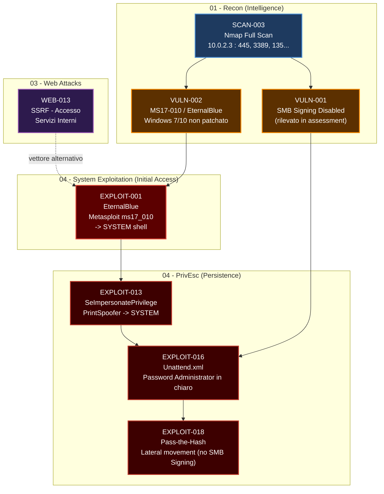
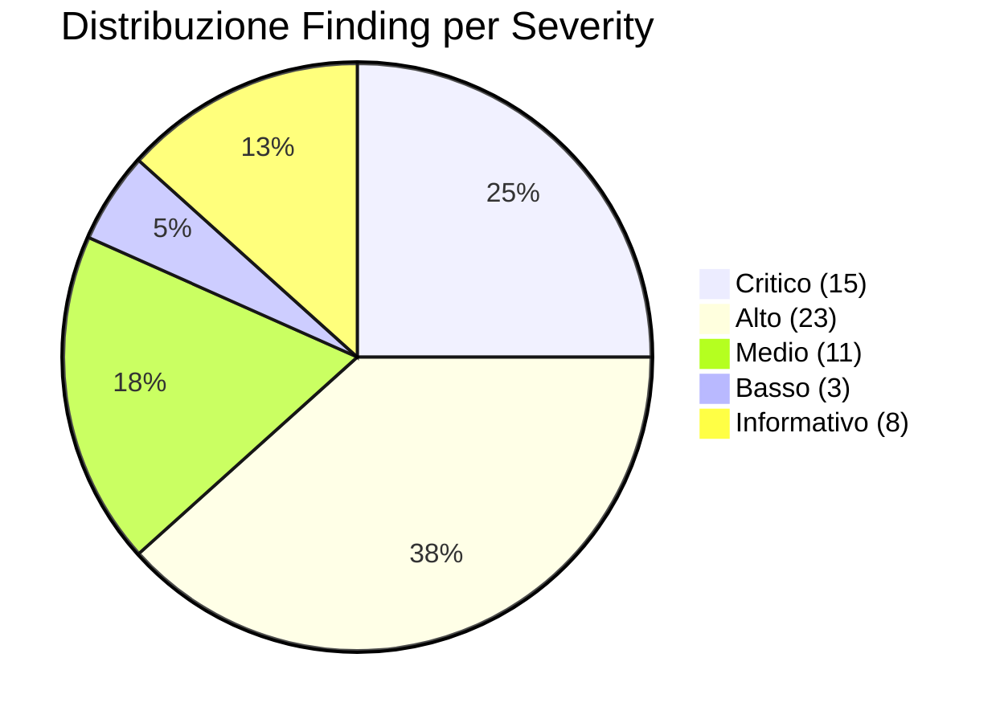
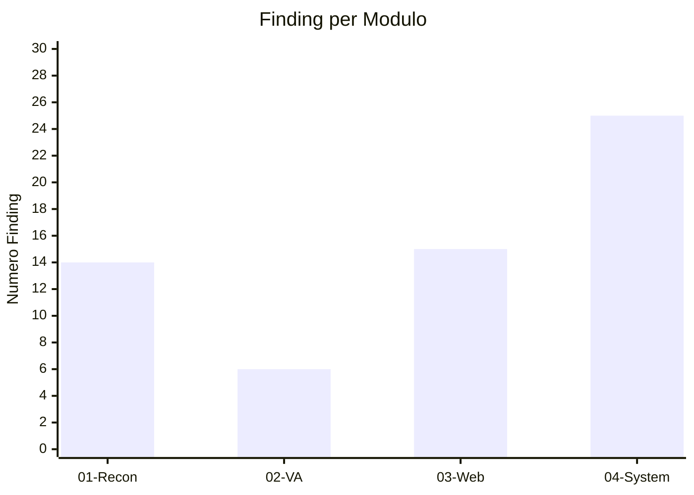

> [English](README.en.md) | **Italiano**

# Cybersecurity labs


---

Benvenuto nella repository centrale per le operazioni di sicurezza offensiva (Red Team), difensiva (Blue Team) e cloud.

Questa struttura e organizzata seguendo il flusso logico di un **Penetration Test** reale e le fasi della **Cyber Kill Chain**, con l'aggiunta di moduli specifici per la difesa e le infrastrutture moderne.

I README di ogni modulo non sono semplici guide di comandi: documentano l'**esperienza reale di laboratorio** (problemi riscontrati, scelte operative, risultati concreti), la **teoria** dietro ogni tecnica e una **proiezione verso scenari reali** di attacco e difesa.

---

## Legal disclaimer

> **ATTENZIONE:** Tutto il materiale, gli script e le metodologie contenute in questa repository sono a scopo puramente **educativo** e di **ricerca**. L'autore non si assume alcuna responsabilita per l'uso improprio di queste informazioni.
>
> *Non testare mai sistemi senza un'autorizzazione scritta esplicita.*

---

## Mappa di navigazione

| fase / dominio | cartella | stato | finding |
| :--- | :--- | :---: | :--- |
| **i. intelligence** | [01-recon](#01-recon-red-team-basic) | completo | OSINT-001..006, SCAN-001..003, DNS-001..003, INTEL-001..006 |
| **ii. assessment** | [02-vulnerability-assessment](#02-vulnerability-assessment) | completo | VULN-001..009 |
| **iii. web ops** | [03-web-attacks](#03-web-attacks-red-team--secure-coding) | completo | WEB-001..015 |
| **00. setup** | [00-setup-after-installing-kali](#00-setup-after-installing-kali) | completo | - (hardening guide) |
| **iv. system ops** | [04-system-exploitation](#04-system-exploitation) | completo | EXPLOIT-001..025 |
| **v. human ops** | [05-social-engineering](#05-social-engineering-toolingpython) | completo | SE-001..015 |
| **vi. wireless** | [06-wireless-security](#06-wireless-security) | completo | WIFI-001..012 |
| **vii. post-exploit** | [07-post-exploitation](#07-post-exploitation) | completo | POST-001..014 |
| **viii. defense** | [08-defense-hardenings](#08-defense-hardenings-blue-team-prevention) | completo | DEF-001..008 |
| **ix. analysis** | [09-digital-forensics](#09-digital-forensics-blue-team-analysis) | completo | FOR-001..002 |
| **x. modern infra** | [10-cloud-security](#10-cloud-security-cloudmodern) | completo | CLOUD-001..010 |
| **xi. active directory** | [11-active-directory](#11-active-directory-windows-domain) | in corso (metodologia) | ad- (da lab) |

---

## Apparato teorico e accademico

Oltre ai README operativi, ogni modulo include un documento **`THEORETICAL-FOUNDATIONS.md`**: un
complemento di livello accademico (struttura da capitolo di tesi) che formalizza il modello
dell'avversario, le proprieta di sicurezza, i fondamenti teorici, l'analisi quantitativa, i limiti e
i problemi aperti, con impegno diretto sulla **letteratura primaria** peer-reviewed. La bibliografia
annotata master e in **[`REFERENCES.md`](REFERENCES.md)** (fonti reali: IEEE S&P, USENIX Security, CCS,
POPL, NIST, RFC).

> **Teoria di livello magistrale:** **[`THEORY-ADVANCED.md`](THEORY-ADVANCED.md)** e il capitolo di teoria
> rigoroso (definizioni, teoremi, dimostrazioni) che porta l'apparato al registro di un testo di crittografia
> e metodi formali: provable security game-based e riduzioni (Parte I); un **teorema di concrete security
> dimostrato** sull'attacco offline, il cui bound coincide con la misura eseguita in `EVALUATION/exp02`
> (Parte II); la gerarchia di autenticazione di Lowe che nomina formalmente la freshness e collega KRACK
> alla verifica in `FORMAL-MODELS/` (Parte III); reticoli BLP/Biba e non-interferenza [Goguen-Meseguer]
> (Parte IV). E la controparte rigorosa dei foundations concettuali di modulo.

| modulo | fondamento teorico centrale | documento |
| :--- | :--- | :--- |
| 01 recon | superficie d'attacco [manadhata & wing] + entropia [shannon] | [foundations](01-recon%20%28Red%20Team%20Basic%29/THEORETICAL-FOUNDATIONS.md) |
| 02 vuln assessment | indecidibilita del rilevamento (rice) + metrologia cvss | [foundations](02-vulnerability-assessment/THEORETICAL-FOUNDATIONS.md) |
| 03 web | injection come confusione dato/codice [su & wassermann] | [foundations](03-web-attacks%20%28Red%20Team%20%2B%20Secure%20Coding%29/THEORETICAL-FOUNDATIONS.md) |
| 04 system | weird machines [bratus] + rop turing-completo [shacham] | [foundations](04-system-exploitation/THEORETICAL-FOUNDATIONS.md) |
| 05 social eng. | doppio processo [kahneman] + divario di autenticazione | [foundations](05-social-engineering/THEORETICAL-FOUNDATIONS.md) |
| 06 wireless | caduta di crypto-1 [nohl, garcia] + freshness | [foundations](06-wireless-security/THEORETICAL-FOUNDATIONS.md) |
| 07 post-exploit | grafi di attacco [sheyner] + confinamento [lampson] | [foundations](07-post-exploitation/THEORETICAL-FOUNDATIONS.md) |
| 08 defense | base-rate fallacy bayesiano [axelsson] | [foundations](08-defense-hardenings%20%28Blue%20Team%20Prevention%29/THEORETICAL-FOUNDATIONS.md) |
| 09 forensics | ordine di volatilita + inferenza abduttiva | [foundations](09-digital-forensics%20%28Blue%20Team%20Analysis%29/THEORETICAL-FOUNDATIONS.md) |
| 10 cloud | co-residenza [ristenpart] + identita come perimetro | [foundations](10-cloud-security%20%28Cloud%26Modern%29/THEORETICAL-FOUNDATIONS.md) |

### Valutazione empirica (misure riproducibili)

Oltre alla teoria, la cartella **[`EVALUATION/`](EVALUATION/README.md)** contiene esperimenti
**eseguibili e deterministici** (Python stdlib, seed fissi) che *misurano* i fenomeni teorici invece
di derivarli soltanto - il passo che porta l'analisi quantitativa dal "citato dalla letteratura" al
"misurato e verificabile in modo indipendente". Nessun numero e inventato: ogni valore proviene
dall'esecuzione reale del codice incluso.

- **Exp A** (modulo 08): un rilevatore brute-force su 1.000.000 di eventi etichettati conferma
  empiricamente il **base-rate fallacy** [Axelsson 2000] - a base rate `1e-5` il 99.8% degli allarmi
  e falso, con la formula bayesiana verificata per resampling.
- **Exp B** (moduli 04, 06): su una distribuzione Zipf di password, Shannon (13.4 bit) sovrastima la
  resistenza pratica; **749 tentativi craccano il 50%** degli account - misura del divario
  entropia-nominale / guessing-entropy.

### Verifica formale (metodi formali su protocollo)

La cartella **[`FORMAL-MODELS/`](FORMAL-MODELS/README.md)** aggiunge il terzo metodo del rigore
accademico: la verifica formale di un protocollo. Un **model checker a stati espliciti** (eseguito,
esaustivo) del 4-way handshake WPA2 sotto avversario Dolev-Yao **trova meccanicamente l'attacco KRACK**
[Vanhoef & Piessens 2017] nel modello vulnerabile (controesempio a 4 passi) e **verifica** l'assenza
del difetto nel modello corretto. Dimostra formalmente che KRACK e un difetto della macchina a stati
(reinstallazione della chiave / perdita di freshness del nonce), non delle primitive crittografiche -
la tesi del modulo 06, sez. 3.5. Una seconda verifica, **per invariante induttivo (senza bound)**,
*dimostra* l'assenza del difetto nel modello corretto per esecuzioni di lunghezza arbitraria. Incluso
anche un modello **Tamarin** di riferimento (non eseguito qui, etichettato come tale).

Infine, la cartella **[`concepts/`](concepts/README.md)** raccoglie pagine di **conoscenza di base** (tassonomia
del malware, DoS/DDoS) con taglio concettuale e difensivo: il contesto teorico che i moduli operativi (00-11)
danno per acquisito.

### Autovalutazione e limiti

Coerentemente con l'onesta scientifica, **[`SELF-ASSESSMENT.md`](SELF-ASSESSMENT.md)** e una revisione
critica avversariale interna: elenca le minacce alla validita di ogni strato (dati sintetici,
astrazioni, autore unico, assistenza LLM) e dichiara cio che resta fuori portata - in primis la peer
review esterna, che nessun repository puo autogenerare. Non e peer review: ne affronta la funzione
(trovare i difetti), non ne rivendica il credenziale.

---

## Kill chain - scenario di attacco documentato

Il diagramma seguente rappresenta il percorso di attacco completo documentato in questa repository,
dalla ricognizione iniziale alla compromissione totale del target Windows 10 (`192.168.0.109`).
Ogni nodo e collegato al finding ID corrispondente nei README di modulo.



---

## Risk heat map

Distribuzione visuale dei 60 finding per severity e categoria.





| categoria | Critico | Alto | Medio | Basso | Informativo | totale |
| :--- | :---: | :---: | :---: | :---: | :---: | :---: |
| 01-recon | 1 | 3 | 4 | 2 | 4 | 14 |
| 02-vulnerability assessment | 0 | 2 | 3 | 1 | 0 | 6 |
| 03-web attacks | 7 | 6 | 2 | 0 | 0 | 15 |
| 04-system exploitation | 7 | 12 | 2 | 0 | 4 | 25 |
| **totale** | **15** | **23** | **11** | **3** | **8** | **60** |

---

## Architettura della repository

```
cybersecurity-labs/
+-- REPORT_STANDARDS.md          <- Standard di redazione (leggere prima di lavorare)
+-- README.md                    <- Questo file
+-- EXECUTIVE_SUMMARY.md         <- Executive Summary per il management (60 finding, Top 5 critici)
+-- LAB_SETUP.md                 <- Topologia VirtualBox, IP NAT/Bridge, Docker Compose, configurazione VM
+-- CERT_MAPPING.md              <- Mappatura lab vs certificazioni (OSCP, eJPT, CEH, Security+, PenTest+)
+-- TOOLS_REFERENCE.md           <- Indice completo tool (70 tool, 76 file linkati)
+-- docker-compose.yml           <- Target web containerizzati (DVWA, DVGA, Juice Shop)
+-- mkdocs.yml                   <- Configurazione MkDocs Material per GitHub Pages
+-- scripts/                     <- Automazione: lab-setup.sh, check-finding-ids.sh
+-- tests/                       <- Test suite pytest per gli script Python
+-- 00-setup-after-installing-kali/  <- Hardening guide: 20 step post-installazione
+-- 01-recon (Red Team Basic)/
+-- 02-vulnerability-assessment/
+-- 03-web-attacks (Red Team + Secure Coding)/
+-- 04-system-exploitation/
+-- 05-social-engineering (Tooling&Python)/
+-- 06-wireless-security/
+-- 07-post-exploitation/
+-- 08-defense-hardenings/
+-- 09-digital-forensics/
+-- 10-cloud-security/
+-- 11-active-directory (Windows Domain)/
```

---

## Struttura della repository

### 01-Recon (red team basic)

**Obiettivo:** Mappare la superficie d'attacco senza lasciare tracce rilevabili.

La ricognizione e la fase piu critica e piu trascurata: piu informazioni si raccolgono prima di attaccare, minore e il rischio di essere rilevati durante le fasi successive. Questa sezione e divisa in due nature operative complementari: la **OSINT passiva** (invisibile, zero contatto col target) e la **scansione attiva** (rumorosa, rilevabile).

- **Completato:** OSINT personale su `nicholas-arcari.github.io`, Google Dorking su `nasa.gov`, network scanning su lab VirtualBox (Windows 10 `10.0.2.3`), DNS enumeration, Shodan/Censys recon
- **Finding:** 12 finding con evidenza (OSINT-001..004, SCAN-001..003, DNS-001..003, INTEL-001..004) + 4 lab metodologici (OSINT-005..006 automazione OSINT e code leakage, INTEL-005..006 perimeter mapping e cloud asset discovery)
- **Contenuto:** TheHarvester, Sherlock, Nmap, Masscan, dnsrecon, Subfinder, Shodan CLI, SpiderFoot, recon-ng, gitleaks, TruffleHog, amass, crt.sh, cloud_enum

---

### 02-Vulnerability-assessment

**Obiettivo:** Rispondere a "cosa e rotto?" con dati misurabili e classificati.

Mentre la recon risponde a "cosa esiste?", il Vulnerability Assessment risponde a "cosa e vulnerabile e quanto?". Questa sezione e il ponte tra la ricognizione e l'exploitation: senza un VA strutturato, gli attacchi successivi sarebbero tentativi alla cieca. Documenta sia la metodologia automatizzata (Nessus, OpenVAS) che quella manuale (audit specifico per protocollo).

- **Completato:** Nessus credentialed scan su Windows 10, audit SMB/NetBIOS, SMTP, SNMP, SSL/TLS, analisi CVE con searchsploit e CVSS calculator, template di reporting professionale
- **Finding:** 6 finding documentati (VULN-001..006): SMB Signing, Windows EoL, NetBIOS disclosure, accesso C$ con credenziali standard, audit SMTP, SNMP; + 3 lab di protocol audit (VULN-007..009: LDAP, NFS/RPC, RDP)
- **Contenuto:** Nessus, OpenVAS/GVM, nmap NSE, enum4linux, nbtscan, testssl.sh, searchsploit

---

### 03-Web-attacks (red team + secure coding)

**Obiettivo:** Compromettere applicazioni web e API - poi correggere il codice.

Questa e la sezione piu ampia della repository, con doppia anima: **Red Team** (trovare e sfruttare le vulnerabilita) e **Secure Coding** (capire perche esistono e come eliminarle nel codice). Copre l'intera OWASP Top 10:2021 e l'OWASP API Top 10:2023. La sezione Secure Coding documenta il ciclo completo: vulnerabilita identificata, codice vulnerabile analizzato, fix implementato, verifica post-remediation.

- **Completato:** SQL Injection (manuale + sqlmap), XSS Reflected/Stored/Blind, SSTI Jinja2 RCE, Brute Force web, Session Hijacking, JWT forging, GraphQL Introspection + RCE, IDOR/BOLA, Drupal CVE-2018-7600, SAST analysis, Prepared Statements fix, htmlspecialchars() fix
- **Finding:** 15 finding documentati (WEB-001..015): da CSRF assente a RCE via GraphQL
- **Contenuto:** Burp Suite, OWASP ZAP, Gobuster, Feroxbuster, Nikto, Nuclei, sqlmap, Hydra, WPScan, JoomScan, PyJWT, DVWA, DVGA, Metasploit

---

### 00-Setup-after-installing-kali

**Obiettivo:** Trasformare un'installazione Kali "bare metal" in un ambiente sicuro e operativo.

20 passaggi documentati per il hardening e la configurazione iniziale: cambio credenziali di default, firewall UFW, SSH hardening, kernel sysctl, Suricata IDS, cifratura LUKS, backup e monitoring. Prerequisito operativo prima di qualsiasi attivita offensiva o difensiva.

- **Stato:** Completo (21 README: parent + 20 step)
- **Contenuto:** UFW, sshd_config, sysctl, Suricata, GVM/OpenVAS, Logwatch, LUKS/VeraCrypt, rsync

---

### 04-System-exploitation

**Obiettivo:** Ottenere una shell (RCE) e diventare root/admin.

Dedicato all'attacco infrastrutturale puro: sfruttamento di servizi esposti, exploit di vulnerabilita note, privilege escalation locale. Il focus non e solo "eseguire Metasploit" ma comprendere la catena di compromissione: dalla shell non privilegiata al controllo totale del sistema.

- **Completato:** C2 frameworks (Empire + Metasploit), custom payload cross-compilation, exploit research (searchsploit), Linux PrivEsc (GTFOBins, LinPEAS, cronjob hijacking), Windows PrivEsc (PrintSpoofer, WinPEAS, Unattend.xml, XAMPP weak ACL), kernel audit (Sherlock, PwnKit)
- **Finding:** 25 finding documentati (EXPLOIT-001..025): da Initial Access fileless a cracking NTLM e hash Linux
- **Contenuto:** PowerShell Empire 5, Metasploit, msfvenom, PrintSpoofer, WinPEAS, LinPEAS, GTFOBins, Sherlock.ps1, MinGW-w64

---

### 05-Social-engineering (Tooling&Python)

**Obiettivo:** Hacking del fattore umano.

Il vettore piu efficace non e tecnico: e psicologico. Questa sezione documenta la simulazione di attacchi di phishing, la creazione di payload ingannevoli e le tecniche di ingegneria sociale, con attenzione particolare alla loro rilevabilita e contromisure.

- **Stato:** Da documentare
- **Contenuto:** GoPhish templates, script Python personalizzati, generatori payload Office/HTA

---

### 06-Wireless-security

**Obiettivo:** Intercettazione e attacco su frequenze radio.

Tutto cio che "viaggia nell'aria" e potenzialmente intercettabile. Questa sezione copre WiFi, Bluetooth/BLE, SDR e RFID/NFC - protocolli spesso trascurati nei programmi di hardening aziendale.

- **Stato:** Da documentare
- **Contenuto:** Aircrack-ng, Bettercap, SDR (radiofrequenza), tool RFID/NFC

---

### 07-Post-exploitation

**Obiettivo:** Mantenere l'accesso e muoversi nella rete (Lateral Movement).

Ottenere la shell iniziale e solo il primo passo. Questa sezione documenta cosa succede dopo: come mantenere l'accesso (persistence), come raccogliere credenziali (credential dumping), come espandere la presenza nella rete (pivoting) e come esfiltrare dati in modo silenzioso.

- **Stato:** Da documentare
- **Contenuto:** Mimikatz, Chisel/Ligolo (tunneling), backdoor persistenti, tecniche di exfiltration

---

### 08-Defense-hardenings (blue team prevention)

**Obiettivo:** Proteggere proattivamente e monitorare in tempo reale.

La controparte difensiva dei moduli precedenti. Per ogni tecnica di attacco documentata nei moduli 01-07, qui si trova la risposta difensiva: configurazione corretta, hardening, monitoring e detection. Wazuh (SIEM/XDR) e il tool centrale di questa sezione.

- **Stato:** Da documentare
- **Tool chiave:** Wazuh (SIEM/XDR), CIS Benchmarks, Honeypots

---

### 09-Digital-forensics (blue team analysis)

**Obiettivo:** Investigare l'incidente e ricostruire la kill chain.

Quando le difese falliscono, entra in gioco la forensics: analisi delle tracce lasciate dall'attaccante per capire cosa e successo, come e entrato, cosa ha fatto e cosa ha portato via. Wireshark (analisi traffico di rete) e il punto di partenza.

- **Stato:** Da documentare
- **Tool chiave:** Wireshark, Autopsy, Volatility

---

### 10-Cloud-security (Cloud&Modern)

**Obiettivo:** Sicurezza per infrastrutture moderne: container, orchestratori e cloud provider.

Le infrastrutture moderne (Docker, Kubernetes, AWS/Azure/GCP) introducono una superficie di attacco completamente diversa dalla rete tradizionale. Questa sezione documenta sia le tecniche di attacco specifiche per il cloud che le contromisure e i tool di audit.

- **Stato:** Da documentare
- **Contenuto:** AWS/Azure/GCP enumeration, Docker security (Trivy), Kubernetes audit, IaC scanning (Terraform)

---

### 11-Active-directory (Windows domain)

**Obiettivo:** Attaccare e difendere il dominio Windows, dall'accesso autenticato al Domain Admin.

Colma il vettore piu comune dei penetration test interni: l'abuso di funzionalita legittime di Active Directory (Kerberos, repliche, deleghe, AD CS, ACL). Modulo in metodologia: tecniche, comandi, detection e MITRE, con output illustrativi e Finding ID (`AD-`) da assegnare in laboratorio reale.

- **Stato:** In corso (metodologia, solo IT; EN in arrivo)
- **Contenuto:** enumerazione (BloodHound/LDAP/kerbrute), Kerberos (Kerberoasting, AS-REP, Golden/Silver Ticket), AD CS (ESC1/ESC8), deleghe e ACL (RBCD, delegation, ACL abuse), credential dumping (DCSync, Shadow Credentials, NTDS.dit)

---

## Finding registry globale

| id | titolo | severity | modulo |
| :--- | :--- | :--- | :--- |
| [OSINT-001](<01-recon (Red Team Basic)/01-osint-passive (Open Source Intelligence)/breach-data/README.md>) | breach data exposure | Alto | osint-passive/breach-data |
| [OSINT-002](<01-recon (Red Team Basic)/01-osint-passive (Open Source Intelligence)/email-harvesting/README.md>) | email harvesting su dominio personale | Informativo | osint-passive/email-harvesting |
| [OSINT-003](<01-recon (Red Team Basic)/01-osint-passive (Open Source Intelligence)/google-dorks/README.md>) | google dorking - documenti e login esposti | variabile | osint-passive/google-dorks |
| [OSINT-004](<01-recon (Red Team Basic)/01-osint-passive (Open Source Intelligence)/user-enumeration/README.md>) | user enumeration su social network | Basso | osint-passive/user-enumeration |
| [OSINT-005](<01-recon (Red Team Basic)/01-osint-passive (Open Source Intelligence)/osint-frameworks/README.md>) | correlazione osint automatica via framework multi-fonte (spiderfoot, recon-ng, maltego) | variabile | osint-passive/osint-frameworks |
| [OSINT-006](<01-recon (Red Team Basic)/01-osint-passive (Open Source Intelligence)/code-secret-leakage/README.md>) | segreti esposti in repository pubblici (git history) | alto/critico | osint-passive/code-secret-leakage |
| [SCAN-001](<01-recon (Red Team Basic)/02-network-scanning-active/live-host-discovery/README.md>) | live host discovery - subnet mapping | Informativo | network-scanning/live-host-discovery |
| [SCAN-002](<01-recon (Red Team Basic)/02-network-scanning-active/port-scanning (Nmap)/masscan/README.md>) | port scan massivo - superficie esposta | Informativo | port-scanning/masscan |
| [SCAN-003](<01-recon (Red Team Basic)/02-network-scanning-active/port-scanning (Nmap)/nmap-scripts/README.md>) | smb signing not required (via nmap nse) | Alto | port-scanning/nmap-scripts |
| [DNS-001](<01-recon (Red Team Basic)/03-dns-enumeration/dns-recon/README.md>) | zone transfer o subdomain disclosure | critico/medio | dns-enumeration/dns-recon |
| [DNS-002](<01-recon (Red Team Basic)/03-dns-enumeration/hosts-file/README.md>) | hosts file manipulation vettore | Medio | dns-enumeration/hosts-file |
| [DNS-003](<01-recon (Red Team Basic)/03-dns-enumeration/subdomain-finding/README.md>) | sottodomini nascosti identificati | Medio | dns-enumeration/subdomain-finding |
| [INTEL-001](<01-recon (Red Team Basic)/04-infrastructure-intel/shodan-censys/README.md>) | servizi esposti rilevati via shodan | Alto | infrastructure-intel/shodan-censys |
| [INTEL-002](<01-recon (Red Team Basic)/04-infrastructure-intel/shodan-censys/README.md>) | versioni software esposte via shodan | Medio | infrastructure-intel/shodan-censys |
| [INTEL-003](<01-recon (Red Team Basic)/04-infrastructure-intel/shodan-censys/README.md>) | banner grabbing infrastruttura | Basso | infrastructure-intel/shodan-censys |
| [INTEL-004](<01-recon (Red Team Basic)/04-infrastructure-intel/tech-stack/README.md>) | tech stack fingerprinting | Informativo | infrastructure-intel/tech-stack |
| [INTEL-005](<01-recon (Red Team Basic)/04-infrastructure-intel/asn-whois-ct/README.md>) | perimetro mappato via asn/whois e certificate transparency | variabile | infrastructure-intel/asn-whois-ct |
| [INTEL-006](<01-recon (Red Team Basic)/04-infrastructure-intel/cloud-asset-discovery/README.md>) | storage cloud esposto (bucket s3/blob) con lettura anonima | medio/critico | infrastructure-intel/cloud-asset-discovery |
| [VULN-001](<02-vulnerability-assessment/01-general-scanners (Infrastructure)/nessus/README.md>) | smb signing not required (nessus credentialed) | Alto | general-scanners/nessus |
| [VULN-002](<02-vulnerability-assessment/01-general-scanners (Infrastructure)/nessus/README.md>) | windows 10 22h2 end of life | Medio | general-scanners/nessus |
| [VULN-003](<02-vulnerability-assessment/02-protocol-specific-audit/smb-net-bios/README.md>) | netbios name/service disclosure | Basso | protocol-audit/smb-net-bios |
| [VULN-004](<02-vulnerability-assessment/02-protocol-specific-audit/smb-net-bios/README.md>) | accesso c$ con credenziali standard | Alto | protocol-audit/smb-net-bios |
| [VULN-005](<02-vulnerability-assessment/02-protocol-specific-audit/smtp/README.md>) | audit smtp - da determinare | Medio | protocol-audit/smtp |
| [VULN-006](<02-vulnerability-assessment/02-protocol-specific-audit/snmp/README.md>) | audit snmp - da determinare | Medio | protocol-audit/snmp |
| [WEB-001](<03-web-attacks (Red Team + Secure Coding)/01-proxy-tools (Intercept)/owasp-zap/README.md>) | assenza token csrf su form di ricerca | Medio | proxy-tools/owasp-zap |
| [WEB-002](<03-web-attacks (Red Team + Secure Coding)/02-web-recon (Enumeration)/tech-profiler/README.md>) | php 5.6.40 eol + x-powered-by exposure | Alto | web-recon/tech-profiler |
| [WEB-003](<03-web-attacks (Red Team + Secure Coding)/02-web-recon (Enumeration)/dir-busting/README.md>) | cvs directory + .idea esposti | Alto | web-recon/dir-busting |
| [WEB-004](<03-web-attacks (Red Team + Secure Coding)/03-owasp (Attacks)/sql-injection (SQLi)/manual-payloads/README.md>) | sql injection manuale - auth bypass + dump | Critico | owasp/sql-injection/manual-payloads |
| [WEB-005](<03-web-attacks (Red Team + Secure Coding)/03-owasp (Attacks)/xss (Cross-Site Scripting)/reflected/README.md>) | xss reflected - parametro get | Medio | owasp/xss/reflected |
| [WEB-006](<03-web-attacks (Red Team + Secure Coding)/03-owasp (Attacks)/xss (Cross-Site Scripting)/stored/README.md>) | xss stored - campo commenti | Alto | owasp/xss/stored |
| [WEB-007](<03-web-attacks (Red Team + Secure Coding)/03-owasp (Attacks)/xss (Cross-Site Scripting)/xss-hunter-payloads/README.md>) | xss blind/oob - form senza output | Alto | owasp/xss/xss-hunter-payloads |
| [WEB-008](<03-web-attacks (Red Team + Secure Coding)/03-owasp (Attacks)/ssti (Server Side Template Injection)/README.md>) | ssti jinja2 rce - mro exploit chain | Critico | owasp/ssti |
| [WEB-009](<03-web-attacks (Red Team + Secure Coding)/03-owasp (Attacks)/auth-attacks/bruteforce-web/README.md>) | brute force web - assenza rate limiting | Alto | owasp/auth-attacks/bruteforce-web |
| [WEB-010](<03-web-attacks (Red Team + Secure Coding)/03-owasp (Attacks)/auth-attacks/session-hijacking/README.md>) | session hijacking - cookie non protetto | Alto | owasp/auth-attacks/session-hijacking |
| [WEB-011](<03-web-attacks (Red Team + Secure Coding)/03-owasp (Attacks)/sql-injection (SQLi)/sql-map-data/README.md>) | sqli automatizzata sqlmap - pci-dss violation | Critico | owasp/sql-injection/sql-map-data |
| [WEB-012](<03-web-attacks (Red Team + Secure Coding)/05-api-security/jwt-tokens/README.md>) | jwt weak secret - token admin forged | Critico | api-security/jwt-tokens |
| [WEB-013](<03-web-attacks (Red Team + Secure Coding)/05-api-security/graphql/README.md>) | graphql introspection + command injection rce | Critico | api-security/graphql |
| [WEB-014](<03-web-attacks (Red Team + Secure Coding)/05-api-security/postman/README.md>) | idor/bola - dati finanziari altrui | Critico | api-security/postman |
| [WEB-015](<03-web-attacks (Red Team + Secure Coding)/04-cms-specific/drupal/README.md>) | drupal CVE-2018-7600 drupalgeddon2 rce | Critico | cms-specific/drupal |
| [EXPLOIT-001](<04-system-exploitation/01-frameworks/empire/README.md>) | initial access fileless via empire agent (stager .bat in-memory) | Alto | frameworks/empire |
| [EXPLOIT-002](<04-system-exploitation/01-frameworks/empire/README.md>) | persistenza via registry run key hkcu | Alto | frameworks/empire |
| [EXPLOIT-003](<04-system-exploitation/01-frameworks/metasploit/README.md>) | initial access via msfvenom reverse_tcp + process injection explorer.exe | Alto | frameworks/metasploit |
| [EXPLOIT-004](<04-system-exploitation/01-frameworks/metasploit/README.md>) | network pivoting via socks proxy interno | Alto | frameworks/metasploit |
| [EXPLOIT-005](<04-system-exploitation/02-exploit-database/compiled-exploits/README.md>) | payload c cross-compilato con backdoor persistente (backadmin) | Alto | exploit-database/compiled-exploits |
| [EXPLOIT-006](<04-system-exploitation/02-exploit-database/compiled-exploits/README.md>) | in-memory shellcode execution via virtualalloc/createthread | Critico | exploit-database/compiled-exploits |
| [EXPLOIT-007](<04-system-exploitation/02-exploit-database/searchsploit/README.md>) | exploit research e correlazione nmap/searchsploit (metodologia) | Informativo | exploit-database/searchsploit |
| [EXPLOIT-008](<04-system-exploitation/03-privilege-escalation (PrivEsc)/linux-priv-esc/gtfo-bins-notes/README.md>) | sudo nopasswd su `find` - escalation root immediata | Alto | linux-priv-esc/gtfo-bins |
| [EXPLOIT-009](<04-system-exploitation/03-privilege-escalation (PrivEsc)/linux-priv-esc/gtfo-bins-notes/README.md>) | suid bit su `awk` - esecuzione arbitraria come root | Alto | linux-priv-esc/gtfo-bins |
| [EXPLOIT-010](<04-system-exploitation/03-privilege-escalation (PrivEsc)/linux-priv-esc/linpeas/README.md>) | credential disclosure in file di log/config (linpeas) | Alto | linux-priv-esc/linpeas |
| [EXPLOIT-011](<04-system-exploitation/03-privilege-escalation (PrivEsc)/linux-priv-esc/linpeas/README.md>) | cronjob hijacking: script root scrivibile - reverse shell | Alto | linux-priv-esc/linpeas |
| [EXPLOIT-012](<04-system-exploitation/03-privilege-escalation (PrivEsc)/linux-priv-esc/linpeas/README.md>) | CVE-2021-4034 pwnkit audit - sistema aggiornato | Informativo | linux-priv-esc/linpeas |
| [EXPLOIT-013](<04-system-exploitation/03-privilege-escalation (PrivEsc)/windows-priv-esc/juicypotato-printnightmare/README.md>) | seimpersonateprivilege abuse via printspoofer - nt authority\system | Critico | windows-priv-esc/juicypotato |
| [EXPLOIT-014](<04-system-exploitation/03-privilege-escalation (PrivEsc)/windows-priv-esc/juicypotato-printnightmare/README.md>) | CVE-2021-34527 printnightmare audit - sistema patchato | Informativo | windows-priv-esc/juicypotato |
| [EXPLOIT-015](<04-system-exploitation/03-privilege-escalation (PrivEsc)/windows-priv-esc/sherlock/README.md>) | kernel patch audit (sherlock) - ms10-015..ms16-032 non presenti | Informativo | windows-priv-esc/sherlock |
| [EXPLOIT-016](<04-system-exploitation/03-privilege-escalation (PrivEsc)/windows-priv-esc/winpeas/README.md>) | credential disclosure in unattend.xml - password administrator | Critico | windows-priv-esc/winpeas |
| [EXPLOIT-017](<04-system-exploitation/03-privilege-escalation (PrivEsc)/windows-priv-esc/winpeas/README.md>) | xampp weak acl: authenticated users writedata su binari servizio | Critico | windows-priv-esc/winpeas |
| [EXPLOIT-018](<04-system-exploitation/03-privilege-escalation (PrivEsc)/windows-priv-esc/winpeas/README.md>) | localaccounttokenfilterpolicy=1 - lateral movement via pth | Medio | windows-priv-esc/winpeas |
| [EXPLOIT-019](<04-system-exploitation/03-privilege-escalation (PrivEsc)/windows-priv-esc/winpeas/README.md>) | powershell history psreadline con credenziali in chiaro | Alto | windows-priv-esc/winpeas |
| [EXPLOIT-020](<04-system-exploitation/04-binary-exploitation/buffer-overflow-prep/README.md>) | stack buffer overflow - eip overwrite e shellcode injection | Critico | binary-exploitation/buffer-overflow |
| [EXPLOIT-021](<04-system-exploitation/04-binary-exploitation/pwntools-scripts/README.md>) | remote aslr/dep bypass via got leak + ret2libc rop chain | Critico | binary-exploitation/pwntools |
| [EXPLOIT-022](<04-system-exploitation/05-password-cracking/hashcat/README.md>) | ntlm cracking via mask attack (keyspace reduction) | Alto | password-cracking/hashcat |
| [EXPLOIT-023](<04-system-exploitation/05-password-cracking/hashcat/README.md>) | ntlm cracking via rule-based attack (regola custom) | Alto | password-cracking/hashcat |
| [EXPLOIT-024](<04-system-exploitation/05-password-cracking/john-the-ripper/README.md>) | cracking password archivio zip cifrato (zip2john) | Medio | password-cracking/john |
| [EXPLOIT-025](<04-system-exploitation/05-password-cracking/john-the-ripper/README.md>) | cracking hash linux via unshadowing + dizionario rockyou | Alto | password-cracking/john |

**Totale finding documentati con evidenza: 60 | Critici: 15 | Alti: 23 | Medi: 11 | Bassi: 3 | Informativi: 8**

> **Nota:** i finding `OSINT-005`, `OSINT-006`, `INTEL-005`, `INTEL-006` (e i successivi contrassegnati come tali nei moduli in espansione) documentano **metodologie riproducibili** con comandi, output di esempio e remediation, ma sono in attesa di esecuzione nel laboratorio: i risultati reali e gli screenshot vanno inseriti nei segnaposto predisposti. Non sono conteggiati nel totale dei 60 finding con evidenza sopra riportato.

---

## MITRE ATT&CK - master table

| tattica | tecnica | id mitre | modulo | finding |
| :--- | :--- | :--- | :--- | :--- |
| reconnaissance | gather victim identity info: credentials | `T1589.001` | 01-recon | OSINT-001 |
| reconnaissance | gather victim identity info: email addresses | `T1589.002` | 01-recon | OSINT-002 |
| reconnaissance | gather victim identity info: employee names | `T1589.003` | 01-recon | OSINT-004 |
| reconnaissance | search open websites/domains: search engines | `T1593.002` | 01-recon | OSINT-003 |
| reconnaissance | search open technical databases: scan databases | `T1596.005` | 01-recon | INTEL-001 |
| reconnaissance | gather victim network info: dns | `T1590.002` | 01-recon | DNS-001..003 |
| reconnaissance | active scanning: vulnerability scanning | `T1595.002` | 01-recon, 02-vuln | SCAN-001..003 |
| reconnaissance | active scanning: wordlist scanning | `T1595.003` | 03-web | WEB-013 |
| reconnaissance | gather victim host info: software | `T1592.002` | 01-recon, 02-vuln | INTEL-004 |
| discovery | network service scanning | `T1046` | 01-recon, 02-vuln | SCAN-001..003 |
| discovery | network share discovery | `T1135` | 02-vuln | VULN-003 |
| discovery | remote system discovery | `T1018` | 01-recon | SCAN-001 |
| discovery | account discovery | `T1087` | 03-web | WEB-014 |
| initial access | exploit public-facing application | `T1190` | 02-vuln, 03-web | WEB-004, WEB-008, WEB-011, WEB-013, WEB-015 |
| credential access | brute force: password guessing | `T1110.001` | 03-web | WEB-009 |
| credential access | brute force: password cracking | `T1110.002` | 03-web, 04-exploit | WEB-012, EXPLOIT-022..025 |
| credential access | steal web session cookie | `T1539` | 03-web | WEB-005, WEB-006, WEB-010 |
| credential access | valid accounts | `T1078` | 02-vuln, 03-web | VULN-004, WEB-012 |
| execution | command and scripting interpreter: unix shell | `T1059.004` | 03-web | WEB-008, WEB-013 |
| persistence | server software component: web shell | `T1505.003` | 03-web | WEB-006, WEB-015 |
| collection | data from information repositories | `T1213` | 02-vuln, 03-web | VULN-004, WEB-004, WEB-011, WEB-013, WEB-014 |
| collection | data from network shared drive | `T1039` | 02-vuln | VULN-004 |
| collection | man in the middle | `T1557` | 03-web | WEB-010 |
| lateral movement | use alternate authentication material: web session cookie | `T1550.004` | 03-web | WEB-010, WEB-012 |
| execution | exploitation of remote services | `T1210` | 04-exploit | EXPLOIT-020, EXPLOIT-021 |
| execution | native api | `T1106` | 04-exploit | EXPLOIT-006, EXPLOIT-020, EXPLOIT-021 |
| exfiltration | exfiltration over web service | `T1567` | 03-web | WEB-011 |

---

## Prerequisiti e setup

Per utilizzare al meglio gli script contenuti in questa repo, si consiglia:

- **OS:** Kali Linux 2024+ / Parrot OS (o VM dedicata con snapshot pre-lab)
- **Python:** 3.10+ (con `requirements.txt` installati nelle singole cartelle dove applicabile)
- **Docker:** Necessario per avviare container vulnerabili (DVWA, DVGA, Metasploitable)
- **Docker:** Necessario per i target web containerizzati (`docker compose up -d` - vedi [LAB_SETUP.md](LAB_SETUP.md))
- **Rete:** Ambiente virtualizzato isolato (VirtualBox/VMware NAT o Host-Only) per i lab attivi
- **Certificazioni:** Mappatura lab-certificazioni disponibile in [CERT_MAPPING.md](CERT_MAPPING.md)
- **Tool:** Indice completo dei 70 tool utilizzati in [TOOLS_REFERENCE.md](TOOLS_REFERENCE.md)

---

> *Repository mantenuta da Nicholas Arcari. Ogni tecnica e stata eseguita in ambiente di laboratorio isolato su sistemi autorizzati o appositamente vulnerabili per scopi didattici.*
